# Write-up: Translate & Shift, Spectrogram, Steganography

## Translate, shift

### 1. Leetspeak

```text
c4n y0u c4p7u23 7h3 f149?
```

Читаем по-человечески:

```text
can you capture the flag?
```

### 2. Binary

Длинная строка из `0` и `1`. Переводим из binary в ASCII:

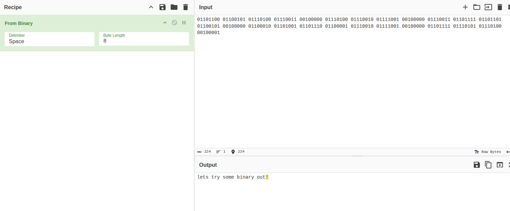

```text
lets try some binary out!
```

### 3. Base32

```text
MJQXGZJTGIQGS4ZAON2XAZLSEBRW63LNN5XCA2LOEBBVIRRHOM======
```

Base32 узнаётся по алфавиту `A–Z2–7` и паддингу `=`. Декодируем:

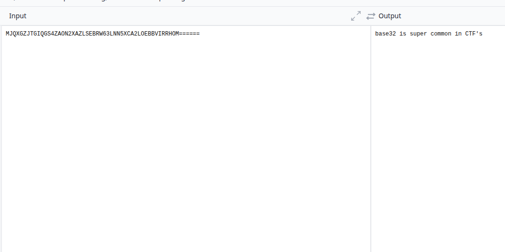

```text
base32 is super common in CTF's
```

### 4. Base64

```text
RWFjaCBCYXNlNjQgZGlnaXQgcmVwcmVzZW50cyBleGFjdGx5IDYgYml0cyBvZiBkYXRhLg==
```

Декодируем:

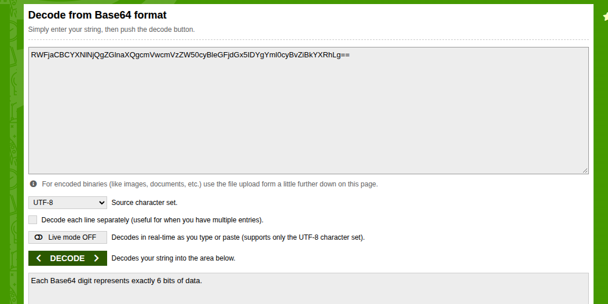

```text
Each Base64 digit represents exactly 6 bits of data.
```

### 5. Hex

```text
68 65 78 61 64 65 63 69 6d 61 6c 20 6f 72 20 62 61 73 65 31 36 3f
```

Переводим hex в ASCII:

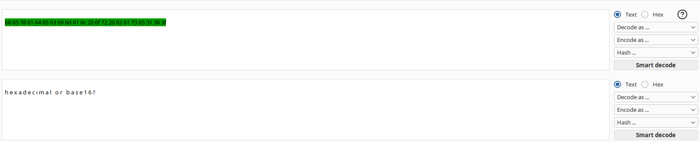

```text
hexadecimal or base16?
```

### 6. ROT13

```text
Ebgngr zr 13 cynprf!
```

ROT13 — сдвиг букв на 13 позиций. В терминале:

```bash
echo 'Ebgngr zr 13 cynprf!' | tr 'A-Za-z' 'N-ZA-Mn-za-m'
```

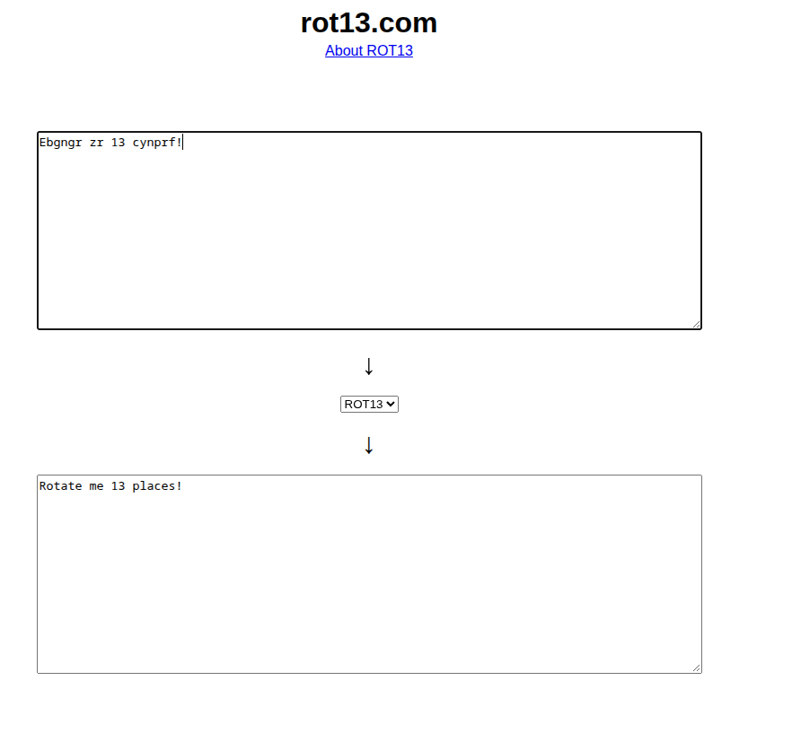

```text
Rotate me 13 places!
```

### 7. ROT47

```text
*@F DA:? >6 C:89E C@F?5 323J C:89E C@F?5 Wcf E:>6DX
```

ROT47 — сдвиг по всему печатаемому диапазону ASCII (33–126):

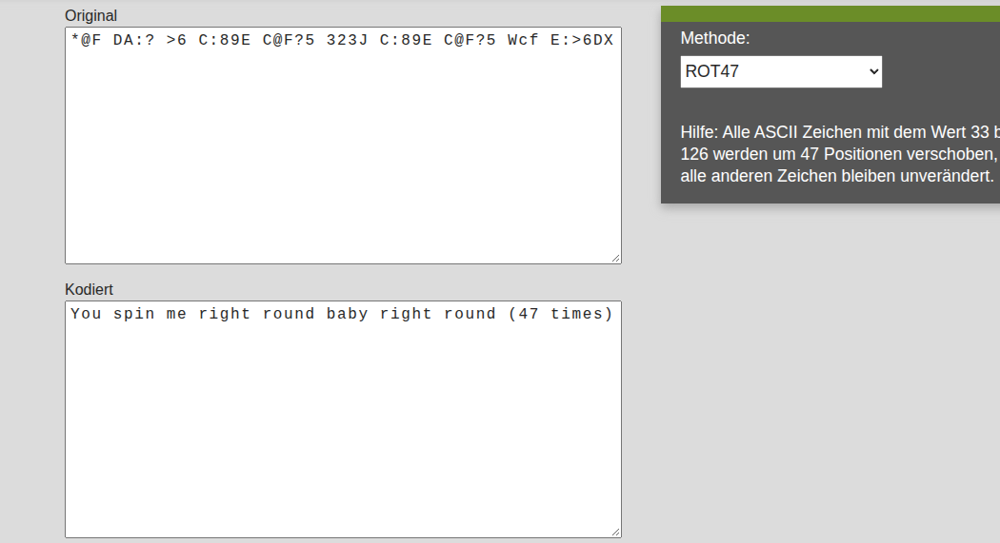

```text
You spin me right round baby right round (47 times)
```

### 8. Morse

```text
- . .-.. . -.-. --- -- -- ..- -. .. -.-. .- - .. --- -.
. -. -.-. --- -.. .. -. --.
```

Переводим морзе в текст:

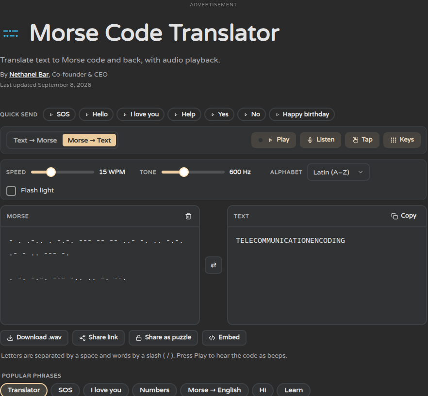

```text
telecommunication encoding
```

### 9. BCD

```text
85 110 112 97 99 107 32 116 104 105 115 32 66 67 68
```

Это BCD (Binary-Coded Decimal), где каждый байт — код символа. Переводим десятичные коды в ASCII:

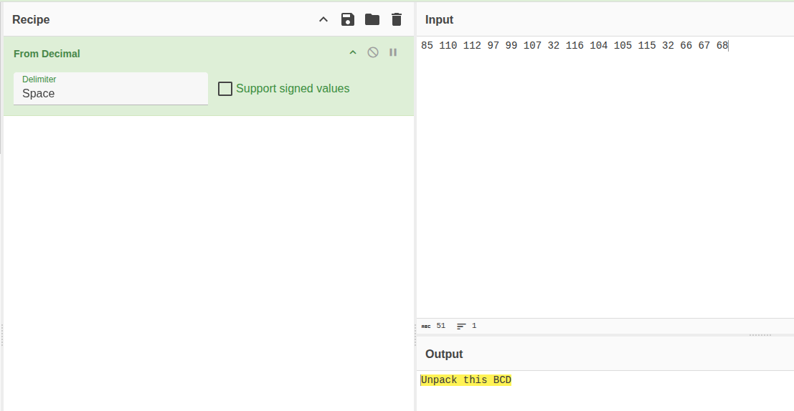

```text
Unpack this BCD
```

### 10. Многослойное кодирование

Длинная строка из `-` и `.`, разделённая на строки. Это **base64**, внутри которого лежит **morse**, внутри — **binary**, а сверху **ROT47**.

Порядок декодирования:

1. base64 → получаем морзе;
2. morse → получаем binary;
3. binary → получаем ASCII;
4. ROT47 → финальный текст.

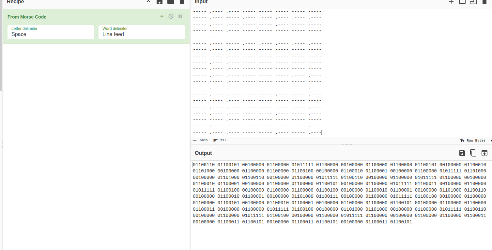

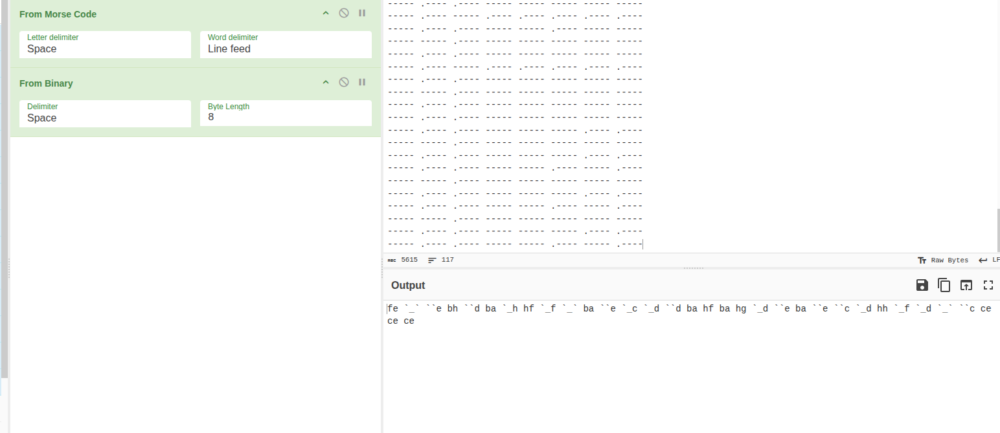

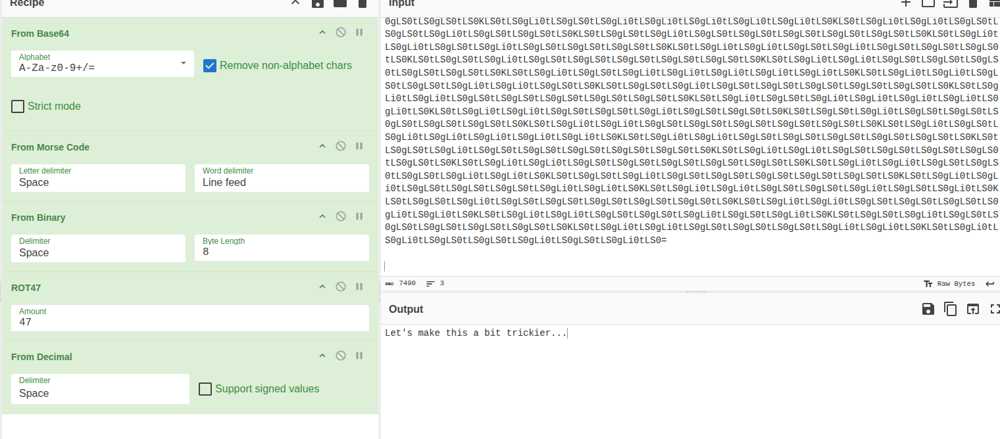

```text
base64 -> morse code -> binary -> rot47
```

```text
Let's make this a bit trickier...
```

## Spectrogram

Открываем аудиофайл в спектрограмме. Я использовал `https://www.dcode.fr/spectral-analysis`, чтобы посмотреть частоты:

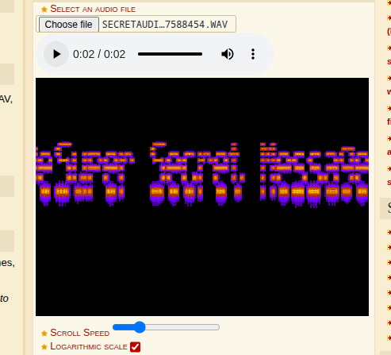

```text
super secret message
```

## Steganography

Смотрим метаданные изображения через `exiftool`:

```bash
exiftool stegosteg_1559008553457.jpg
```

```text
File Type                       : JPEG
File Type Extension             : jpg
Image Width                     : 254
Image Height                    : 343
Image Size                      : 254x343
Megapixels                      : 0.087
```

Метаданные чистые. Пробуем `binwalk` — ищем встроенные данные:

```bash
binwalk stegosteg_1559008553457.jpg
```

```text
DECIMAL       HEXADECIMAL     DESCRIPTION
------------------------------------------------------------------
0             0x0             JPEG image, total size: 52234 bytes
```

Ничего лишнего, кроме самого JPEG. Значит, данные спрятаны внутри через `steghide`.

## Security through obscurity

Смотрим, что `steghide` видит в файле:

```bash
steghide info stegosteg_1559008553457.jpg
```

```text
"stegosteg_1559008553457.jpg":
  format: jpeg
  capacity: 2.5 KB
Try to get information about embedded data ? (y/n) y
Enter passphrase:
```

Извлекаем с пустым паролем:

```bash
steghide extract -sf stegosteg_1559008553457.jpg -p ""
```

```text
wrote extracted data to "steganopayload2248.txt".
```

Читаем:

```bash
cat steganopayload2248.txt
```

```text
SpaghettiSteg%
```

## Строки в другом изображении

```bash
strings meme_1559010886025.jpg
```

```text
AHH_YOU_FOUND_ME!
hackerchat.png
```

## Итоговая схема (Kill Chain)

- **Translate, shift:** leetspeak → binary → base32 → base64 → hex → ROT13 → ROT47 → morse → BCD → многослойное (base64 → morse → binary → ROT47).
- **Spectrogram:** аудио → спектрограмма → `super secret message`.
- **Steganography:** `exiftool`/`binwalk` → `steghide` → `SpaghettiSteg%`.
- **Security through obscurity:** `strings` → `AHH_YOU_FOUND_ME!` / `hackerchat.png`.
